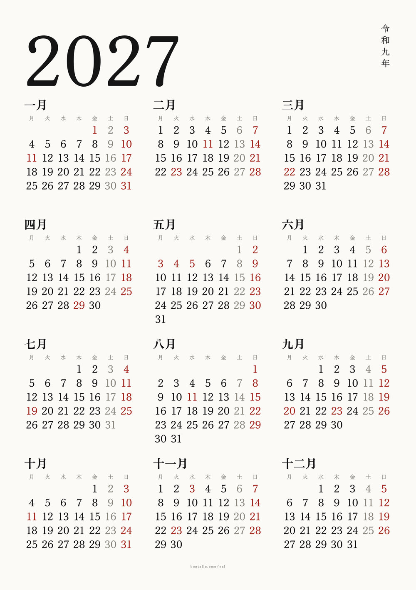
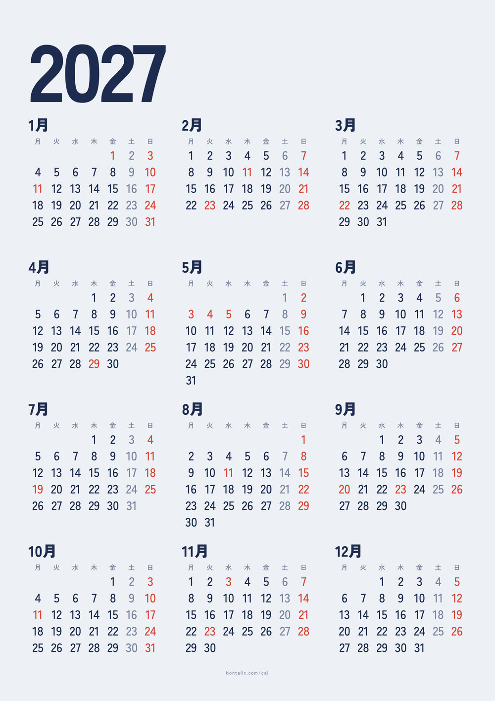
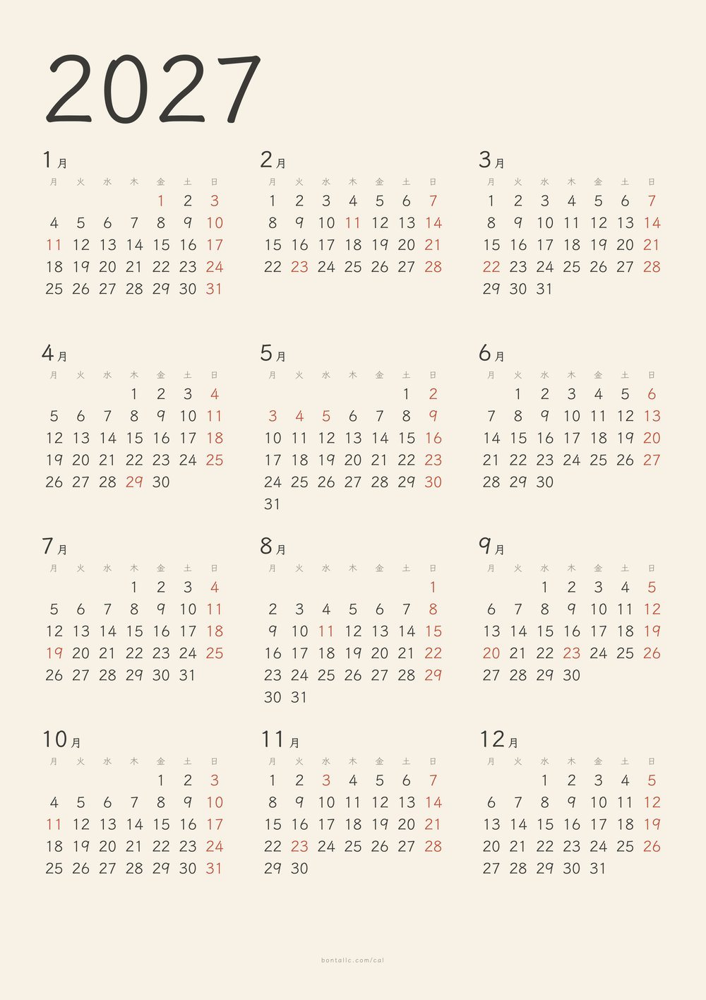
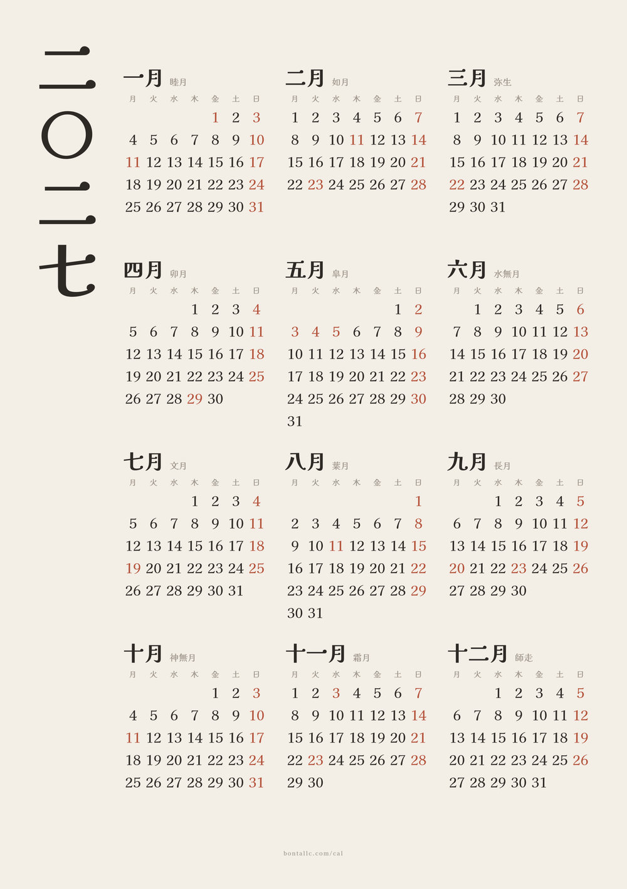
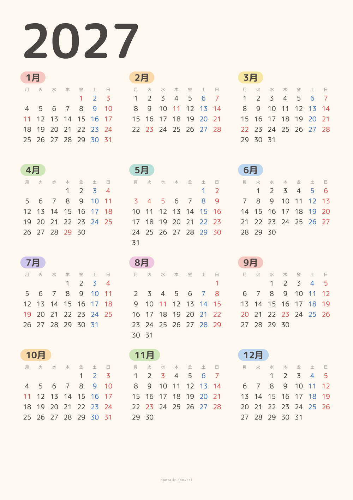

# 壁に飾る2027年カレンダー｜和の文字の5種

壁に飾る2027年カレンダーの紹介シリーズです。全6回のうち、この回は第1回「和の文字」です。
注文ページの絞り込みにある「和の文字」の回です。漢数字や漢字の曜日、和風月名など、日本語の文字を生かした5種を紹介します。
全30種のうち、はじめの3種（Swiss Grotesk・Shippori Washi・Night Lime）は最初の記事で紹介しています。

## Zen Old Mincho 墨

白に近い生成りの地に、明朝体で組んだデザインです。左上に黒く大きな「2027」、右上には縦書きで「令和九年」と入っています。月名は「一月」「二月」と漢数字、曜日も「月火水木金土日」の漢字一字です。日曜と祝日は赤に分けています。白い壁にも和室にも静かになじみ、目上の方や和の雰囲気が好きな方への贈り物にも向きます。
このデザインを選んだ状態で開く：[https://bontallc.com/cal?design=18&utm_source=note&utm_campaign=cal-series-1](https://bontallc.com/cal?design=18&utm_source=note&utm_campaign=cal-series-1)

## Zen Kaku Gothic 藍

うすく青みがかったグレーの地に、藍色の数字を並べたゴシック体のデザインです。「2027」は太く、月名は「1月」「2月」、曜日は漢字一字で、日曜と祝日は赤に分けています。明朝体より線の太さがそろっているので、少し離れた場所からも日付を読み取りやすい作りです。書斎や仕事場、白やグレーの壁、すっきりした部屋に合います。
このデザインを選んだ状態で開く：[https://bontallc.com/cal?design=19&utm_source=note&utm_campaign=cal-series-1](https://bontallc.com/cal?design=19&utm_source=note&utm_campaign=cal-series-1)

## Klee One 手書き

クリーム色の地に、手書きの文字のような温かみのある書体（Klee One）で組んだデザインです。「2027」は細めの茶がかったグレーで、月名は「1 月」のように数字を大きく、「月」を小さく添えています。曜日は漢字一字、日曜と祝日はれんが色です。文字の角がやわらかく紙の色も暖かいので、台所やリビング、子ども部屋に向きます。
このデザインを選んだ状態で開く：[https://bontallc.com/cal?design=25&utm_source=note&utm_campaign=cal-series-1](https://bontallc.com/cal?design=25&utm_source=note&utm_campaign=cal-series-1)

## Kaisei Opti 漢数字

ベージュの地の左端に、「二〇二七」を縦書きの漢数字で大きく置いたデザインです。月名は「一月」「二月」で、横に睦月、如月といった和風月名を小さく添えています。曜日は漢字一字、日の数字は洋数字なので、日付は読み取りやすいままです。日曜と祝日はれんが色です。和室や和食のお店、年配の方への贈り物に向きます。
このデザインを選んだ状態で開く：[https://bontallc.com/cal?design=30&utm_source=note&utm_campaign=cal-series-1](https://bontallc.com/cal?design=30&utm_source=note&utm_campaign=cal-series-1)

## M PLUS Rounded Pastel

ごく淡い暖色の白地に、角の丸い書体（M PLUS Rounded）で組んだデザインです。月名は「1月」から「12月」まで、月ごとに色の違うパステルの丸い札に入っています。曜日は漢字一字で、日曜と祝日が赤、土曜が青です。やわらかく明るい印象なので、子ども部屋や寝室、お祝いの贈り物に向きます。色の違いで月の区切りも見つけやすい作りです。
このデザインを選んだ状態で開く：[https://bontallc.com/cal?design=33&utm_source=note&utm_campaign=cal-series-1](https://bontallc.com/cal?design=33&utm_source=note&utm_campaign=cal-series-1)

## 選べること

サイズはA1（594×841mm）・A2（420×594mm）・A3（297×420mm）から選べます。
ポスター単体と額装セットがあり、額装セットの額はブラック・ホワイト・シルバーから選べます。
月曜始まり・日曜始まりも選べます。
名前やメッセージを入れるカスタマイズ（額装）もできます。
価格（すべて送料込み・税込）は、ポスター単体がA1 4,400円／A2 2,980円／A3 2,200円、額装セットがA1 9,900円／A2 6,600円／A3 4,980円、カスタマイズ（額装）がA1 15,500円／A2 12,200円／A3 10,580円です。
住所やデザインの好みがわからない相手には、「受け取りリンク」で贈れます。サイズと、額装セットかポスター単体かを選んで購入すると、受け取り用のリンクがメールで届きます。それをLINEやメールで相手に送ると、相手がデザインと額の色、お届け先を選びます。相手の画面に金額は表示されません。

## 部屋に置いて見る

スマホで注文ページ（bontallc.com/cal）を開き、デザイン・サイズ・種類を選んで「部屋に置いて見る（スマホのカメラが開きます）」を押すと、カメラで自分の部屋の壁に実物大で置いた様子を確かめられます。
壁から1〜2m離れて、カメラを壁に向けます
スマホをゆっくり左右に動かすと、額が壁に貼り付きます
置いた後は指で動かさず、スマホを動かして眺めてください。置き直したいときは、いったん閉じてもう一度開きます

## 年内にお届けしたい方へ

年内にお届けしたい場合は、お早めにご注文ください。ご注文から約7〜10日で発送します。

## 注文ページへ

この回のデザインも、ほかのデザインも、注文ページで選べます。
[https://bontallc.com/cal?utm_source=note&utm_campaign=cal-series-1](https://bontallc.com/cal?utm_source=note&utm_campaign=cal-series-1)

## シリーズの他の回

2027年は、壁に一枚。貼っても、額に入れても飾れるA1・A2・A3サイズの年間カレンダーを作りました
壁に飾る2027年カレンダー｜数字が主役の4種
壁に飾る2027年カレンダー｜暗い地と深い色の4種
壁に飾る2027年カレンダー｜色が楽しい5種
壁に飾る2027年カレンダー｜白・生成りのセリフ体の5種
壁に飾る2027年カレンダー｜白・生成りのサンセリフと横長の4種
