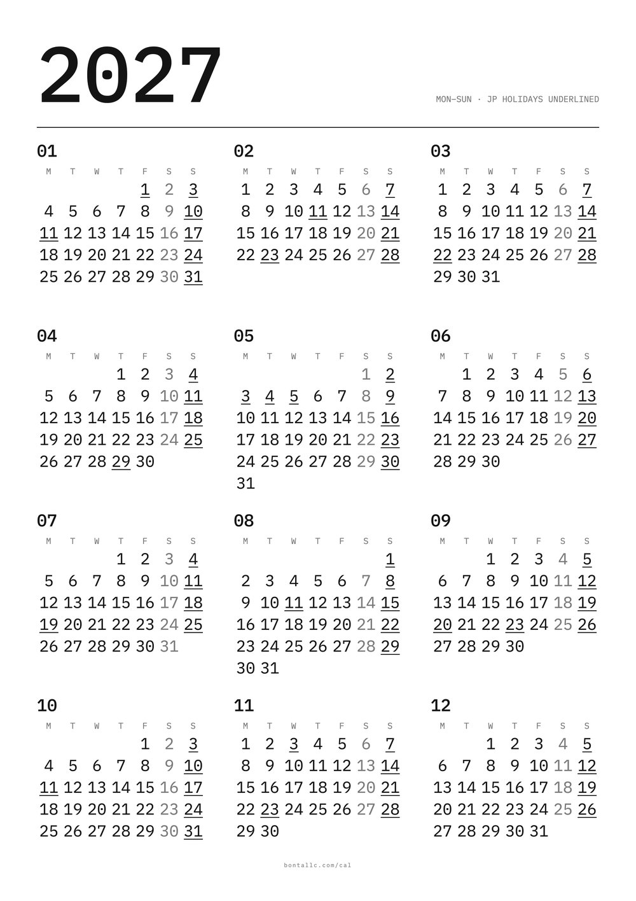
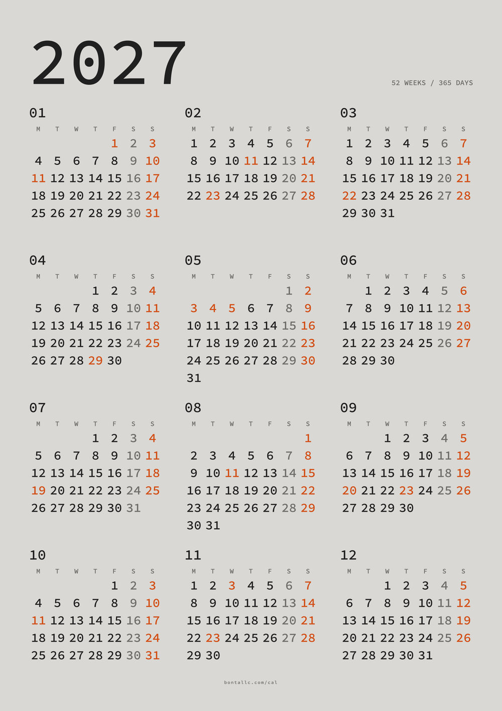
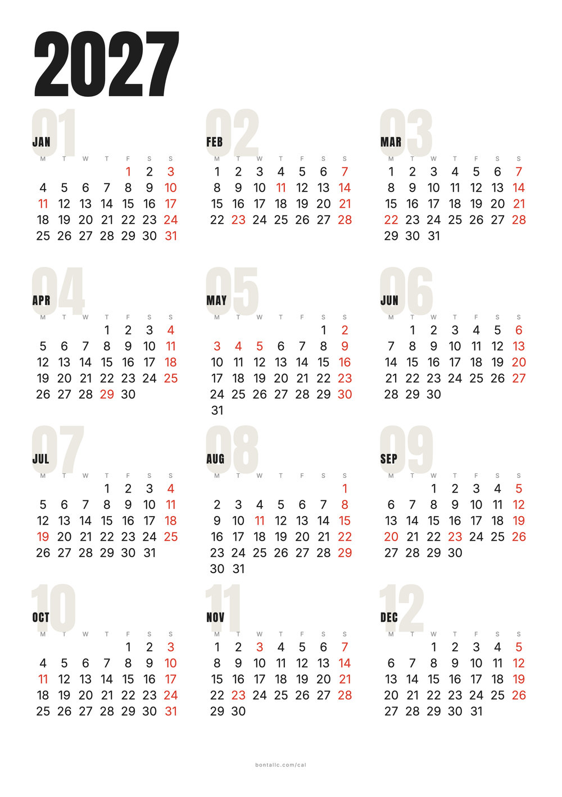
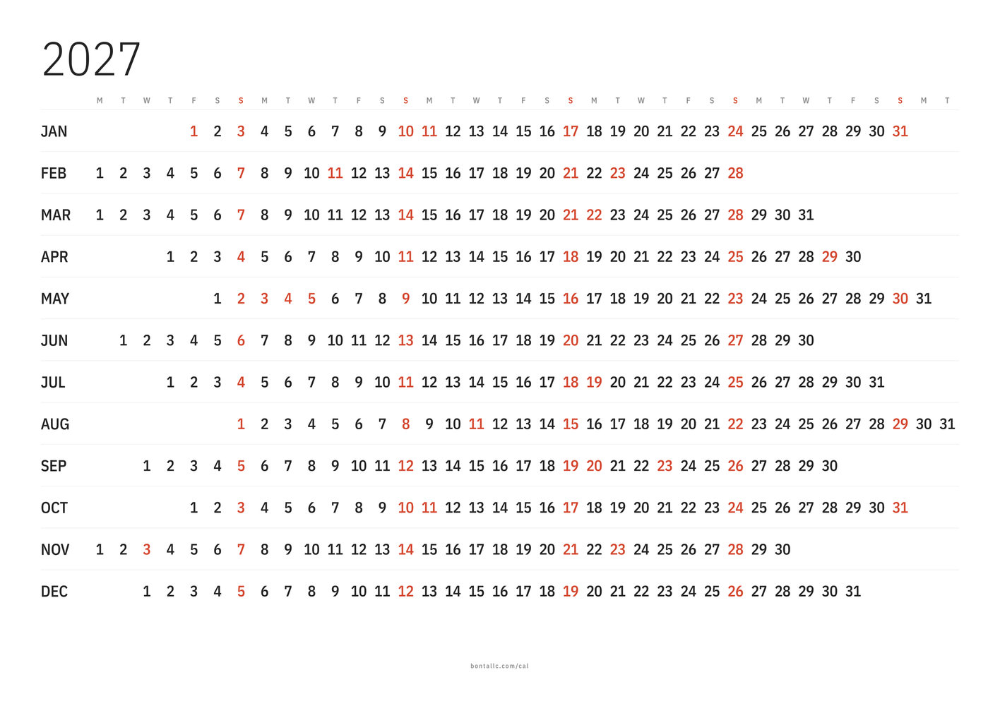

# 壁に飾る2027年カレンダー｜数字が主役の4種

壁に飾る2027年カレンダーの紹介シリーズです。全6回のうち、この回は第2回「数字が主役」です。
注文ページの絞り込みにある「数字が主役」の回です。等幅書体や大きな数字など、数字の見せ方に特徴のある4種を紹介します。最後の1種は横向きに飾るデザインです。
全30種のうち、はじめの3種（Swiss Grotesk・Shippori Washi・Night Lime）は最初の記事で紹介しています。

## Plex Mono Grid

白地に、等幅書体（IBM Plex Mono）で組んだモノクロのデザインです。月名は01から12までの数字で、日付の数字は一桁も二桁も同じ幅で縦にそろいます。色は使わず、日本の祝日には下線を引いて区別しています。右上には「MON–SUN · JP HOLIDAYS UNDERLINED」と小さな注記があります。機械的で整った雰囲気が好きな方や、仕事部屋に合います。
このデザインを選んだ状態で開く：[https://bontallc.com/cal?design=03&utm_source=note&utm_campaign=cal-series-2](https://bontallc.com/cal?design=03&utm_source=note&utm_campaign=cal-series-2)

## Source Code Concrete

コンクリートのような明るい灰色の地に、等幅書体（Source Code Pro）で組んだデザインです。大きな「2027」の右に「52 WEEKS / 365 DAYS」と小さく入り、月名は01から12の数字です。日曜と祝日の数字はオレンジに分けています。灰色の地とオレンジの組み合わせが落ち着いているので、打ちっぱなしの壁や、事務所、作業場に合います。
このデザインを選んだ状態で開く：[https://bontallc.com/cal?design=12&utm_source=note&utm_campaign=cal-series-2](https://bontallc.com/cal?design=12&utm_source=note&utm_campaign=cal-series-2)

## Anton Numerals

白地に、太く縦長の書体（Anton）で「2027」を大きく組んだデザインです。各月の後ろには、薄い灰色で01から12の大きな数字が敷かれ、その上に「JAN」「FEB」といった月名と日付が重なります。日曜と祝日は赤に分けています。数字の存在感が強く、少し離れても月の見当がつくので、玄関や廊下、広い壁に向きます。
このデザインを選んだ状態で開く：[https://bontallc.com/cal?design=24&utm_source=note&utm_campaign=cal-series-2](https://bontallc.com/cal?design=24&utm_source=note&utm_campaign=cal-series-2)

## Plex Condensed Linear（横向きに飾る）

白地に、幅を絞った書体（IBM Plex Sans Condensed）で組んだ横長のデザインです。1月から12月までを1行ずつ上から下へ並べ、各行の左に「JAN」から「DEC」の月名、その右に日付が一列に続きます。日曜と祝日は赤に分けています。横向きに飾るデザインで、1年の流れを一目で見渡せるので、机の上の壁や、予定を書き込む場所の近くに向きます。
このデザインを選んだ状態で開く：[https://bontallc.com/cal?design=29&utm_source=note&utm_campaign=cal-series-2](https://bontallc.com/cal?design=29&utm_source=note&utm_campaign=cal-series-2)

## 選べること

サイズはA1（594×841mm）・A2（420×594mm）・A3（297×420mm）から選べます。
ポスター単体と額装セットがあり、額装セットの額はブラック・ホワイト・シルバーから選べます。
月曜始まり・日曜始まりも選べます。
名前やメッセージを入れるカスタマイズ（額装）もできます。
価格（すべて送料込み・税込）は、ポスター単体がA1 4,400円／A2 2,980円／A3 2,200円、額装セットがA1 9,900円／A2 6,600円／A3 4,980円、カスタマイズ（額装）がA1 15,500円／A2 12,200円／A3 10,580円です。
住所やデザインの好みがわからない相手には、「受け取りリンク」で贈れます。サイズと、額装セットかポスター単体かを選んで購入すると、受け取り用のリンクがメールで届きます。それをLINEやメールで相手に送ると、相手がデザインと額の色、お届け先を選びます。相手の画面に金額は表示されません。

## 部屋に置いて見る

スマホで注文ページ（bontallc.com/cal）を開き、デザイン・サイズ・種類を選んで「部屋に置いて見る（スマホのカメラが開きます）」を押すと、カメラで自分の部屋の壁に実物大で置いた様子を確かめられます。
壁から1〜2m離れて、カメラを壁に向けます
スマホをゆっくり左右に動かすと、額が壁に貼り付きます
置いた後は指で動かさず、スマホを動かして眺めてください。置き直したいときは、いったん閉じてもう一度開きます

## 年内にお届けしたい方へ

年内にお届けしたい場合は、お早めにご注文ください。ご注文から約7〜10日で発送します。

## 注文ページへ

この回のデザインも、ほかのデザインも、注文ページで選べます。
[https://bontallc.com/cal?utm_source=note&utm_campaign=cal-series-2](https://bontallc.com/cal?utm_source=note&utm_campaign=cal-series-2)

## シリーズの他の回

2027年は、壁に一枚。貼っても、額に入れても飾れるA1・A2・A3サイズの年間カレンダーを作りました
壁に飾る2027年カレンダー｜和の文字の5種
壁に飾る2027年カレンダー｜暗い地と深い色の4種
壁に飾る2027年カレンダー｜色が楽しい5種
壁に飾る2027年カレンダー｜白・生成りのセリフ体の5種
壁に飾る2027年カレンダー｜白・生成りのサンセリフと横長の4種
