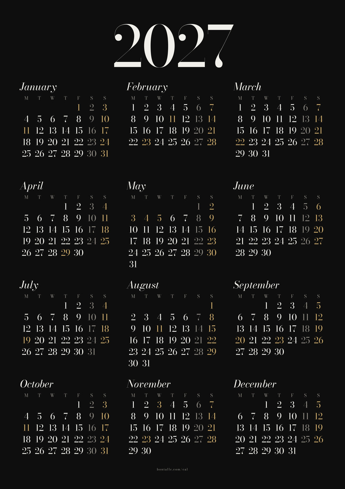
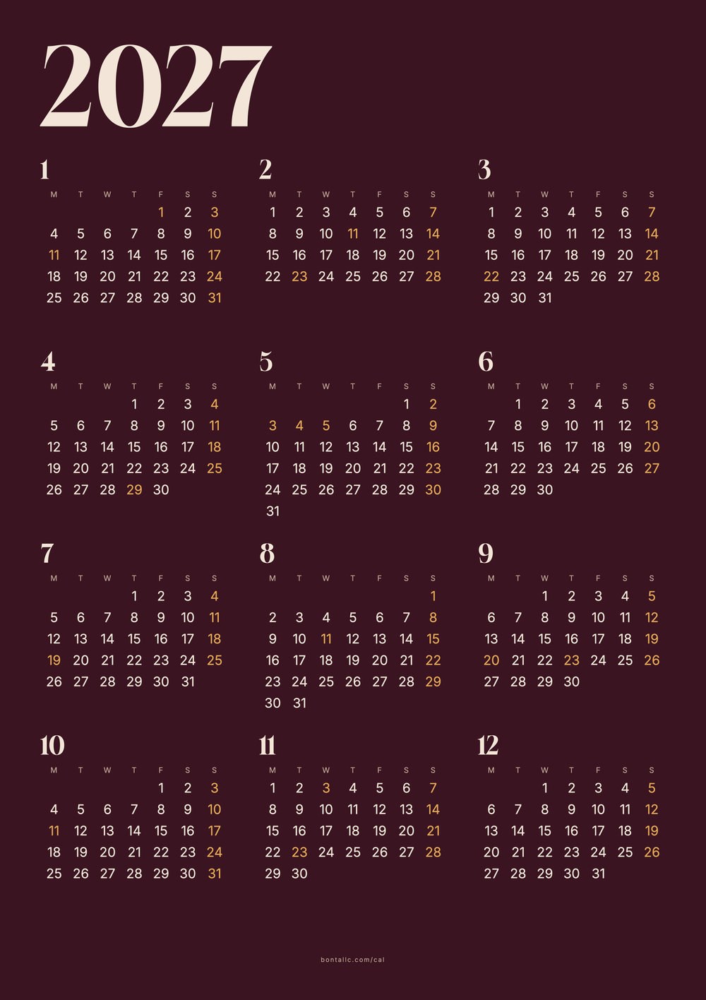
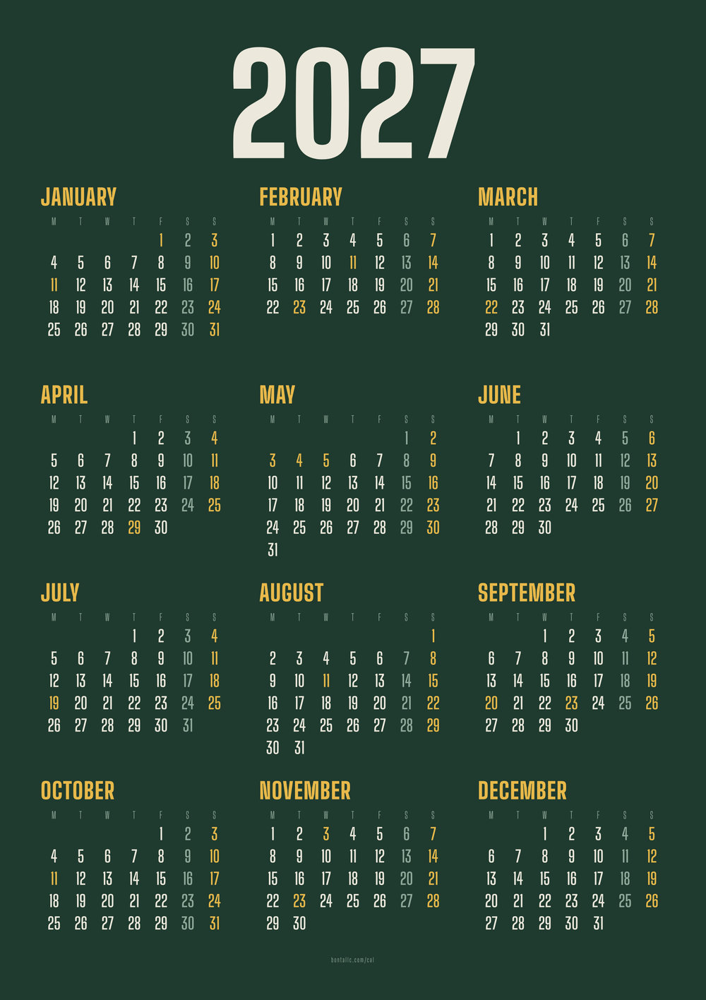
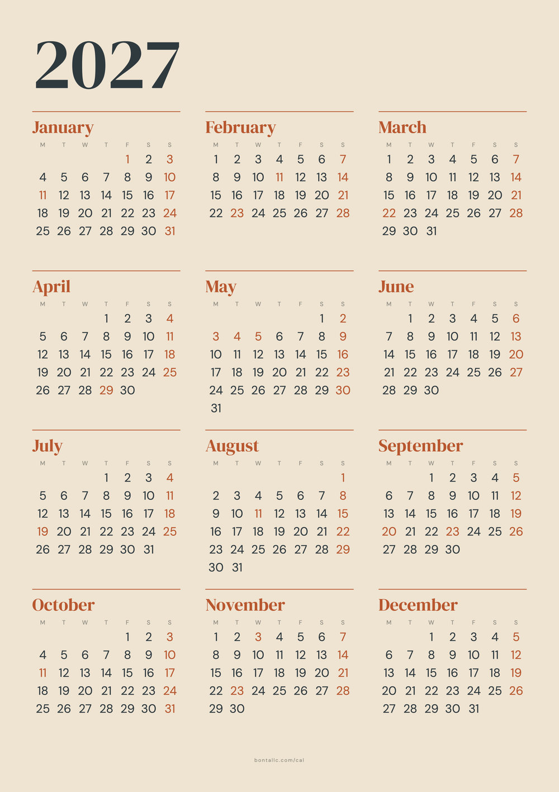

# 壁に飾る2027年カレンダー｜暗い地と深い色の4種

壁に飾る2027年カレンダーの紹介シリーズです。全6回のうち、この回は第3回「暗い地と深い色」です。
注文ページの絞り込みにある「暗い地」の回です。地の暗い3種に、深い色合いの1種を加えた4種を紹介します。
全30種のうち、はじめの3種（Swiss Grotesk・Shippori Washi・Night Lime）は最初の記事で紹介しています。

## Bodoni Noir

黒に近い地に、太さの差が大きい書体（Bodoni Moda）で組んだデザインです。クリーム色の大きな「2027」を上の中央に置き、月名は「January」のように斜体の英語で入れています。日曜と祝日は金色に分けています。黒い地に細い線が浮かぶ印象で、黒やダークウッドの家具のある部屋、バーや落ち着いた店の壁に合います。
このデザインを選んだ状態で開く：[https://bontallc.com/cal?design=14&utm_source=note&utm_campaign=cal-series-3](https://bontallc.com/cal?design=14&utm_source=note&utm_campaign=cal-series-3)

## Gloock Bordeaux

深いワインレッドの地に、コントラストの強いセリフ体（Gloock）で組んだデザインです。クリーム色の大きな「2027」を左上に置き、月名は1から12の数字を大きく入れています。日曜と祝日は琥珀色に分けています。赤みのある暗い地なので、黒より少し温かい印象になります。ダイニングや寝室の壁、ワインや食事を楽しむ場所への贈り物に向きます。
このデザインを選んだ状態で開く：[https://bontallc.com/cal?design=34&utm_source=note&utm_campaign=cal-series-3](https://bontallc.com/cal?design=34&utm_source=note&utm_campaign=cal-series-3)

## Big Shoulders Forest

深い緑の地に、縦長で力強い書体（Big Shoulders Display）で組んだデザインです。クリーム色の大きな「2027」を中央に置き、「JANUARY」などの月名と祝日は金色にしています。縦長の書体と濃い緑の組み合わせで、書斎や木の家具のある部屋、緑の植物のそばに合います。暗い地の落ち着いた一枚を探している方に向きます。
このデザインを選んだ状態で開く：[https://bontallc.com/cal?design=17&utm_source=note&utm_campaign=cal-series-3](https://bontallc.com/cal?design=17&utm_source=note&utm_campaign=cal-series-3)

## DM Serif Mediterranean

砂色の地に、DM Serif Display で組んだデザインです。地は暗くありませんが、濃いスレート色の「2027」と赤茶色の月名が重みを出しています。月名の上には細い線が引かれ、日曜と祝日は赤茶色に分けています。南欧の陶器のような色合いなので、白い壁のリビングや、木や素焼きの小物のある部屋に合います。
このデザインを選んだ状態で開く：[https://bontallc.com/cal?design=35&utm_source=note&utm_campaign=cal-series-3](https://bontallc.com/cal?design=35&utm_source=note&utm_campaign=cal-series-3)

## 選べること

サイズはA1（594×841mm）・A2（420×594mm）・A3（297×420mm）から選べます。
ポスター単体と額装セットがあり、額装セットの額はブラック・ホワイト・シルバーから選べます。
月曜始まり・日曜始まりも選べます。
名前やメッセージを入れるカスタマイズ（額装）もできます。
価格（すべて送料込み・税込）は、ポスター単体がA1 4,400円／A2 2,980円／A3 2,200円、額装セットがA1 9,900円／A2 6,600円／A3 4,980円、カスタマイズ（額装）がA1 15,500円／A2 12,200円／A3 10,580円です。
住所やデザインの好みがわからない相手には、「受け取りリンク」で贈れます。サイズと、額装セットかポスター単体かを選んで購入すると、受け取り用のリンクがメールで届きます。それをLINEやメールで相手に送ると、相手がデザインと額の色、お届け先を選びます。相手の画面に金額は表示されません。

## 部屋に置いて見る

スマホで注文ページ（bontallc.com/cal）を開き、デザイン・サイズ・種類を選んで「部屋に置いて見る（スマホのカメラが開きます）」を押すと、カメラで自分の部屋の壁に実物大で置いた様子を確かめられます。
壁から1〜2m離れて、カメラを壁に向けます
スマホをゆっくり左右に動かすと、額が壁に貼り付きます
置いた後は指で動かさず、スマホを動かして眺めてください。置き直したいときは、いったん閉じてもう一度開きます

## 年内にお届けしたい方へ

年内にお届けしたい場合は、お早めにご注文ください。ご注文から約7〜10日で発送します。

## 注文ページへ

この回のデザインも、ほかのデザインも、注文ページで選べます。
[https://bontallc.com/cal?utm_source=note&utm_campaign=cal-series-3](https://bontallc.com/cal?utm_source=note&utm_campaign=cal-series-3)

## シリーズの他の回

2027年は、壁に一枚。貼っても、額に入れても飾れるA1・A2・A3サイズの年間カレンダーを作りました
壁に飾る2027年カレンダー｜和の文字の5種
壁に飾る2027年カレンダー｜数字が主役の4種
壁に飾る2027年カレンダー｜色が楽しい5種
壁に飾る2027年カレンダー｜白・生成りのセリフ体の5種
壁に飾る2027年カレンダー｜白・生成りのサンセリフと横長の4種
