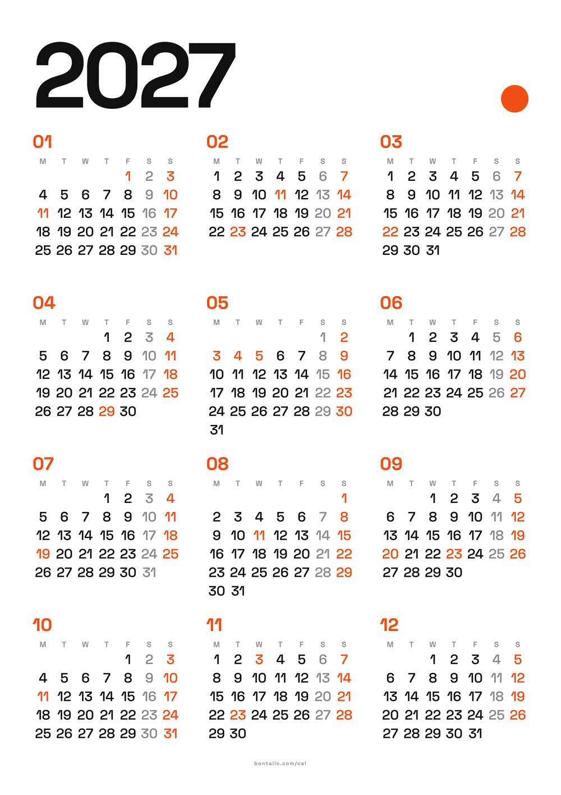
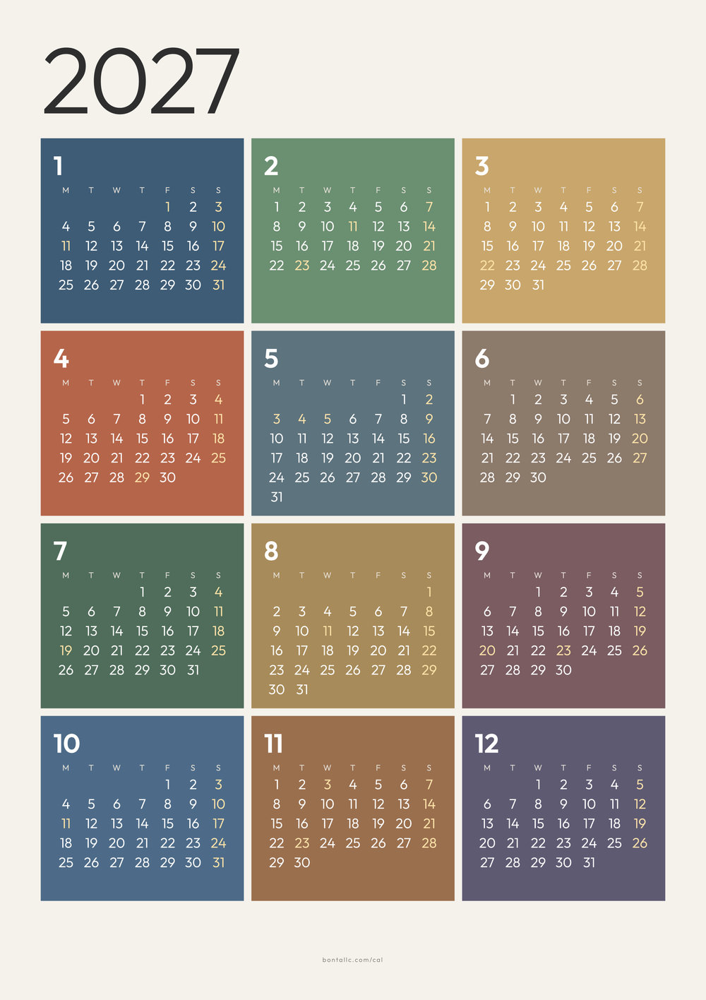
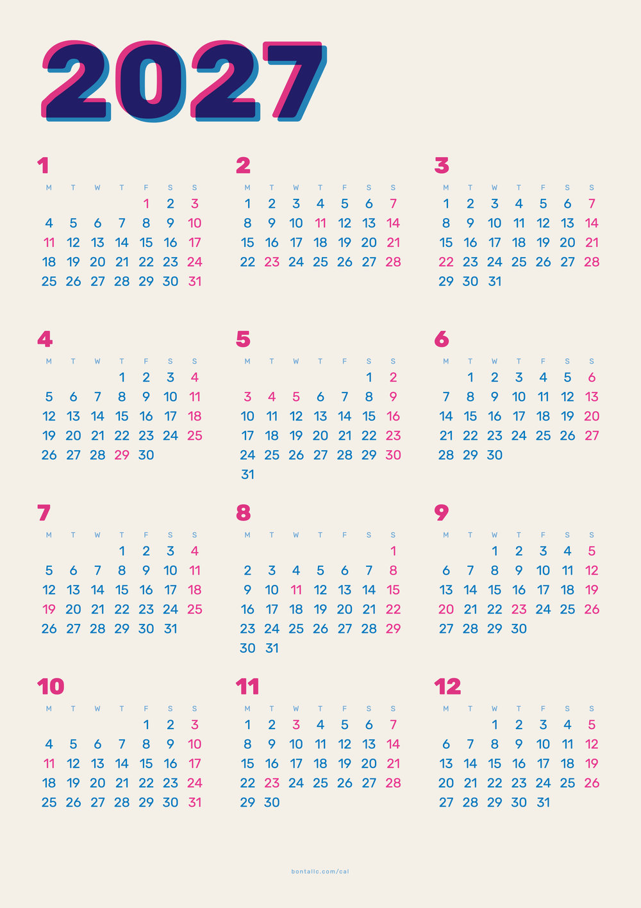
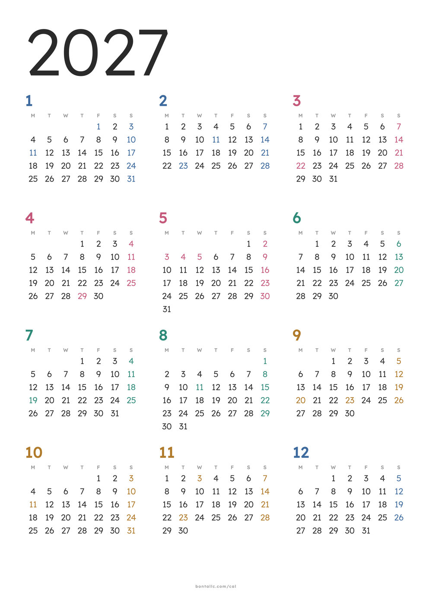
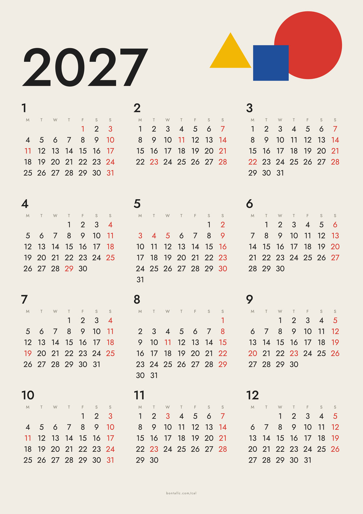

# 壁に飾る2027年カレンダー｜色が楽しい5種

壁に飾る2027年カレンダーの紹介シリーズです。全6回のうち、この回は第4回「色が楽しい」です。
注文ページの絞り込みにある「色が楽しい」の回です。色の使い方に特徴のある5種を紹介します。
全30種のうち、はじめの3種（Swiss Grotesk・Shippori Washi・Night Lime）は最初の記事で紹介しています。

## Space Grotesk Signal

白地に、幾何学的な書体（Space Grotesk）を使ったデザインです。太い黒の「2027」の右に、オレンジの丸がひとつ入っています。月名は01から12までオレンジの数字で、日曜と祝日もオレンジに分けています。白と黒の中にオレンジだけが浮かぶので、色数は少ないのに目に留まります。モダンな部屋や、事務所の壁に向きます。
このデザインを選んだ状態で開く：[https://bontallc.com/cal?design=16&utm_source=note&utm_campaign=cal-series-4](https://bontallc.com/cal?design=16&utm_source=note&utm_campaign=cal-series-4)

## Outfit Tiles

あたたかい白の地に、12か月を12枚のタイルにして並べたデザインです。タイルは青、緑、からし色、れんが色、紫がかった灰色などの落ち着いた色で、1月から12月まで一枚ずつ色が違います。数字は白で、書体は幾何学的な Outfit です。色の数は多いものの彩度を抑えているので、にぎやかになりすぎません。子ども部屋やリビングに向きます。
このデザインを選んだ状態で開く：[https://bontallc.com/cal?design=23&utm_source=note&utm_campaign=cal-series-4](https://bontallc.com/cal?design=23&utm_source=note&utm_campaign=cal-series-4)

## Rubik Riso

クリーム色の地に、角の丸いRubikで組んだデザインです。「2027」は紺色で、マゼンタの影をずらして重ね、2色刷りのリソグラフ印刷のような見た目にしています。月名と日付は青で、日曜と祝日はマゼンタに分けています。青とピンクだけの色使いなので、色数は少なくても元気な印象になります。若い方の部屋や、雑貨や本のお店に合います。
このデザインを選んだ状態で開く：[https://bontallc.com/cal?design=27&utm_source=note&utm_campaign=cal-series-4](https://bontallc.com/cal?design=27&utm_source=note&utm_campaign=cal-series-4)

## Lexend Seasons

白地に、読みやすさを意識して作られた書体（Lexend）で組んだデザインです。月名の数字が季節ごとに色分けされ、冬は青、春はピンク、夏は緑、秋は黄土色になっています。日曜と祝日の数字も、その月の色に合わせています。色は月名と数字のまわりだけで、地は白のままなので、明るく軽い印象です。季節の移り変わりを楽しみたい方や、玄関に向きます。
このデザインを選んだ状態で開く：[https://bontallc.com/cal?design=28&utm_source=note&utm_campaign=cal-series-4](https://bontallc.com/cal?design=28&utm_source=note&utm_campaign=cal-series-4)

## Jost Bauhaus

生成りの地に、幾何学的な書体（Jost）で組んだデザインです。太い黒の「2027」の右上に、黄色の三角、青の四角、赤の丸が並んでいます。バウハウスなどのモダンデザインを思わせる配置で、月名は太い数字、日曜と祝日は赤に分けています。三原色の図形が目を引くので、デザインや美術が好きな方や、アトリエ、本棚の近くに向きます。
このデザインを選んだ状態で開く：[https://bontallc.com/cal?design=32&utm_source=note&utm_campaign=cal-series-4](https://bontallc.com/cal?design=32&utm_source=note&utm_campaign=cal-series-4)

## 選べること

サイズはA1（594×841mm）・A2（420×594mm）・A3（297×420mm）から選べます。
ポスター単体と額装セットがあり、額装セットの額はブラック・ホワイト・シルバーから選べます。
月曜始まり・日曜始まりも選べます。
名前やメッセージを入れるカスタマイズ（額装）もできます。
価格（すべて送料込み・税込）は、ポスター単体がA1 4,400円／A2 2,980円／A3 2,200円、額装セットがA1 9,900円／A2 6,600円／A3 4,980円、カスタマイズ（額装）がA1 15,500円／A2 12,200円／A3 10,580円です。
住所やデザインの好みがわからない相手には、「受け取りリンク」で贈れます。サイズと、額装セットかポスター単体かを選んで購入すると、受け取り用のリンクがメールで届きます。それをLINEやメールで相手に送ると、相手がデザインと額の色、お届け先を選びます。相手の画面に金額は表示されません。

## 部屋に置いて見る

スマホで注文ページ（bontallc.com/cal）を開き、デザイン・サイズ・種類を選んで「部屋に置いて見る（スマホのカメラが開きます）」を押すと、カメラで自分の部屋の壁に実物大で置いた様子を確かめられます。
壁から1〜2m離れて、カメラを壁に向けます
スマホをゆっくり左右に動かすと、額が壁に貼り付きます
置いた後は指で動かさず、スマホを動かして眺めてください。置き直したいときは、いったん閉じてもう一度開きます

## 年内にお届けしたい方へ

年内にお届けしたい場合は、お早めにご注文ください。ご注文から約7〜10日で発送します。

## 注文ページへ

この回のデザインも、ほかのデザインも、注文ページで選べます。
[https://bontallc.com/cal?utm_source=note&utm_campaign=cal-series-4](https://bontallc.com/cal?utm_source=note&utm_campaign=cal-series-4)

## シリーズの他の回

2027年は、壁に一枚。貼っても、額に入れても飾れるA1・A2・A3サイズの年間カレンダーを作りました
壁に飾る2027年カレンダー｜和の文字の5種
壁に飾る2027年カレンダー｜数字が主役の4種
壁に飾る2027年カレンダー｜暗い地と深い色の4種
壁に飾る2027年カレンダー｜白・生成りのセリフ体の5種
壁に飾る2027年カレンダー｜白・生成りのサンセリフと横長の4種
