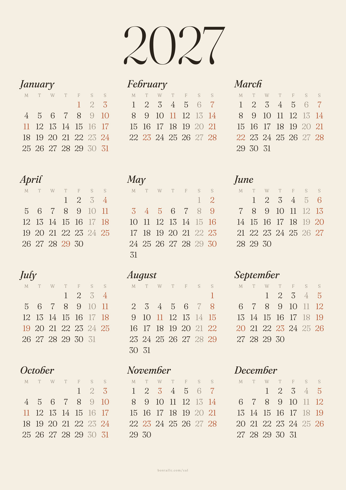
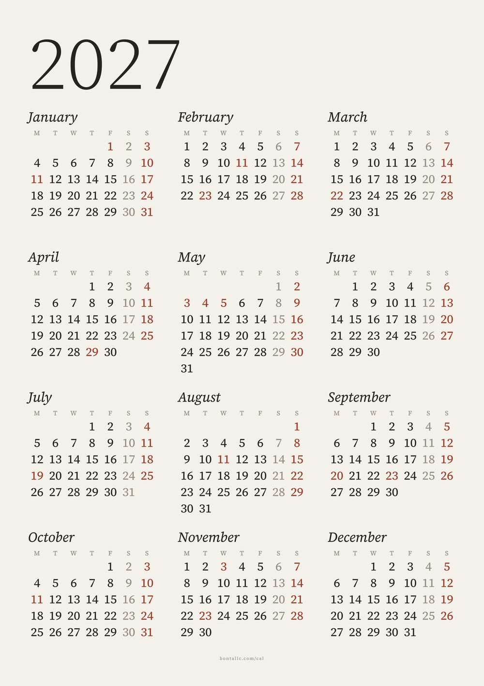
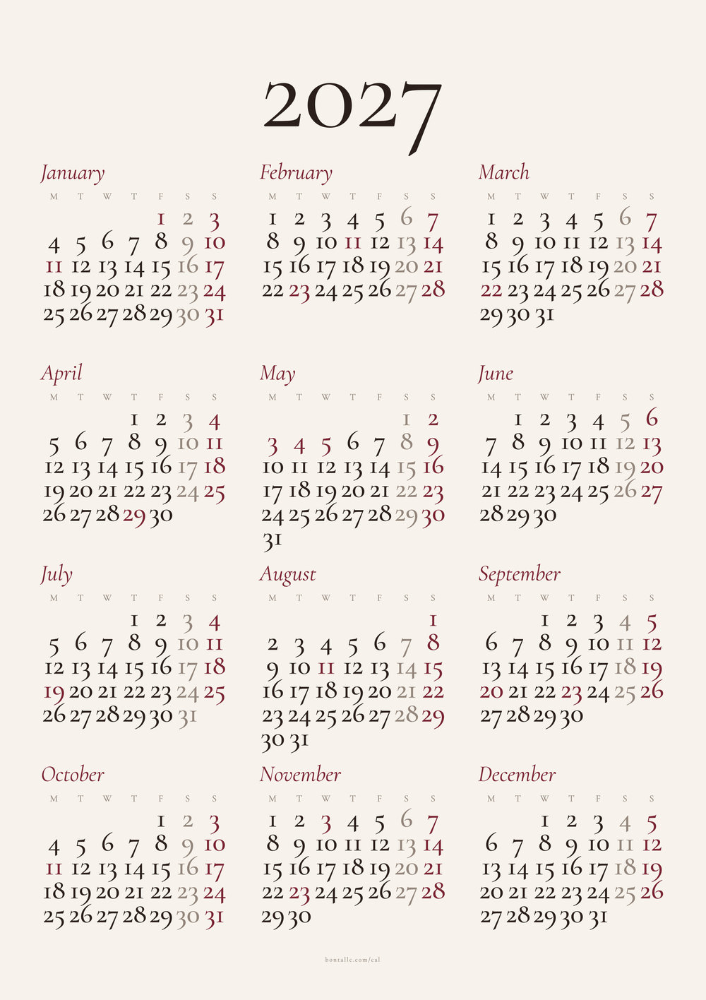
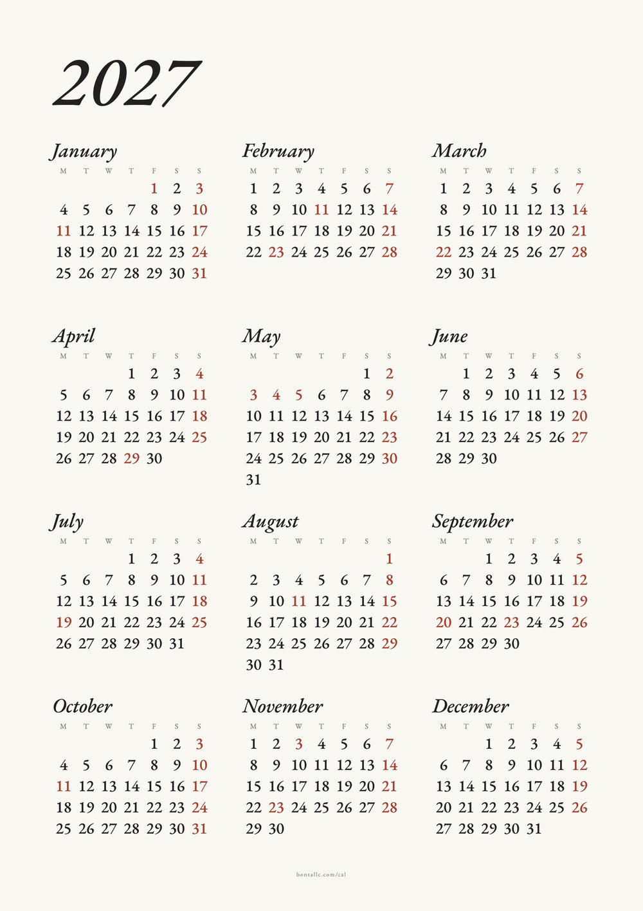
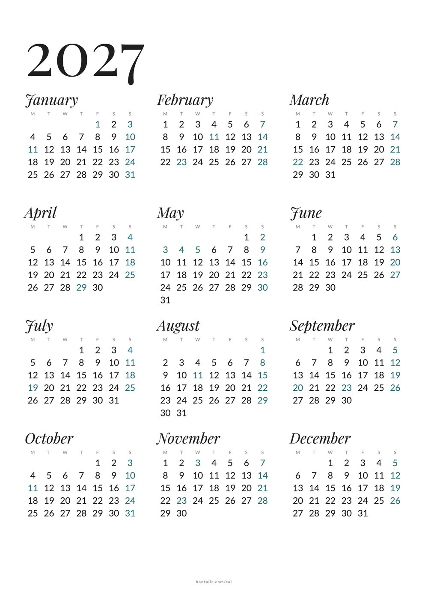

# 壁に飾る2027年カレンダー｜白・生成りのセリフ体の5種

壁に飾る2027年カレンダーの紹介シリーズです。全6回のうち、この回は第5回「白・生成りのセリフ体」です。
注文ページの絞り込みにある「白・生成りでシンプル」から、セリフ体の5種を紹介する回です。
全30種のうち、はじめの3種（Swiss Grotesk・Shippori Washi・Night Lime）は最初の記事で紹介しています。

## Fraunces Cream

クリーム色の地に、やわらかな表情のセリフ体（Fraunces）で組んだデザインです。「2027」は上の中央に黒で大きく置き、月名は「January」のように斜体の英語です。日曜と祝日はテラコッタ色に分けています。字形に温かみがあり、堅くなりすぎません。木の家具が多い部屋や、カフェのような雰囲気にしたい壁に合います。
このデザインを選んだ状態で開く：[https://bontallc.com/cal?design=02&utm_source=note&utm_campaign=cal-series-5](https://bontallc.com/cal?design=02&utm_source=note&utm_campaign=cal-series-5)

## Source Serif Paper

少し灰色がかった紙色の地に、読み物向けのセリフ体（Source Serif）で組んだデザインです。「2027」は左上に寄せ、月名は「January」などの英語です。日曜と祝日は赤茶色に分けています。派手な要素がなく、本の紙面のような落ち着きがあります。本棚のそばや書斎の壁、読書や書き物が好きな方への贈り物に向きます。
このデザインを選んだ状態で開く：[https://bontallc.com/cal?design=11&utm_source=note&utm_campaign=cal-series-5](https://bontallc.com/cal?design=11&utm_source=note&utm_campaign=cal-series-5)

## Cormorant Ivory

アイボリーの地に、繊細なセリフ体（Cormorant Garamond）で組んだデザインです。数字は高さの揃わない古典的な形で、3、4、5、7、9が行の下にはみ出し、手書きに近い表情があります。日曜と祝日はワインレッドに分けています。細い線と古風な数字が上品な印象を作ります。寝室や玄関、年上の方への贈り物に向きます。
このデザインを選んだ状態で開く：[https://bontallc.com/cal?design=15&utm_source=note&utm_campaign=cal-series-5](https://bontallc.com/cal?design=15&utm_source=note&utm_campaign=cal-series-5)

## EB Garamond Margin

生成りに近い白地に、古い活字を元にした書体（EB Garamond）で組んだデザインです。「2027」と月名は斜体で、周囲の余白を広めに取っています。日曜と祝日は赤れんが色に分けています。紙面の大半が余白と細かな活字で占められ、洋書のページのような静けさがあります。本や古い家具の多い部屋、書斎に向きます。
このデザインを選んだ状態で開く：[https://bontallc.com/cal?design=22&utm_source=note&utm_campaign=cal-series-5](https://bontallc.com/cal?design=22&utm_source=note&utm_campaign=cal-series-5)

## Playfair Months

白地に、コントラストの強いセリフ体（Playfair Display）で月名を組んだデザインです。「January」などの月名は斜体で、文字の端に装飾的な払いがあります。日付の数字は Lato のサンセリフで、日曜と祝日は深い青緑色に分けています。月名の装飾と日付の読みやすさが分かれているので、見やすさを保ったまま華やかさが出ます。リビングや玄関に向きます。
このデザインを選んだ状態で開く：[https://bontallc.com/cal?design=26&utm_source=note&utm_campaign=cal-series-5](https://bontallc.com/cal?design=26&utm_source=note&utm_campaign=cal-series-5)

## 選べること

サイズはA1（594×841mm）・A2（420×594mm）・A3（297×420mm）から選べます。
ポスター単体と額装セットがあり、額装セットの額はブラック・ホワイト・シルバーから選べます。
月曜始まり・日曜始まりも選べます。
名前やメッセージを入れるカスタマイズ（額装）もできます。
価格（すべて送料込み・税込）は、ポスター単体がA1 4,400円／A2 2,980円／A3 2,200円、額装セットがA1 9,900円／A2 6,600円／A3 4,980円、カスタマイズ（額装）がA1 15,500円／A2 12,200円／A3 10,580円です。
住所やデザインの好みがわからない相手には、「受け取りリンク」で贈れます。サイズと、額装セットかポスター単体かを選んで購入すると、受け取り用のリンクがメールで届きます。それをLINEやメールで相手に送ると、相手がデザインと額の色、お届け先を選びます。相手の画面に金額は表示されません。

## 部屋に置いて見る

スマホで注文ページ（bontallc.com/cal）を開き、デザイン・サイズ・種類を選んで「部屋に置いて見る（スマホのカメラが開きます）」を押すと、カメラで自分の部屋の壁に実物大で置いた様子を確かめられます。
壁から1〜2m離れて、カメラを壁に向けます
スマホをゆっくり左右に動かすと、額が壁に貼り付きます
置いた後は指で動かさず、スマホを動かして眺めてください。置き直したいときは、いったん閉じてもう一度開きます

## 年内にお届けしたい方へ

年内にお届けしたい場合は、お早めにご注文ください。ご注文から約7〜10日で発送します。

## 注文ページへ

この回のデザインも、ほかのデザインも、注文ページで選べます。
[https://bontallc.com/cal?utm_source=note&utm_campaign=cal-series-5](https://bontallc.com/cal?utm_source=note&utm_campaign=cal-series-5)

## シリーズの他の回

2027年は、壁に一枚。貼っても、額に入れても飾れるA1・A2・A3サイズの年間カレンダーを作りました
壁に飾る2027年カレンダー｜和の文字の5種
壁に飾る2027年カレンダー｜数字が主役の4種
壁に飾る2027年カレンダー｜暗い地と深い色の4種
壁に飾る2027年カレンダー｜色が楽しい5種
壁に飾る2027年カレンダー｜白・生成りのサンセリフと横長の4種
