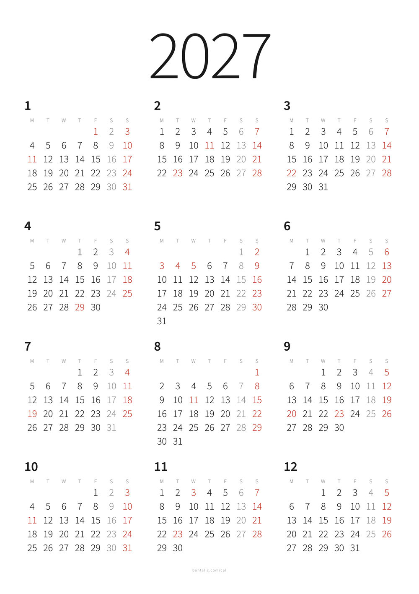
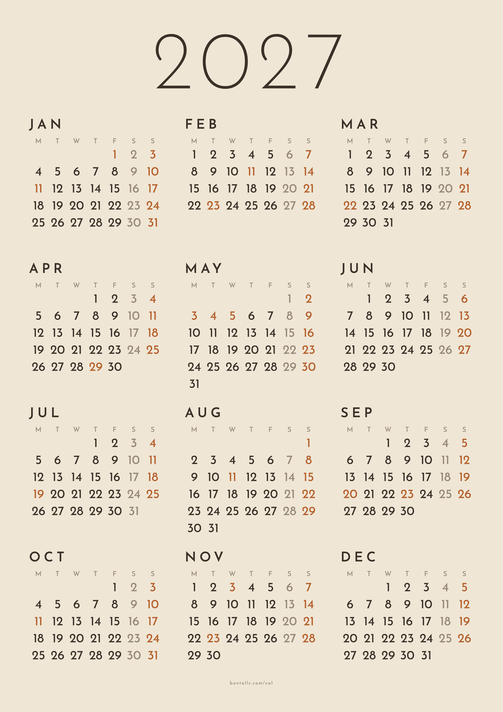
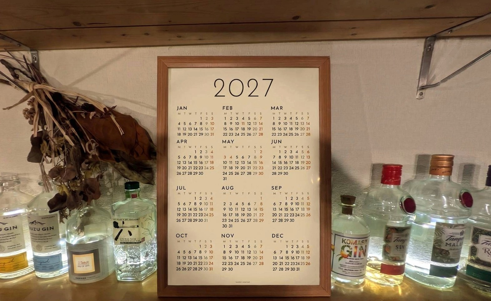
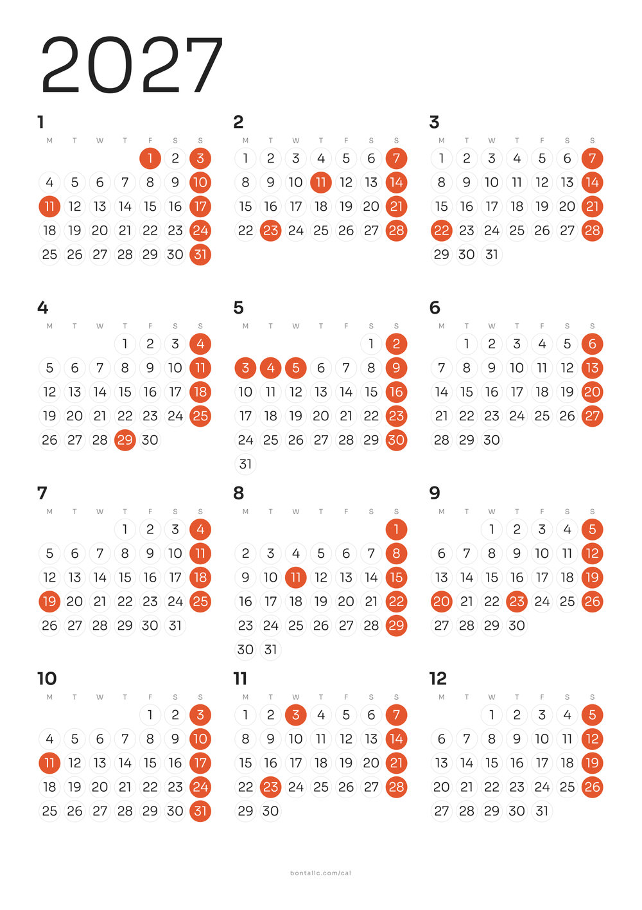
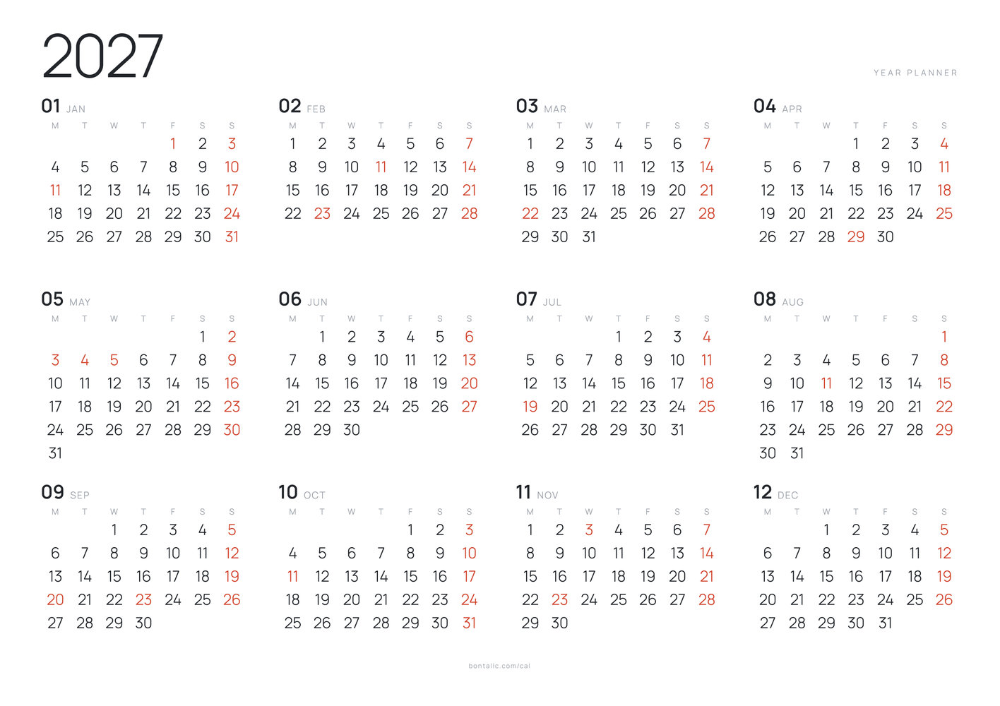

# 壁に飾る2027年カレンダー｜白・生成りのサンセリフと横長の4種

壁に飾る2027年カレンダーの紹介シリーズです。全6回のうち、この回は第6回「白・生成りのサンセリフと横長」です。
注文ページの絞り込みにある「白・生成りでシンプル」から、サンセリフ体と横向きの4種を紹介する回です。最後の1種は横向きに飾るデザインです。
全30種のうち、はじめの3種（Swiss Grotesk・Shippori Washi・Night Lime）は最初の記事で紹介しています。

## Source Sans White

白地に、細めのサンセリフ（Source Sans 3）で組んだ、飾りの少ないデザインです。「2027」は上の中央に置き、月名は1から12の数字を太めに小さく添えています。日曜と祝日は赤に分けています。余計な要素がなく、どんな部屋にも合わせやすい一枚です。住まいやお店の壁、はじめての一枚、贈り先の好みがわからないときに向きます。
このデザインを選んだ状態で開く：[https://bontallc.com/cal?design=10&utm_source=note&utm_campaign=cal-series-6](https://bontallc.com/cal?design=10&utm_source=note&utm_campaign=cal-series-6)

## Josefin Cream

実際に飾った写真は、こちらの記事で見られます：[https://note.com/bontallc/n/nb95e92be02c5](https://note.com/bontallc/n/nb95e92be02c5)
ベージュの地に、細身の幾何学的な書体（Josefin Sans）で組んだデザインです。「2027」は細い線で上の中央に置き、月名は「JAN」「FEB」と英語の3文字で、字間をあけています。日曜と祝日は銅色に分けています。紙の色がやわらかく、暖かい照明や木の棚と合います。棚に置いても、壁に掛けても使えます。
このデザインを選んだ状態で開く：[https://bontallc.com/cal?design=13&utm_source=note&utm_campaign=cal-series-6](https://bontallc.com/cal?design=13&utm_source=note&utm_campaign=cal-series-6)

## Sora Dots

白地に、幾何学的なサンセリフ（Sora）で組んだデザインです。「2027」は左上に置き、日曜と祝日の日付は、オレンジ色の丸の中に白抜きの数字で入っています。丸が点々と並ぶので、休みの日が遠くからもひと目でわかります。月名は1から12の数字です。予定を立てるときに、休日の並びを見たい方や、ご家族で使う壁に向きます。
このデザインを選んだ状態で開く：[https://bontallc.com/cal?design=31&utm_source=note&utm_campaign=cal-series-6](https://bontallc.com/cal?design=31&utm_source=note&utm_campaign=cal-series-6)

## Manrope Landscape（横向きに飾る）

白地に、くせの少ないサンセリフ（Manrope）で組んだ横長のデザインです。左上に「2027」、右上に「YEAR PLANNER」と小さく入り、12か月を4列×3段に並べています。月名は「01 JAN」のように数字と英語の略称で、日曜と祝日は赤に分けています。横向きに飾るデザインで、仕事場や書斎の壁、予定の見通しを立てたい方に向きます。
このデザインを選んだ状態で開く：[https://bontallc.com/cal?design=21&utm_source=note&utm_campaign=cal-series-6](https://bontallc.com/cal?design=21&utm_source=note&utm_campaign=cal-series-6)

## 選べること

サイズはA1（594×841mm）・A2（420×594mm）・A3（297×420mm）から選べます。
ポスター単体と額装セットがあり、額装セットの額はブラック・ホワイト・シルバーから選べます。
月曜始まり・日曜始まりも選べます。
名前やメッセージを入れるカスタマイズ（額装）もできます。
価格（すべて送料込み・税込）は、ポスター単体がA1 4,400円／A2 2,980円／A3 2,200円、額装セットがA1 9,900円／A2 6,600円／A3 4,980円、カスタマイズ（額装）がA1 15,500円／A2 12,200円／A3 10,580円です。
住所やデザインの好みがわからない相手には、「受け取りリンク」で贈れます。サイズと、額装セットかポスター単体かを選んで購入すると、受け取り用のリンクがメールで届きます。それをLINEやメールで相手に送ると、相手がデザインと額の色、お届け先を選びます。相手の画面に金額は表示されません。

## 部屋に置いて見る

スマホで注文ページ（bontallc.com/cal）を開き、デザイン・サイズ・種類を選んで「部屋に置いて見る（スマホのカメラが開きます）」を押すと、カメラで自分の部屋の壁に実物大で置いた様子を確かめられます。
壁から1〜2m離れて、カメラを壁に向けます
スマホをゆっくり左右に動かすと、額が壁に貼り付きます
置いた後は指で動かさず、スマホを動かして眺めてください。置き直したいときは、いったん閉じてもう一度開きます

## 年内にお届けしたい方へ

年内にお届けしたい場合は、お早めにご注文ください。ご注文から約7〜10日で発送します。

## 注文ページへ

この回のデザインも、ほかのデザインも、注文ページで選べます。
[https://bontallc.com/cal?utm_source=note&utm_campaign=cal-series-6](https://bontallc.com/cal?utm_source=note&utm_campaign=cal-series-6)

## シリーズの他の回

[2027年は、壁に一枚。貼っても、額に入れても飾れるA1・A2・A3サイズの年間カレンダーを作りました](https://note.com/bontallc/n/ncb3b34c01984)
[壁に飾る2027年カレンダー｜和の文字の5種](https://note.com/bontallc/n/nc0e368ed3d4b)
[壁に飾る2027年カレンダー｜数字が主役の4種](https://note.com/bontallc/n/n3662649dd696)
[壁に飾る2027年カレンダー｜暗い地と深い色の4種](https://note.com/bontallc/n/n2b915e4b67d2)
[壁に飾る2027年カレンダー｜色が楽しい5種](https://note.com/bontallc/n/nb8e5241f4931)
[壁に飾る2027年カレンダー｜白・生成りのセリフ体の5種](https://note.com/bontallc/n/n409655d2e61e)
マガジン「壁に飾る2027年カレンダー」にまとめています：[https://note.com/bontallc/m/m7114f8643bb3](https://note.com/bontallc/m/m7114f8643bb3)
