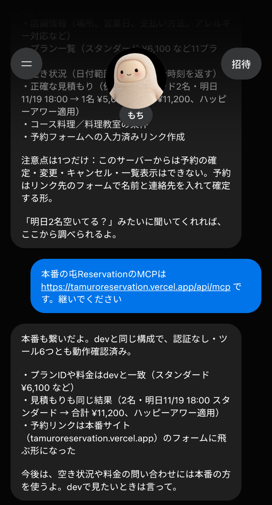

# 屯の予約を、AIからもできるようにした理由

先日の屯の周年パーティにお越しいただいた皆さま、ありがとうございました。

当日、何人かの方から「なぜ屯の予約システムをMCPサーバーにしたのか」というご質問をいただきました。その場では短くしかお話しできなかったので、ここで改めてご説明します。

MCPは、AIが外部のサービスに問い合わせたり操作したりするための共通の窓口のようなものです。屯ではこれを予約システムに用意し、ChatGPTやClaudeから普段の言葉でプランを確認し、予約まで進められるようにしています。

理由は、AIの使われ方が変わってきているからです。この数か月で、AIの各社から代わりに動いてくれるAIが相次いで出てきました。8月にxAIの「Grok Bot」、9月にMetaの「Muse」とOpenAIの「dots」、10月にAnthropicの「Claude Duet」です。どれも、メールや予定を見ながら、頼んだ仕事を裏で進めてくれるAIエージェントです。Museは日本でも10月から使えるようになりました。AIは質問に答える相手から、エージェントや秘書のように動いてくれる存在になりつつあります。

そうなると、お店を探して予約するのも、だんだんAIの仕事になっていきます。そのとき、お店の側がAIの話しかけられる窓口を用意しておけば、お客さまは自分のAIに「金曜に4人で屯に行きたい」と話しかけるだけで予約できるようになります。

実際に、私のMuseに屯の予約システムのMCPのURLを渡して「繋いでください」と頼んでみました。Museはその場でつないで、店の情報、プランの一覧、空き状況、正確な見積もりまで調べられるようになりました。たとえば「明日18時にスタンダード2名」なら、ハッピーアワーを適用した合計金額を出してくれます。予約の確定は、Museが作ったリンクから予約フォームに進み、お名前と連絡先を入れていただく形です。

もう一つの理由はAIO対策です。AIOは、AIに質問したときにお店が答えの中に出てくるようにするための対策のことです。これからは検索エンジンだけでなく、AIに聞いてお店を探す人が増えていきます。AIが屯の情報を正しく読み取れる状態にしておくことは、通りに看板を出しておくのと同じだと考えています。

とはいえ、今すぐAI経由の予約がどんどん入るとは思っていません。近い未来を、19席の小さな店で先に試している、という感覚です。

この考え方や、予約システムを自分で作った経緯は、自著『うちの店は、うちの仕様で』に詳しく書きました。noteで全文を無料で読めますので、よろしければこちらからどうぞ。

https://note.com/bontallc/m/m1576d0e10b0e
