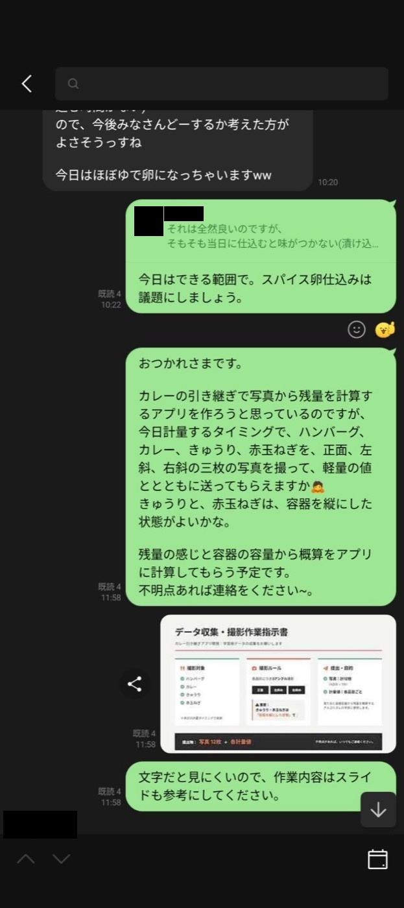
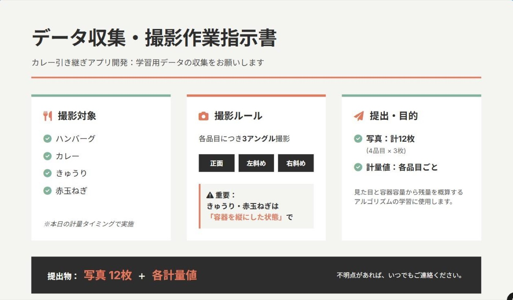
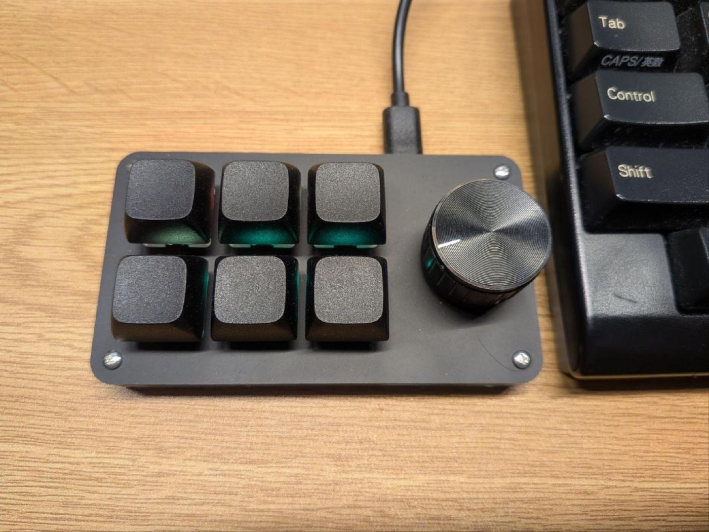

# 『一人で店を回す、その横にAIが来た。』第2章　基礎編 - 知識ゼロから始める「バイブコーディング」

この本は PDF でも無料で読めます（再配布自由）→ [https://bontallc.com/books/hitori-de-mise/pdf?via=note](https://bontallc.com/books/hitori-de-mise/pdf?via=note)

全8回の3回目

[◀ 前の章　第1章　概念編 - AIエージェントという新しい従業員](https://note.com/bontallc/n/nbed7fb1f6c79)

～プログラムは「書く」ものではなく、「AIと話して作らせる」もの～

## 2-1. 「長文LINE」は読まれない。30秒で終わる「図解」の魔法

「AIでシステムを作る」と言うと、まだ少しハードルが高く感じるかもしれません。

そこで、もっと身近で、今日からすぐに使える「AI活用術」から始めましょう。

それは、「スタッフへの指示出し」の革命です。

私たち店主は、スタッフへの連絡手段としてLINEを使うことが多いと思います。
私は普段、限られた人数で店を回していますが、忙しい営業中はゆっくり指示を出す暇もありません。

そのため、連絡事項はどうしても営業後のLINE頼みになります。

しかし、自分1人の頭の中にある「こうしてほしい」というイメージを、経験の浅いスタッフや、たまに来るヘルプの方に言葉だけで伝えるのは至難の業です。

そこで発生するのが、「長文LINE」です。

丁寧に伝えようとすればするほど文章は長くなり、結果として……

「あ、すみません、そこまで読んでませんでした」

「文字ばかりで、どれが重要かわかりませんでした」

現場でこんなミスが起きたりしませんか？

私もそうでした。

ある日、開発中のアプリのために、スタッフに「食材の写真撮影」をお願いしようとしました。

条件が少し複雑だったので、スマホで打った指示はこんな長文になってしまいました。

実際にスタッフへ送った長文のLINE。誤字もそのまま掲載

これを見ても、忙しい厨房のスタッフは「要するに写真撮ればいいんですね？」と流し読みし、「角度」や「容器の向き」の指定を見落とすでしょう。

かといって、PowerPointを開いて、図形を並べて指示書を作る暇なんてありません。

そこで私は、このテキストをそのままAI（ManusなどのAIツール、あるいはGemini）に投げ込み、こう頼みました。

「このテキストの内容を、スタッフが一目でわかる『作業指示書』として、スライド1枚にまとめて」

## 2-2. AIは「優秀な翻訳者」である

待つこと数秒。AIが生成したのは、驚くほどわかりやすい「図解スライド」でした。

AIが自動生成した「データ収集・撮影作業指示書」のスライド

私は何もデザインしていません。ただ「テキストを貼って、まとめて」と言っただけです。

AIは、私のダラダラとした文章の中から「何が重要か」「どう分類すべきか」を瞬時に理解し、人間が直感的にわかるレイアウトに「翻訳」してくれたのです。

## 2-3. 「伝わらないストレス」からの解放

私はこの画像をLINEに貼り付けて送りました。

効果はてきめんでした。

スタッフからは質問も来ず、一発で「縦向き」「3アングル」の完璧な写真データが送られてきました。

これまで私は、「なんで読んでくれないんだ」とスタッフにイライラしたり、「自分の伝え方が悪いのか」と悩んだりしていました。

しかし、悪いのはスタッフでも私でもなく、「文字だけのコミュニケーション」だったのです。

この体験で、私はAIに対する見方が変わりました。

AIは、新しい文章や画像を「ゼロから作る」ためだけの道具ではありません。

「私たちが持っている『うまく伝わらない言葉』を、相手に伝わる形に『変換』してくれる道具」なのです。

## 2-4. 「バイブコーディング」という新しい対話

AIとの対話に慣れてきたら、次はいよいよ「ツール作り」です。

「プログラミングなんて無理」と思うかもしれませんが、安心してください。

今、エンジニア界隈で「バイブコーディング（Vibe Coding）」という言葉が話題になっています。

これは、難しいコードを人間が書くのではなく、AIと「バイブス（感覚・ノリ）」を合わせるように対話しながら、システムを作り上げていく手法です。

将棋の藤井聡太名人が2025年に「今年ハマったもの」として「バイブコーディング」を挙げています。全くシステム構築と無縁に思える将棋の世界の方も、日本語でAIに要望を伝えて便利ツールを作っているとのことです。

私たちもAIと対話することで、専門知識がなくてもシステムを作れるのです。

あなたが使うのは「日本語」だけ。「こういう動きにしたい」「ここが使いにくい」と伝えると、副店長（AI）が裏側でコードを書きます。

つまり、あなたは「プログラマー」になる必要はありません。

「優秀なエンジニア（AI）」に指示を出す「現場監督」になればいいのです。

## 2-5. お店の「愚痴」が最強のプロンプトになる

AIへの指示（プロンプト）は、かっこいい言葉である必要はありません。

私が発見した最強のプロンプトは、「お店の『不便』や『不満』、つまり愚痴」です。

- 「毎日この計算をするのが面倒くさい」
- 「画像のリサイズなんて手作業でやりたくない」

これらはAIにとって立派な「開発要件」です。

「〜したい」という目標よりも、「〜が嫌だ」という感情の方が、具体的な解決策を引き出しやすいのです。

## 2-6. エラーは「失敗」ではなく「対話の始まり」

これからAIと一緒に何かを作ろうとすると、必ず「エラー」に直面します。

しかし、バイブコーディングにおいて、エラーは失敗ではありません。

「AIとの会話のキャッチボールが始まった合図」です。

人間同士でも、一度で完璧に意図が伝わることは稀です。

AIがエラーを出したら、「あ、伝わらなかったんだな」と軽く受け流し、「そうじゃなくて、こうしてほしい」と聞き返せばいいのです。

諦めずにラリーを続けること。それさえできれば、知識ゼロのあなたにも、必ず「自分だけのシステム」が作れます。

## 2-7. 「物理ボタン」で効率を劇的に変える — サブキーボード活用術

バイブコーディングにおいて、最も重要なのは「入力へのこだわり」です。

AIとの対話スピードが上がれば上がるほど、思考が止まらず、開発はどんどん進みます。逆に、入力でモタつくと、せっかくのアイデアも消えてしまいます。

先ほど、「エラーが出たらスクリーンショットを撮って貼るのが正解」とお話ししました。

しかし、1日に何十回も [Windows] + [Shift] + [S] を押して、マウスで範囲選択して、Geminiの画面に戻って [Ctrl] + [V] を押す……。

正直、指が疲れてしまいますよね。

そこで私が導入したのが、「6ボタンのサブキーボード」です。

Amazonなどで「プログラマブルキーボード」と検索すると出てくる、数百円〜千円程度の中華製の小さなキーボードです。

愛用している6ボタンのサブキーボードの実物写真

私はこの6つのボタンに、以下のショートカットを割り当てています。

1.  スクリーンショット起動
2.  全選択（Ctrl + A）
3.  コピー（Ctrl + C）
4.  ペースト（Ctrl + V）
5.  Enter（送信）
6.  （予備）

たったこれだけです。しかし、効果は劇的です。

エラーが出る。

↓

左手で「ボタン1（スクショ）」をポンと押す。

↓

範囲を選んで、Geminiの画面で「ボタン4（ペースト）」をポン。

↓

「ボタン5（送信）」をポン。

この間、わずか2秒。

キーボードショートカットを思い出す必要も、指を複雑に動かす必要もありません。

まるでゲームのコントローラーを操作するように、AIに情報を投げ込むことができます。

この後の章で出てきますが、AIが出力してくれるソースコードの修正も、全選択（Ctrl + A）、コピー（Ctrl + C）、ペースト（Ctrl + V）で再実行をすぐ行えるので便利です。

高度なプログラミング知識を学ぶ前に、まずはこの小さなデバイスを一つ用意してみてください。

「入力の手間」を物理的に消し去ること。それが、AIという相棒との会話を加速させる一番の近道なのです。

[次の章 ▶　第3章　実践編① - クリエイティブと集客の自動化](https://note.com/bontallc/n/nd1edb2b18ac3)

## この本の、ほかの読み方

PDF（無料・再配布自由）：[https://bontallc.com/books/hitori-de-mise/pdf?via=note](https://bontallc.com/books/hitori-de-mise/pdf?via=note)

Kindle：[https://www.amazon.co.jp/dp/B0GFY4WW4Y](https://www.amazon.co.jp/dp/B0GFY4WW4Y)

Google Play：[https://play.google.com/store/books/details?id=4dUiEgAAQBAJ](https://play.google.com/store/books/details?id=4dUiEgAAQBAJ)

本のページ：

https://bontallc.com/books/hitori-de-mise?via=note

PDF は再配布自由です。周りの店主仲間や、AI に興味のある方に、そのまま送ってください。

屯の予約サイト：[https://tamuroreservation.vercel.app/?src=note1](https://tamuroreservation.vercel.app/?src=note1)

Agendaシリーズ：[https://bontallc.com/agenda?via=note1](https://bontallc.com/agenda?via=note1)

note：[https://note.com/bontallc](https://note.com/bontallc)

X：[https://x.com/tamuro_hnakano](https://x.com/tamuro_hnakano)
