# 『一人で店を回す、その横にAIが来た。』第3章　実践編① - クリエイティブと集客の自動化

この本は PDF でも無料で読めます（再配布自由）→ [https://bontallc.com/books/hitori-de-mise/pdf?via=note](https://bontallc.com/books/hitori-de-mise/pdf?via=note)

全8回の4回目

[◀ 前の章　第2章　基礎編 - 知識ゼロから始める「バイブコーディング」](https://note.com/bontallc/n/nf8175f36f33e)

～「スクショを貼って丸投げ」が、最強の開発手法だった～

## 3-1. 「AIっぽさ」を消すための試行錯誤（LINEスタンプ）

テキストでの対話（バイブコーディング）に慣れてきた私は、いよいよ「画像生成」に挑戦することにしました。

実践として選んだのは、お店のファン作りにもなる「LINEスタンプ」の作成です。

しかし、よくあるAI生成画像の「ツルッとしたCGのような絵」は私の店の雰囲気には合いません。

私が目指したのは、「80年代風のレトロで、クレヨンや筆の質感が残る、手書き風フラットデザイン」。

ここから、私と副店長（AI）の長い「対話」が始まりました。

最初は「男の子2人と柴犬」のキャラクターでスタートしました。

「日常会話25パターンを出して」

「線の太さは筆致をランダムにして」

一つひとつ、まるで人間のイラストレーターに修正指示を出すように、粘り強く好みのテイストを学習させていきました。

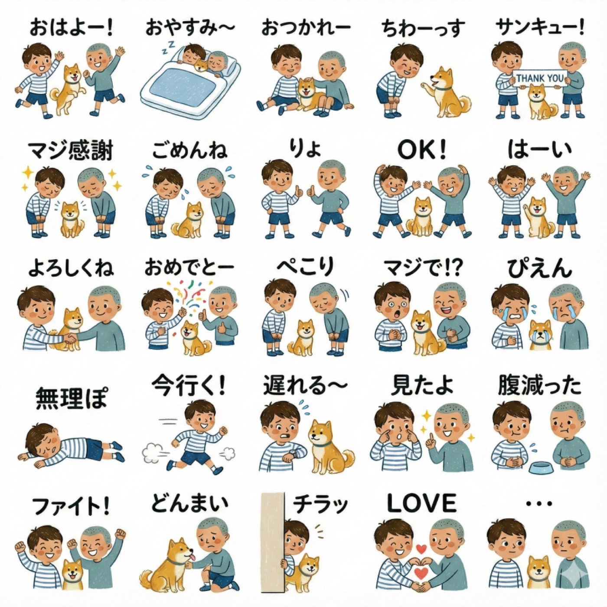

LINEスタンプ用に生成したイラスト

## 3-2. 「犬だけを猫に変えて」という大胆なリクエスト

ある程度形になったところで、私は大きな路線変更を決意します。「やっぱり、女の子と猫にしたい」と。

普通のイラストレーターなら「ええっ、最初から書き直しですか？」と嫌な顔をするところでしょう。しかし、副店長（AI）は文句一つ言いません。

「キャラクターをロングヘアとショートヘアの女の子2人に変更。服は黄色と緑、テイストはさっきの手書きの感じで」

「犬を猫に変えて、言葉はさっきAIで生成した猫語に変更、合わせてポーズもつくって」

「猫の種類は茶トラではなく、シャム猫で」

さらに、私はここでAIの限界を試すようなリクエストをしました。

「さっき作った『男の子と柴犬』の構図はそのままに、犬の部分だけをシャム猫に書き換えて」

驚いたことに、AIはこの複雑な指示を理解しました。男の子たちの位置関係やポーズはそのままで、人と動物が、見事に「シャム猫」に置き換わったのです。

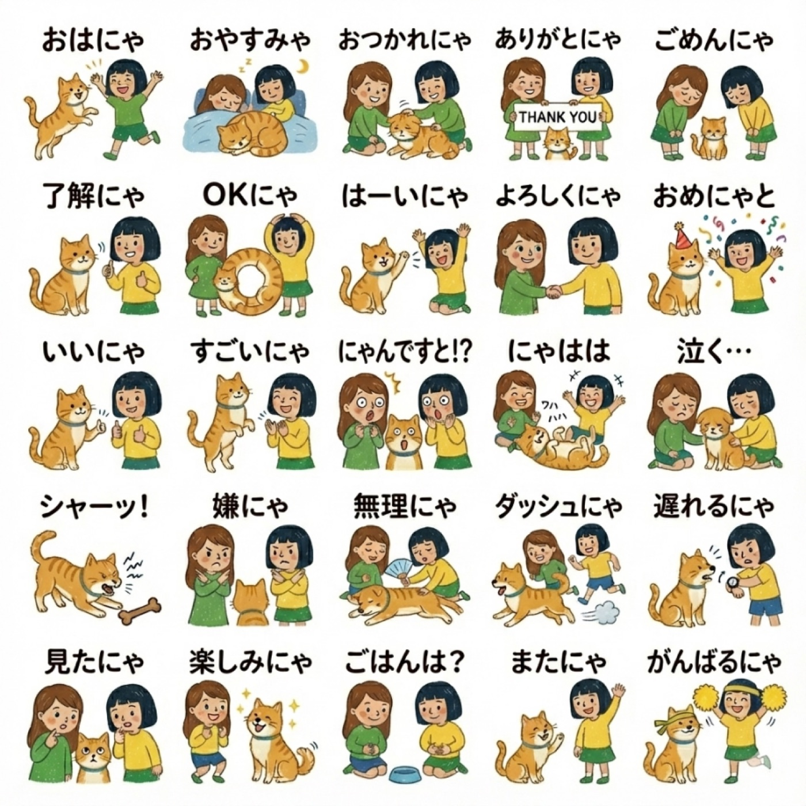

完成したLINEスタンプ用のイラストシート

ただ、LINE上でスタンプとして使うにはイラストの分割やサムネイルの作成、ZIPで圧縮してのアップロードなどの作業が必要となります。

これもGeminiとの対話で作ることが出来るのですが、これは後の3-6. 最初の難所：単純分割と「画質の罠」で改めて説明させて頂きます。

## 3-3. 事例②：22回の対話で作った「クリスマス・バナー」

LINEスタンプに続き、もう一つ、AIと二人三脚で作った大作があります。それが、店にとって最大のイベントである「クリスマスディナー」の告知バナーです。

使ったのは「NanoBanana」（※筆者が利用している画像生成AIツールの名称、Geminiで使えます）というAIです。

### Phase 1：配置と文字情報の調整

最初は、必要な要素（サンタ、トナカイ、テキスト情報）を横長のキャンバスに配置することから始めました。

出てきた画像を見ながら、私は指示を出します。

「少し寂しい。クリスマスツリーとシャンパンのイラストを追加して」

「メニューが箇条書きで読みづらい。『全6品』とまとめて、タイトルをもっと大きく目立たせて」

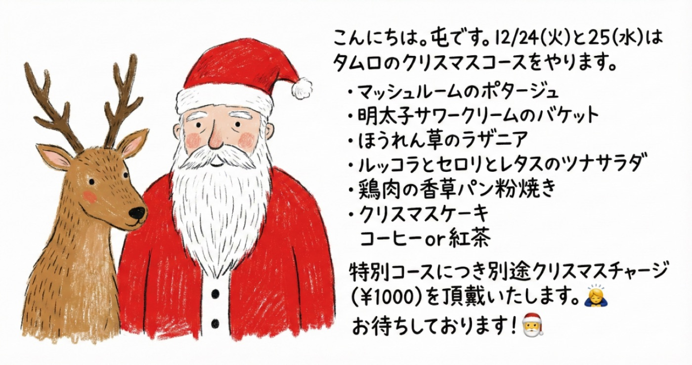

初期段階の生成画像。まだ少し寂しい印象

### Phase 2：「賑やかさ」のチューニング

配置が決まったら、次は雰囲気作りです。「パーティー感」が足りません。

「もっと賑やかに！ 小さなサンタやトナカイ、風船、紙吹雪をたくさん散りばめて」と指示。

すると、今度は画面がごちゃごちゃになりすぎました。

「ごめん、要素が多すぎた。一度キャラクターを減らしてスッキリさせて」

この「足したり引いたり」の微調整を繰り返せるのが、AIの強みです。

### Phase 3：まさかの「全面やり直し」案

制作の途中、ふと迷いが生じました。「キャラクターメインじゃなくて、料理の絵を見せた方が美味しそうじゃないか？」

そこで私は、「別案として、実際の料理のイラストをメインにしたデザインを作ってみて」と大胆な変更を指示しました。

料理提案のイラスト案（一部文字化けもしてます）

AIは瞬時に美味しそうな料理イラスト案を出してくれましたが、見比べた結果、やはり最初のキャラクター案で行くことに決めました。こんな「やっぱり元に戻して」も、AI相手なら気兼ねなくできます。

### Phase 4：最後の砦は「人間」の目

最終的なデザインが決定した後、Instagram投稿用（縦長）や、ストーリー用（さらに縦長）のサイズ展開もAIに任せました。

そして、いよいよ完成というその時です。私はある重大なミスに気づきました。

「あれ、日付の曜日が間違ってる！」

AIは絵を描くのは得意ですが、カレンダーの曜日は理解していません。そのままポストしていたら大変なことになるところでした。

私は慌てて「日付を『12/24（水）・25(木)』に修正して！」と指示し、最終版を完成させました。

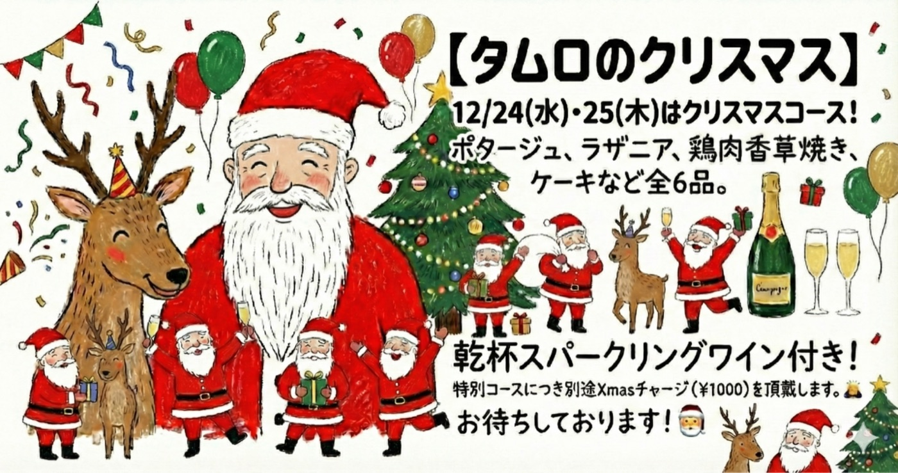

修正後の最終版バナー

合計22回もの修正と対話。

AIは魔法の杖ではありませんが、粘り強く対話すれば、これほど頼りになるデザインパートナーはいないのです。

## 3-4. 事例③：状況に合わせて進化する「年始の営業案内」

クリスマスの興奮も冷めやらぬ中、次にやってくるのが年末年始の営業です。

飲食店にとって、この時期の情報発信はスピード勝負です。「年末はいつまで？」「年始はいつから？」お客様は常に情報を求めています。

しかし、情報は刻一刻と変わります。

「年末の営業が終わったら、年始の案内だけに書き換えたい」

「X（横長）で出したけど、インスタ（縦長）でも流したい」

これを外部のデザイナーに頼んでいたら、修正費だけで大変なことになりますし、何より間に合いません。

そこで私は、再び画像生成AI（NanoBanana）と共に、年末年始を走り抜けるバナー制作に取り掛かりました。

### Step 1：スタイルは「80年代クレヨン画」で

まずはベースとなる世界観の構築です。

私の店に合うのは、ピカピカのCGではありません。

「80年代風の、筆致が残る手描きクレヨン画のような温かいスタイル。背景は白でシンプルに」

この指示を軸に、まずはX（旧Twitter）での告知を見据えて、横長のキャンバスで制作を開始しました。

### Step 2：去りゆく「巳」と来る「午」。バトンタッチの乾杯

最初は干支の動物を一体だけ描こうかと思いましたが、せっかくの「年末年始」です。

「去りゆく年（今年の干支）と、やってくる年（来年の干支）の両方を登場させたい」と思いつきました。

そこで私はAIにこう指示しました。

「画面の左側に『ヘビ（巳）』のグループ、右側に『ウマ（午）』のグループを配置して。お互いにビールジョッキを持って、年の瀬のバトンタッチをするように楽しく乾杯させて」

AIが生成した画像は、まさに私のイメージ通りでした。

左側には愛嬌のあるヘビたちが、右側には頼もしげなウマたちが並び、種族を超えて酒を酌み交わしている。

「年末（ヘビ）」から「年始（ウマ）」へ。

一枚の絵の中に時間の流れと、祝祭の雰囲気が見事に凝縮されていました。

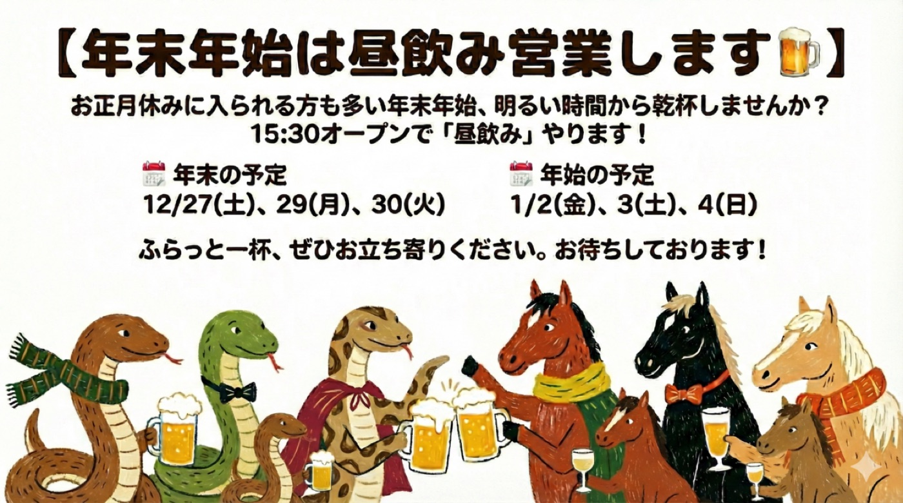

左のヘビと右のウマが乾杯し、新旧の交代を表現した生成画像

### Step 3：動物たちへの「演技指導」と「衣装合わせ」

構図が決まれば、次はディテールの演出です。AIはここでも、私の細かい「こだわり」に付き合ってくれます。

最初に出てきた画像では、彼らはただ並んでいるだけだったり、持ち方が不自然だったりしました。

「もっと楽しそうに！ まるで常連さん同士が盛り上がっているような雰囲気で」

「季節感も出したいな。マフラーや蝶ネクタイをつけさせて、冬の装いにして」

この一言で、画面内の動物たちは赤や緑の暖かそうなマフラーを巻き、一気に「冬のパーティー」の主役たちに変わりました。

「うん、これで『寒い日の昼飲み』という温かい感じが出た」

よくよく見ると手の動きや持ち方も一部不自然ですが、こだわるということはそれだけ時間がかかるということです。時間と伝わりやすさとのトレードオフでまずまずの仕上がりでもOKとしています。

### Step 4：時間が経てば、情報も変わる

ここからが、AI活用の真骨頂です。

当初のバナーには、「年末年始の営業スケジュール」として、12月の予定と1月の予定が両方書かれていました。

しかし、12月31日を過ぎれば、年末の情報は不要になります。

私は作成途中のプロジェクトを開き、テキスト内容の大幅な変更を指示しました。

1.  タイトルの変更： 「年末年始の営業」から「年始は昼飲み営業します」へ。
2.  情報の整理： 終わった12月の予定を削除し、「年始の予定（1/2～1/4）」だけに絞り込む。
3.  干支のキャラクターの修正：去りゆく年の干支の蛇を馬に変換。
4.  フックの追加： 新たな集客の目玉として、「ハイボールと唐揚げ食べ飲み放題」という魅力的なオファーを追記。

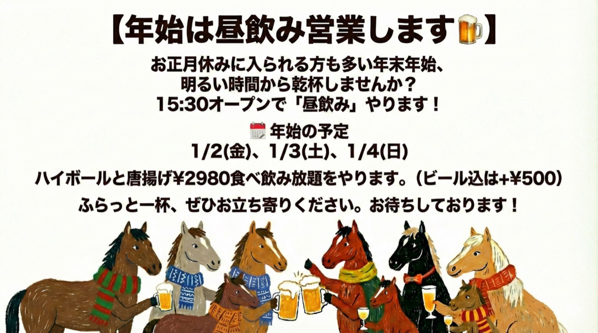

Step 4：時間が経てば、情報も変わる

画像を一から作り直すことなく、まるで黒板の文字を書き換えるように、情報の鮮度を更新できる。これがAIデザインの強みです。

### Step 5：XからInstagramへ。変幻自在のフォーマット

そして最終仕上げです。

「Xでは告知した。次はインスタのストーリーで流したい」

しかし、ストーリーはスマホ全画面の「縦長」サイズです。横長の画像をそのまま載せると、上下に余白ができてかっこ悪くなります。

普通のイラストなら、描き直しが必要なレベルの変更です。

しかし、私はAIにこう告げるだけでした。

「このデザインのまま、インスタのストーリー用の縦型レイアウトに組み替えて」

AIは、横に広がっていた動物たちの配置を縦に並べ替え、テキストのバランスを調整し、瞬時に「スマホ特化型」のデザインを生成しました。

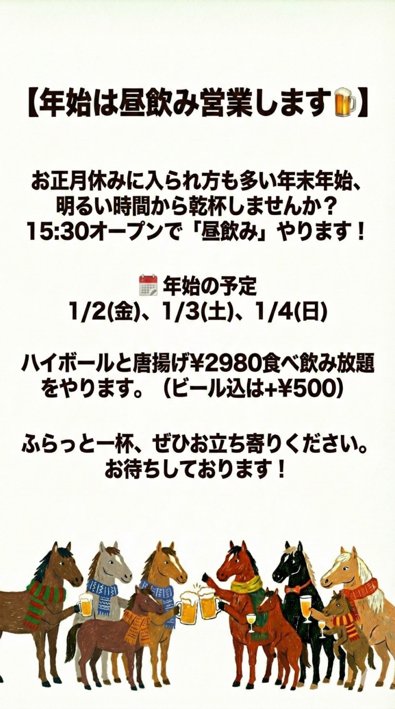

完成したInstagramストーリー用の縦長画像

## 3-5. 事例④：バーのロゴ作成 - 「意味」を「形」にする対話

バナーやスタンプといった「絵」だけでなく、AIとはもっと抽象的な「ロゴデザイン」の新調にも挑戦しました。

バナーなどに組み込んで人目でタムロと分かるようにする為のものです。

対象は、私が夜に営業している紹介制のバー「屯（タムロ）」です。この店名には「東中野という街で、多様な人々が自由に、楽しげに集まる（たむろする）場所でありたい」という強い願いが込められています。

この目に見えない「物語」を、どうやって小さなロゴマークに凝縮するか。AIとの根気強い対話が始まりました。

### Step 1：文字の選定とデザインの方向性

最初は「漢字の『屯』で渋く」という案や、「カタカナでポップに」という案をAIに投げかけ、いくつかラフ案を出させました。

しかし、どうもしっくりきません。店の性質上、もっとモダンで、多様性を受け入れるニュートラルな雰囲気が欲しい。

そこで方針を転換しました。

「ベースは汎用性の高いアルファベットの『TAMURO』でいこう。スタイルは、複雑な装飾を排した『フラットデザイン』で。色は単色でも力強く映えるように」

AIは即座に、シンプルで力強いサンセリフ体の「TAMURO」を提案してきました。

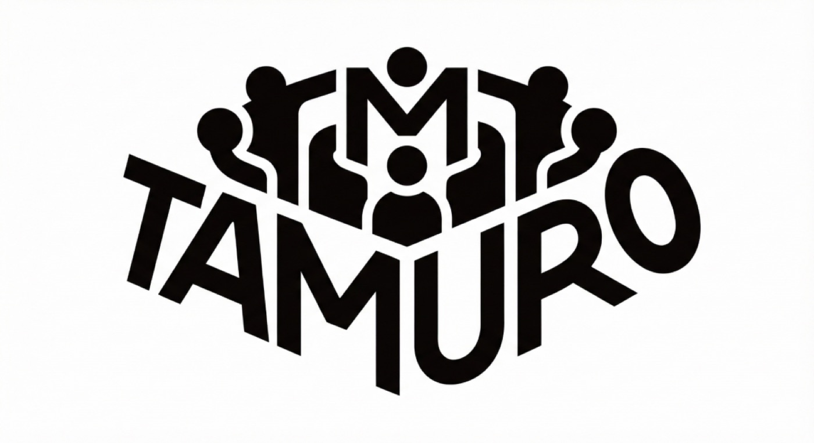

サンセリフ体のロゴ

### Step 2：形に「意味」を吹き込む

ここからが正念場です。ただの文字では意味がありません。中心に「M」だけが来ているのも意味としてよく理解できません。

「『人が集まる』という店名の由来を表現したい。全体を親しみやすい『円形（サークル状）』にまとめつつ、アルファベットの一文字一文字が楽しげに動いている人のように見える造形にできないか？」

これは非常に抽象的なオーダーです。しかし、副店長（AI）の想像力は私の期待を超えてきました。

AIが出してきたのは、アルファベットの「T」「A」「M」といった文字の骨格が、手足を伸ばして踊っている人のシルエットのように変形したデザイン案でした。

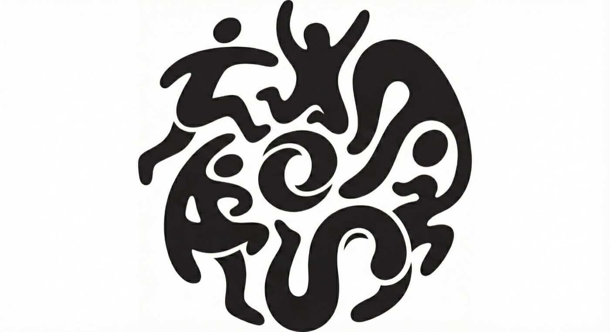

アルファベットを人に当てはめるロゴ

### Step 3：デザイン性と視認性のせめぎ合い

「面白い！ でも、これだと『TAMURO』って読めないな……」

デザインを優先しすぎると文字として認識できなくなり、文字を優先すると面白みがなくなる。このジレンマに直面しました。

ここからは微調整の繰り返しです。

「『A』の文字、人の形に見えるのはいいけど、もう少し『A』としての骨格を強調して。横棒をしっかり入れて」

「全体のバランスはいいけど、人が密集しすぎて窮屈そう。もう少し楽しげな余白を作って」

「さっきの人の踊ってるやつと、TAMUROのアルファベットを合わせて、円形にして！」

試行錯誤の末に完成した「TAMURO」の円形ロゴマーク

躍動感のある人のシルエットでありながら、一目見れば下部を見てしっかりと「TAMURO」と読める。

AIと何度もキャッチボールを繰り返すことで、視認性とデザイン性、そして何より店に込めた「想い」が融合した、納得のいくロゴが誕生しました。

現在、お店のX(旧：Twitter)とインスタのアイコンに使用しています。

## 3-6. 最初の難所：単純分割と「画質の罠」

ロゴ作成のクリエイティブな挑戦は終わりました。

しかし、ここからがまだ作業は続きます。

LINEスタンプの話に戻りますが、手元にあるのは、25個のイラストが1枚に描かれた「シート」です。

LINEスタンプとして申請するには、これらを1個ずつ切り出し、透過処理し、リサイズする必要があります。面倒くさくて保留にしていた作業です。

「手作業で切り抜くのは無理だ……」

私はGeminiに相談し、解決策を求めました。すると、Geminiは事もなげにこう言いました。

「Python（パイソン）というプログラミング言語を使って自動化しましょう」

私は正直、ここで諦めかけました。

「Python？ 名前は聞いたことあるけど、私のパソコンにそんなソフトをインストールするのは怖い。設定も難しそうだし、飲食店のオヤジにそこまで求めないでくれ……」

しかし、ここからが本書のハイライトの一つです。私の心の声を察したのか、Geminiは驚くべき提案をしてきたのです。

Gemini：

「環境構築は一切不要です。『Google Colab（グーグル・コラボ）』というGoogleの無料ツールを使ってください。ブラウザ上で動くので、私が書くコードをそこにコピペするだけで動きます」

「えっ、そんなものがあるの？」

私は耳を疑いました。自分のPCに何もインストールせず、ブラウザだけでプログラミングが動く環境があるなんて、想像もしていませんでした。

「Pythonを勉強してから」ではなく、「道具（Colab）の存在ごとAIに教えてもらう」。

この瞬間、私の中の「プログラミング＝準備が大変」という常識が崩れ去りました。

## 3-7. エラー画面は「読む」な、「撮って送れ」

言われた通りにGoogle Colabを開き、コードを貼り付け、再生ボタンを押しました。

しかし、現実はそう甘くありません。画面に表示されたのは、真っ赤な文字の羅列……エラーメッセージです。

「エラー：画像ファイルが見つかりません...」

以前の私なら、このエラーを見ただけでアレルギー反応を起こし、そっとブラウザを閉じていたでしょう。

しかし、今の私には「マルチモーダル（目を持ったAI）」という味方がいます。

私はエラーメッセージを読もうともしませんでした。

ただ、その画面のスクリーンショットを撮り、Geminiのチャット欄に「ペタッ」と貼り付けたのです。

そして一言、「なんかエラー出た」とだけ添えました。

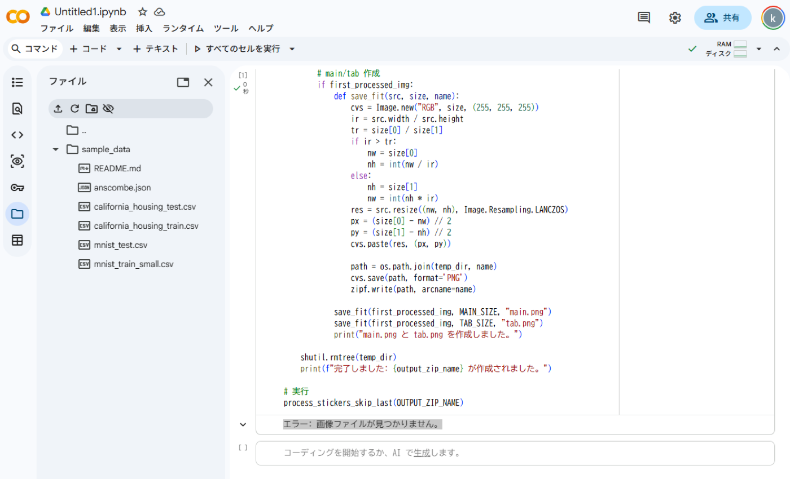

Google Colabのエラー画面をそのままGeminiに貼り付けた様子

すると、Geminiは即座に画像を解析し、回答を返してきました。

Gemini：

「ああ、これは読み込む画像のファイル名が間違っていますね。コードの方を『.jpg』に修正しました。こちらを使い直してください」

「……なにこれ、面白い！」

このやり取りは、プログラミングというより、まるで「間違い探し」や「キャッチボール」でした。

- 私：（スクショを貼る）「また止まったよ」
- Gemini：「これは画像のサイズが合っていませんね。自動調整する機能を追加します」
- 私：（スクショを貼る）「今度は画像が荒い気がする」
- Gemini：「画質を維持する『LANCZOS（ランチョス）』という処理を入れ忘れていました。修正します」

私はコードの意味など一行も理解していません。ただ、エラーが出たらスクショを撮って、AIに「見て！」と投げるだけ。

この「エラー解析の丸投げ」こそが、知識ゼロの私がシステムを作れた最大の秘訣であり、同時に最もワクワクした体験でもありました。

## 3-8. 最大の壁：「手書きのズレ」と「はみ出し」

こうして「エラーという名の会話」を繰り返すうちに、システムはどんどん洗練されていきました。

そしてついに、最大の難関「フェーズ2：手書き配置の自動切り出し」へと突入します。

私は欲を出しました。

「5×5の25個シートで作ろう。しかも、もっと手書き感を出したいから、枠線に囚われずに自由に配置したい」

単純に等分するコードでは、キャラクターの手や文字が隣のマスにはみ出し、無惨に切れてしまいます。

「背景の白い部分以外を切り抜く」方法も試しましたが、余白がバラバラになり失敗。

私は諦めかけました。その時、システム屋時代の勘で、Geminiにこう伝えました。

「画像をハサミで切るイメージは捨ててほしい。代わりに、その絵の『中心点』がどこのマスにあるかを見てくれ。中心がそのマスにあれば、多少はみ出していても、その絵全体を『そのマスの持ち物』としてバケツに入れてくれ」

これが「グリッド・バケツ法」と名付けた解決策でした。

なぜ私は「ハサミで切る」ではなく「中心点でバケツに入れる」と思いついたのか。

素人の発想（アナログ）： 「一枚の絵をハサミでチョキチョキ切る」イメージを持ちます。これだと、線の上で切ってしまい、キャラクターの手や足が切断されてしまいます。

システム屋の発想（デジタル）： コンピュータは「切る」という物理的な感覚を持ちません。代わりに「座標（位置）」を持っています。 私はこう考えました。 「多少はみ出していても、その絵の『へそ（中心点）』さえマスの中にあれば、その絵全体を『このマスの所属』と見なしてしまえばいい」

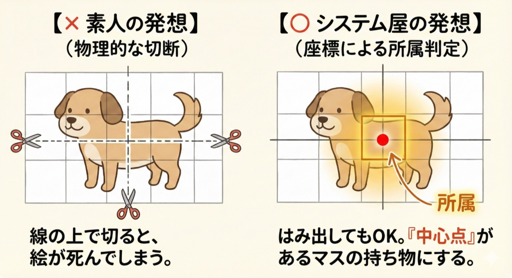

「線で切る」アナログ発想と、「点で選ぶ」デジタル発想

これが「曖昧なアナログ作業を、明確なデジタルルールに翻訳する」ということです。AIに指示を出すときは、このように「誰が見ても（計算しても）答えが一つになるルール」を考えると、うまくいきます。

Geminiはこの抽象的なオーダーを見事にコードに落とし込みました。結果は完璧でした。

隣のマスにはみ出していた「ありがとう！」の文字も、尻尾も、すべてきれいに認識され、一つのスタンプとして回収されました。

さらに、「最後の1個（25番目）は不要だからスキップして」という私のわがままにも応え、ついに「画像を放り込んでボタンを押すだけで、LINE申請用の画像一式が完成するツール」ができあがりました。

私がやったのは、「現場の悩み（絵が切れる）」を伝え、「論理的な解決策（中心点で判断させる）」を提案しただけ。難しいコードを書いたのは、すべてAIです。

これこそが、知識ゼロから始めるシステム開発、「バイブコーディング」の真髄なのです。

### 第3章のまとめ

1.  AIの描画は「一度きり」ではない。 キャラクター変更、季節感の追加、媒体の変更など、状況に合わせて何度でも作り変えられる。
2.  抽象的な「コンセプト（人が集まる）」も、対話を重ねることで「形（ロゴ）」に落とし込める。
3.  面倒な作業（画像の切り出し）こそ、Gemini×Google Colabで自動化できる。エラーはスクショで解決すればいい。

### コラム①：文系店主のための「Google Colab」超入門

～手元のPCはそのままに「レンタルの厨房」を使う～

本文で登場した「Google Colab」。プログラミング（Python）を自分のパソコンでやるのは、「自宅のキッチンで本格的なラーメンをスープから作る」ようなもので、準備が大変です。

一方、Google Colabは「調理器具が完備された無料のレンタルキッチン」です。ブラウザを開くだけで、最強の道具が揃っています。あなたのパソコンの設定を変える必要はありません。環境をクリーンに保ったまま、ブラウザひとつでプログラミングができる。まずは「Google Colab」と検索して、このレンタルキッチンを覗いてみてください。

### コラム②：エラー画面は「読まない」が正解

～最強の武器「スクショ」を使いこなせ～

エラーが出た時、英語のメッセージを真面目に解読しようとしていませんか？ それは時間の無駄です。

料理中に「味が変だ」と思った時、シェフに味見をお願いするように、AIにも「スクリーンショット（画面キャプチャ）」を見せればいいのです。

- Windows： [Win] + [Shift] + [S]
- Mac： [Cmd] + [Shift] + [4]
  これを押して、エラー部分を囲って、Geminiに貼り付けるだけ。「エラーを読む」のではなく「エラーを見せる」。この意識に変えるだけで、開発スピードは3倍になります。

ここまでいくつかの事例を紹介しましたが、やっていることはすべて、次の3点に集約されます。

・完成形を一度で求めない（対話前提でOK）
・「やっぱり違う」を遠慮なく言う
・修正コストがゼロだと思って雑に投げる

デザインの才能は不要です。 必要なのは、「気になる」を言葉にする勇気だけです

[次の章 ▶　第4章　実践編② - 日々の業務効率化（マルチモーダル活用）](https://note.com/bontallc/n/n1a1aaea50698)

## この本の、ほかの読み方

PDF（無料・再配布自由）：[https://bontallc.com/books/hitori-de-mise/pdf?via=note](https://bontallc.com/books/hitori-de-mise/pdf?via=note)

Kindle：[https://www.amazon.co.jp/dp/B0GFY4WW4Y](https://www.amazon.co.jp/dp/B0GFY4WW4Y)

Google Play：[https://play.google.com/store/books/details?id=4dUiEgAAQBAJ](https://play.google.com/store/books/details?id=4dUiEgAAQBAJ)

本のページ：

https://bontallc.com/books/hitori-de-mise?via=note

PDF は再配布自由です。周りの店主仲間や、AI に興味のある方に、そのまま送ってください。

屯の予約サイト：[https://tamuroreservation.vercel.app/?src=note1](https://tamuroreservation.vercel.app/?src=note1)

Agendaシリーズ：[https://bontallc.com/agenda?via=note1](https://bontallc.com/agenda?via=note1)

note：[https://note.com/bontallc](https://note.com/bontallc)

X：[https://x.com/tamuro_hnakano](https://x.com/tamuro_hnakano)
