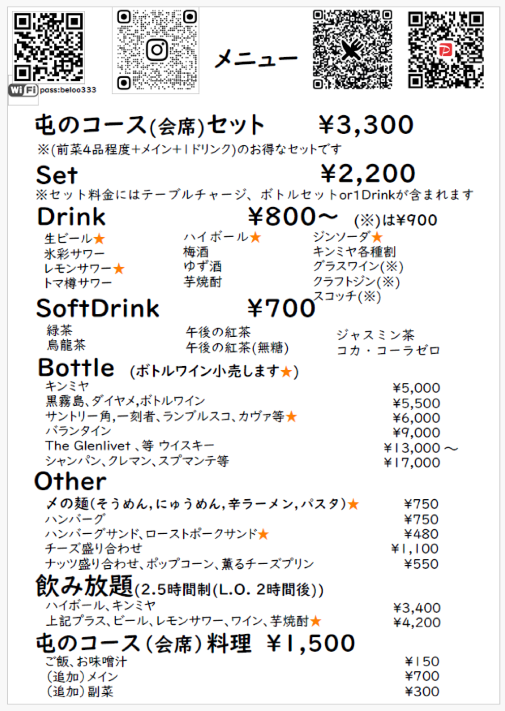
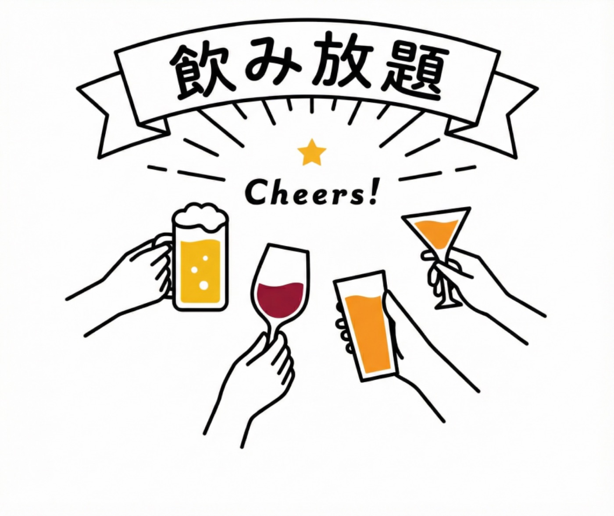
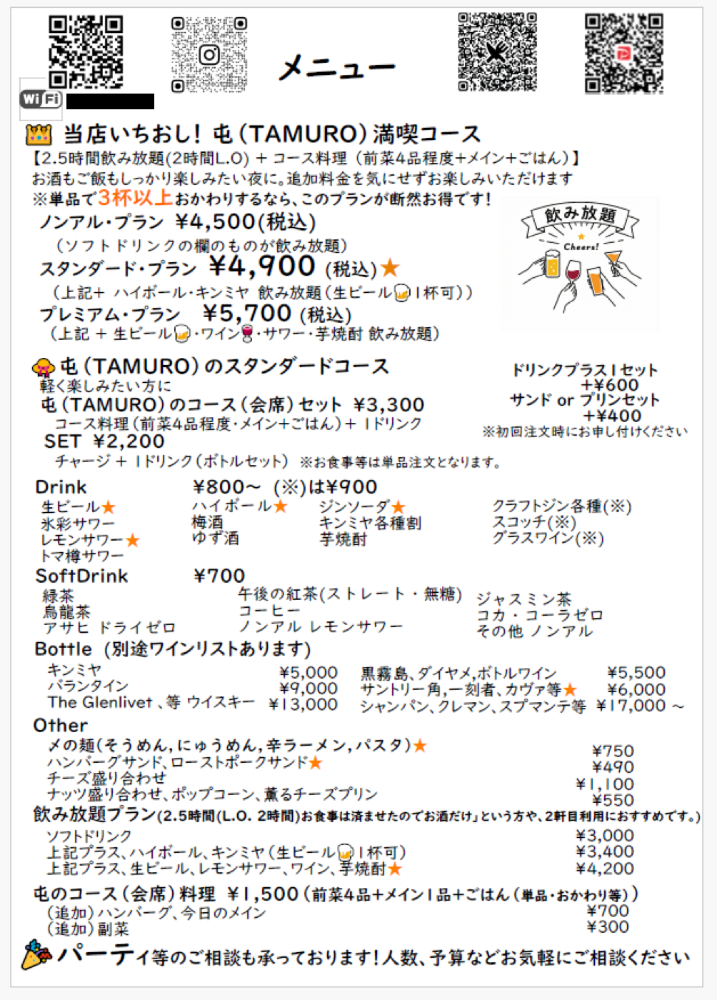
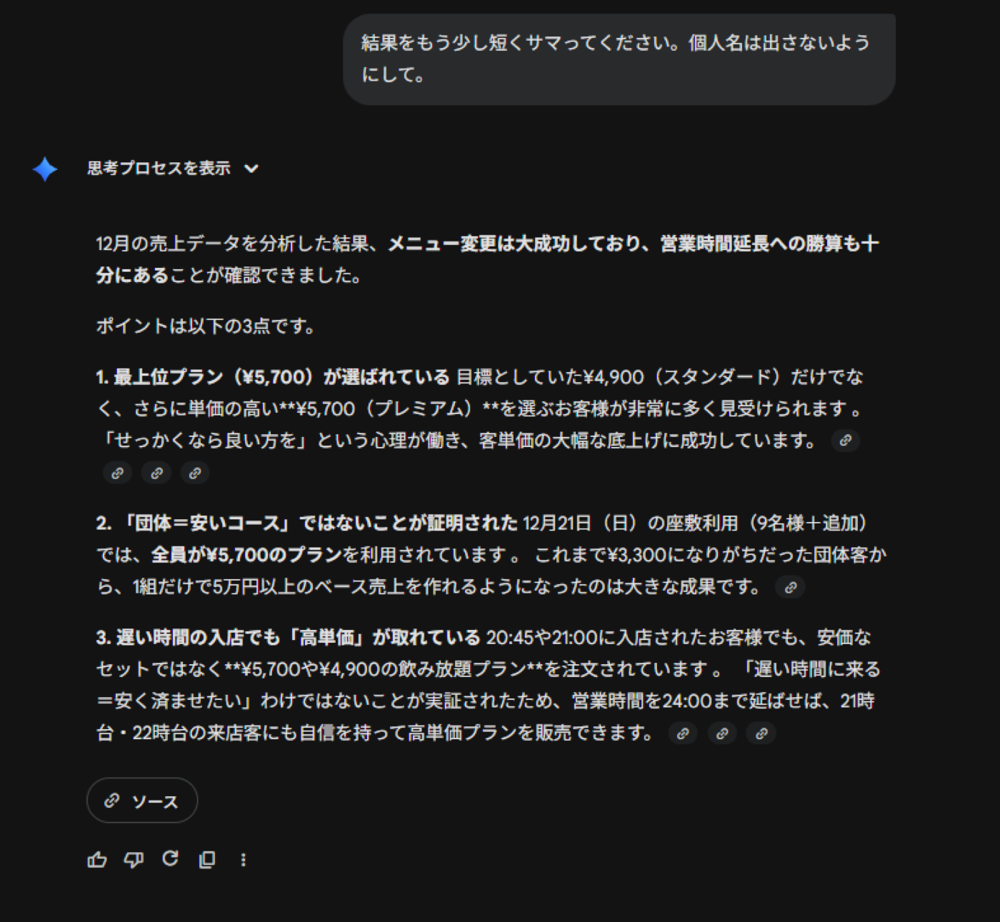

# 『一人で店を回す、その横にAIが来た。』第5章　応用編 - 経営分析と利益改善

全8回の6回目

[◀ 前の章　第4章　実践編② - 日々の業務効率化（マルチモーダル活用）](https://note.com/bontallc/n/n1a1aaea50698)

～「見えない金脈」を掘り起こせ。AIコンサルタントとの経営会議～

## 5-1. 毎月末、電卓を叩きながら頭を悩ませる夜

私たち個人飲食店の店主にとって、毎月の「締め作業」ほど気が重くなる時間はありません。

レジのデータを集計し、Excelに入力していく深夜の静けさの中で、ため息だけが響きます。

「今月の売上目標は〇〇万円。……届かなかった」

「客数は悪くない。週末は満席だった。でも、なぜか客単価が伸び悩んでいる」

なぜ目標に届かないのか。料理は美味しいはずだ。接客も頑張っている。

「もしかして、値段が高すぎるのか？」

「いや、これ以上安くしたら利益が出ない。材料費だって上がっているのに」

答えの出ない問いが頭をグルグル回り、結局は「来月はもっと気合を入れて、お勧めを徹底しよう」という精神論で終わらせてしまう。これが私の、そして多くの店主の「悪い癖」でした。

しかし、今の私には「感情のない相談相手」がいます。

私は、その月の売上データと、お店のメニュー表のデータを持って、Geminiに向き合いました。

## 5-2. 「視覚」と「数字」を同時に読ませる実験

今回、私がGeminiに与えた情報は3つです。

これまで別々に管理していた「デザイン（右脳）」と「数字（左脳）」を、ごちゃ混ぜにして投げ込みました。

1.  「今月の売上目標金額」
- 私の切実な願望です。「これだけ売りたい」という必達の数字。
2.  「直近の売上伝票の全データ（CSV/Excel）」
- 現実の結果です。「誰が」「何を」「いくらで」頼んだかという冷酷な事実。
3.  「現在のメニュー表のPDFファイル」
- お客様が見ている世界です。写真の配置、文字の大きさ、色使いなどの視覚情報。

そして、私はこう問いかけました。

これまでの「画像を作って」という作業指示ではなく、経営者としての「問い」です。

> 「今の売上データ（現実）と、メニュー表の構成（見た目）を見比べてください。
>
> 目標金額の〇〇万円を達成するために、今の私たちに何が足りないのか、ボトルネックを指摘してください」

## 5-3. AIが見抜いた「店主の思い込み」

数秒後、Geminiから返ってきた回答は、私の盲点を鋭く突くものでした。

私はてっきり、「新メニューを開発しましょう」とか「SNSで宣伝しましょう」といった一般的なアドバイスが来ると思っていました。

しかし、AIが指摘したのは、私が無意識に隠そうとしていた「ある事実」でした。

Geminiの回答：

> 「データとメニュー表を照合した結果、大きな機会損失が見つかりました。
>
> 利益率が高く、客単価を確実に引き上げられる『飲み放題』のプランが、現在のメニュー表（Before）では左下の最下部に、文字だけでひっそりと記載されています。
>
> 一方で、メニューの一等地である最上部には、単価の安い『Set ¥2,200』が配置されています。これでは、お客様は安いプランに流れてしまい、高単価な飲み放題に気づくことすらありません」

私は画面を見て、思わず「うっ」と唸りました。図星だったからです。

確かに店には「飲み放題」があります。しかし、私は心のどこかでこう思っていました。

「うちはチェーンの居酒屋じゃない。飲み放題をデカデカと売るのは安っぽい」

「ワインの味をじっくり楽しんでほしいから、知っている人だけが頼めばいい」

そんな私の「思い込み」が、メニュー表のレイアウト（最下部のテキスト表記）に表れていたのです。

Beforeのメニュー表。飲み放題の表記が左下で目立たない。料理は別というのも伝わりづらい

AIはそれを見逃しませんでした。

「店主さん、目標数字を達成したいんですよね？ だったら、一番売りたい『飲み放題付きコース』を、堂々と一番上に持ってくるべきです」

## 5-4. 画像素材がない？ なら、それもAIに描かせよう

私は腹を括りました。「カッコつけて売上が下がるくらいなら、なりふり構わずやってみよう」

しかし、ここで問題が発生しました。

「一番上に大きく載せるとしても、文字だけじゃ弱いな……」

かといって、フリー素材のサイトから「ビールで乾杯」している写真を持ってくると、途端に「チェーン店感」が出てしまいます。私の店の雰囲気には合いません。

自分で絵を描くセンスもないし、イラストレーターに頼めばお金と時間がかかります。

「どうしよう……」と悩みかけましたが、すぐに思い出しました。

「そうだ、私には絵が描ける副店長（AI）がいるじゃないか」

素材のサイトでイメージに近いものはありました。改変もOKとの記載があります。

私は続けてチャット欄にこう打ち込みました。

> 「メニューのトップに載せるための挿絵を描いて。添付の画像をベースにして。
>
> 楽しそうに乾杯しているイメージで、でも安っぽくならないように。
>
> シンプルな線画のスタイルでお願いします」

数秒後、画面に4枚のイラスト候補が表示されました。

その中から、最も店の雰囲気に合う、シンプルで温かみのある「Cheers!（乾杯）」のイラストを選びました。

AIがわずか10秒で生成した「Cheers!」のイラスト

時間はわずか10秒です。

分析だけでなく、その改善に必要な「素材」までその場で調達できる。

これが、生成AIを経営に組み込むことの真の強みです。

## 5-5. 配置を変えただけで、客単価が倍になった

こうして、私はメニュー表を刷新しました。

### Before：修正前のメニュー

- 一等地（最上部）: 「Set ¥2,200」「コースセット ¥3,300」などの安価なメニュー。
- 飲み放題: 左下の隅に、文字だけで「飲み放題 ¥3,000〜」と記載。完全に埋もれていました。

### After：修正後のメニュー

- 一等地（最上部）: 「当店いちおし！満喫コース（飲み放題付き）」として、¥4,500〜¥5,700の高単価プランを配置。
- デザイン: AIが生成した「Cheers!」のイラストを添えて、視覚的にも「まずここを見てください」と強力に誘導。
- 配置転換: これまで主役だった安いセットメニューは、その下に移動させました。

Afterのメニュー表。飲み放題コースが最上部に配置されている

料理の内容も、価格も、お酒の質も、実はほとんど変えていません。変えたのは「見せ方」と「場所」だけです。

結果はどうだったか。

翌日から、お客様の注文行動が劇的に変わりました。

メニューを開いたお客様の第一声が、「とりあえずビール」ではなく、「じゃあ、このイラストの載ってる『いちおしコース（¥4,900）』で」になったのです。

これまでは「セット（¥2,200）＋ドリンク2杯」で終わっていたお客様（客単価約3,500円）が、最初から「¥4,900」のコースを選んでくれる。

これだけで、客単価は一気に1,400円もアップしました。

しかも、お客様にとっても「会計を気にせず飲める」というメリットがあり、満足度が下がるどころか上がったのです。

## 5-6. 12月の売上PDFで「答え合わせ」をする（PDCA）

施策を実行して1ヶ月が経ちました。

ここで終わらせないのが、AI活用の真骨頂です。

多くの店主は、「なんとなく忙しかったから成功だろう」「売上が増えたからよかった」と、結果を感覚で捉えて終わりにしてしまいます。

しかし、私は再びGeminiに向き合いました。

今度は、結果が出た「12月の売上データのPDF」をアップロードし、こう問いかけました。

> 「先月の施策（メニュー変更）の結果が出ました。
>
> この12月の売上データを見て、狙い通りに『いちおしコース』の注文数が増えているか、客単価にどう影響したか、答え合わせ（評価）をしてください」

Geminiは瞬時にデータを分析し、私にレポートを返してくれました。

Geminiによる売上分析レポートの画面：掲載用にサマリーを作っていますので内容が下記と一部異なります

Geminiの分析：

> 「素晴らしい結果です。データの推移を確認すると、前月と比較して『満喫コース』の出数が約1.8倍に増加しています。
>
> これにより、全体の客単価は平均で〇〇円アップしました。
>
> 飲み放題プランが上位に配置されたことで、特にグループ客の注文単価が底上げされたことが要因です」

この言葉を聞いて、初めて私は本当の意味で安心できました。

「なんとなく儲かった」ではなく、「狙って数字を作れた」という自信。

これが次の施策への原動力になります。

1.  Plan（計画）： 売上データとメニューを見て、課題（飲み放題が隠れている）を見つける。
2.  Do（実行）： イラストを描かせ、メニューの配置を変える。
3.  Check（評価）： 12月の売上PDFを読ませて、結果を検証する。
4.  Act（改善）： 次はフードメニューの配置も見直そうか、と考える。

大企業が莫大なコストをかけてやる「PDCAサイクル」を、私のような個人店主でも、AIという相棒がいれば、スマホひとつで回すことができるのです。

[次の章 ▶　第6章　挑戦編 - 自分の店専用のシステム開発](https://note.com/bontallc/n/n14b99767d3a2)

## この本の、ほかの読み方

PDF（全文・無料・再配布自由）：【ストアURL】

Kindle：[https://www.amazon.co.jp/dp/B0GFY4WW4Y](https://www.amazon.co.jp/dp/B0GFY4WW4Y)

Google Playブックス：【ストアURL】

屯の予約サイト：[https://tamuroreservation.vercel.app/?src=note1](https://tamuroreservation.vercel.app/?src=note1)

Agendaシリーズ：[https://bontallc.com/agenda?via=note1](https://bontallc.com/agenda?via=note1)
