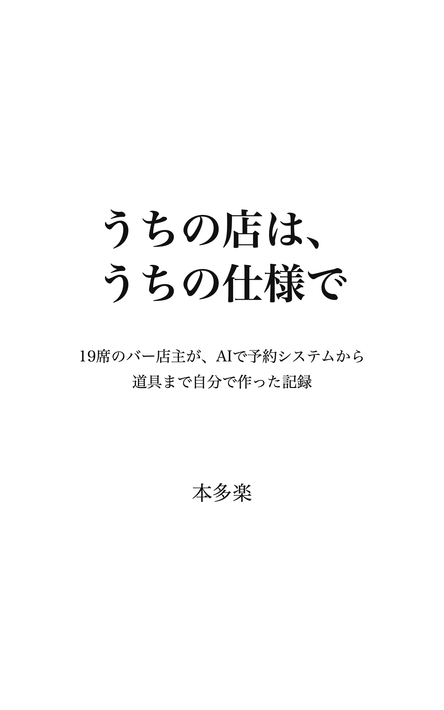

# 『うちの店は、うちの仕様で』はじめに

この本は PDF・Google Play でも無料で読めます（PDF は再配布自由）→ [https://bontallc.com/books/uchi-no-mise/pdf?via=note](https://bontallc.com/books/uchi-no-mise/pdf?via=note)

全7回の1回目

この本は、東京・東中野で19席のバーを営む店主が、AIを使って店をどう回しているかを、そのまま書いた記録です。

店の名前は「屯（たむろ）」といいます。人が集まる、という意味です。2018年11月に開いた、カウンター11席と座敷8席の小さな店です。昼は同じ場所で、スタッフが「キャトルエピス」というハンバーグカレーの店を営業しています。

前作『一人で店を回す、その横にAIが来た。』では、生成AIそのものについて書きました。それから一年あまりで、AIは「質問に答える道具」から「仕事を代わりに進める道具」へと姿を変えました。指示を出せば、プログラムを書き、試し、間違いを直し、最後まで仕上げる。そういうAIを、エージェント型のAI（エージェンティックAI）と呼びます。

わたしはこのエージェント型のAIを使って、屯の予約システムを自分で作りました。値上げに合わせて値引きの仕組みを作り、常連を育てる仕組みを作り、お客さんの質問に答えるAIを作り、最後には、お客さんが自分のAIから屯に問い合わせ、予約に進めるところまで来ました。

さらに、自分の店のために作った便利な道具を、他の店でも使える形に整え、月数百円で配り始めました。それが「Agendaシリーズ」です。

この本は、その過程で何を作り、何に失敗し、何を学び直したかを書いています。うまくいった話だけではありません。動くものをノリで作り続けた結果、矛盾が積み重なったこと。お客さんの個人情報が外から読める状態になっていたのを、あとから見つけたこと。AIが、店が言っていない事実を書いてしまったこと。そうした失敗も、そのまま載せました。

## この本の読み方

この本は5つの章でできています。

| 章 | 内容 | 向いている読者 |
| --- | --- | --- |
| 第1章 | AIから予約される店（予約システムの経営編） | すべての方 |
| 第2章 | 予約システムの裏側（技術編） | 作り手、技術に興味のある方 |
| 第3章 | 自分の店の道具を、他の店に配る（Agendaシリーズの事業編） | すべての方 |
| 第4章 | 一人で製品を作り続ける仕組み（技術編） | 作り手、技術に興味のある方 |
| 第5章 | 小さな店の、これから | すべての方 |

第2章と第4章は、専門用語が多めの技術編です。それぞれの章の冒頭に要点を3行でまとめてあるので、技術に興味がなければ、要点だけ読んで次の章へ進んでください。第1章、第3章、第5章と読めば、話は一本につながります。

専門用語には、なるべくその場で言い換えを添えました。プログラムを書いたことがない方にも、AIで店を回すとはどういうことか、その手触りが伝わればうれしいです。

## 筆者について

筆者は、システムエンジニアとして約16年働き、その後に飲食の道に入りました。ですから「プログラムを一度も書いたことがない人が、AIだけで全部作った」という話ではありません。その点は、正直に書いておきます。

それでも、かつてはチームと資金が必要だった規模のものを、店に立ちながら、一人で作り、一人で運用できるようになった。これは、ほんの数年前には考えられなかったことです。その変化の現場を、できるだけ具体的に伝えたいと思います。

## この本の作り方について

この本も、AIを使って作りました。わたしが日々の開発で残してきた記録をもとに、AIが下書きを書き、わたしが読み、直し、決めました。挿絵の画面写真も、AIに撮らせています。

わたしも一通り目を通していますが、AIが書いた文章には、事実と違うところが紛れ込むことがあります。本文の中でも書いたとおり、AIは「できた」と言い、それを確かめるのは人間の仕事です。この本にも、わたしが見落とした間違いが残っている可能性があります。

また、AIの道具やサービスの仕様は、数か月で変わります。この本に書いた手順や料金、各社の対応状況は、2026年10月時点のものです。実際に試すときは、その時点の公式の情報を確かめてください。

間違いに気づかれた方は、noteやXで教えていただけるとうれしいです。分かった分から直していきます。

## この本の、3つの出口

この本は、PDFとnoteとGoogle Playで無料で読めます（Kindleだけは、ストアの決まりで最低価格を付けています）。代わりに、読み終えたあとに行ける場所を3つ用意しました。どれか一つでも使ってもらえたら、この本を書いた甲斐があります。

1. 屯に行ってみる。東中野駅東口から1分。予約なしでも入れます。予約サイト https://tamuroreservation.vercel.app/?src=note
2. 自分の店で試してみる。Agendaシリーズは無料の手帳から始められます。https://bontallc.com/agenda?via=note
3. 活動を追いかける。次に作る道具や、店の日々は、noteとXで書いています。note https://note.com/bontallc／X https://x.com/tamuro_hnakano

[次の章 ▶　第1章　AIから予約される店](https://note.com/bontallc/n/n30c4694b95cf)

## この本の、ほかの読み方

この本は note・PDF・Google Play で無料で読めます。Kindle 版のみ 99円です。

PDF（無料・再配布自由）：[https://bontallc.com/books/uchi-no-mise/pdf?via=note](https://bontallc.com/books/uchi-no-mise/pdf?via=note)

Google Play（無料）：[https://play.google.com/store/books/details?id=WdUiEgAAQBAJ](https://play.google.com/store/books/details?id=WdUiEgAAQBAJ)

Kindle（99円）：[https://www.amazon.co.jp/dp/B0HPJY4NRR](https://www.amazon.co.jp/dp/B0HPJY4NRR)

本のページ：

https://bontallc.com/books/uchi-no-mise?via=note

PDF は再配布自由です。周りの店主仲間や、AI に興味のある方に、そのまま送ってください。

屯の予約サイト：[https://tamuroreservation.vercel.app/?src=note](https://tamuroreservation.vercel.app/?src=note)

Agendaシリーズ：[https://bontallc.com/agenda?via=note](https://bontallc.com/agenda?via=note)

note：[https://note.com/bontallc](https://note.com/bontallc)

X：[https://x.com/tamuro_hnakano](https://x.com/tamuro_hnakano)
