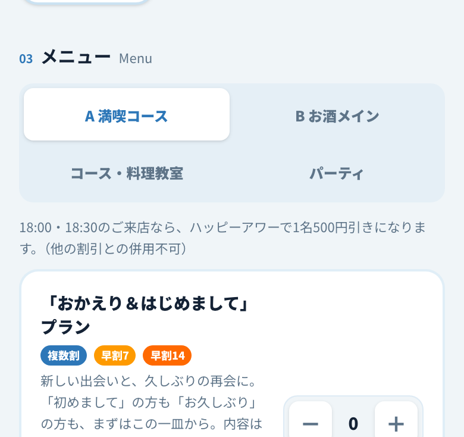
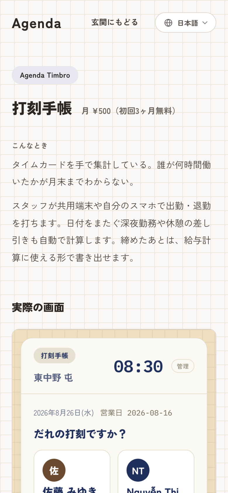

# 2冊目『うちの店は、うちの仕様で』を、1日で書いて、無料で配るまで

2冊目の本を書きました。題名は『うちの店は、うちの仕様で』です。19席のバーの店主が、AIで予約システムから道具まで自分で作った記録で、無料で配ります。この記事では、本の中身ではなく、本ができるまでの経緯を書きます。

## 構想から初稿まで、1日

最初のメモは、1行でした。AIを使って飲食店を経営している実態。屯の予約サイトに、自分のAIから問い合わせや予約ができる仕組み（MCPサーバー）を付けた話と、値上げと一緒に作った値引き、常連を育てる仕組みを並べたところから始めました。

材料は、Notionに貯めていた開発の記録です。会話の窓の試験と改善の記録など、本の素材として残していた3本と、日々の作業ログを渡して、Claudeに初稿を書いてもらいました。構想から初稿まで、1日です。初稿は約4万字になりました。店主しか知らない数字は空欄にしておき、あとから自分で埋めました。

章立ては、書きながら変わりました。予約システムだけの1章構成が、問い合わせAI、シリーズ展開、基盤づくりと広がり、最終的に5章になりました。専門用語が多い部分は「技術編」として切り出し、興味がなければ飛ばして読めるようにしています。

## 題名で迷った

仮題は「AIから予約される店」でした。いまいちでした。「小さな店ほど、尖れる」は、尖ることが目的ではないので違う。「小さな店ほど、AIが効く」は、AIという言葉がもう陳腐に思えました。

本当に言いたいのは、これまで大企業のシステムにお金を払って実現していたことを、自分で作って、自分の仕様にできるようになった、ということでした。そこから「うちの店は、うちの仕様で」に決まりました。AIという言葉は、副題にだけ入れました。

## 別のAIに、辛口で読んでもらった

書いた原稿は、GeminiとChatGPTにも読ませて、講評をもらいました。良いと言われたのは、失敗を隠さず書いたことです。いくつかは直しました。

- 第2章と第4章で同じ教訓が重なっていたので、片方を2行にまとめた
- 「作ったこと」と「効いたこと」を、別の節に分けた
- 個人情報の件は、「取得できる状態だった」ことと「実際に取得された」ことを区別して書いた

自分で気づいて直したところもあります。メニューと値段の羅列が冗長だったので、「プランが増えすぎて選べないから、相談できる仕組みを作った」という話に書き換えました。

## 無料の本を、集客の装置として作り直した

この本は無料で配ります。目的は、屯に来てもらうことと、Agendaシリーズを使ってもらうことです。ところが読み返すと、読者を次の行動へ渡す場所が、おわりにの1か所しかありませんでした。

そこで、はじめにの直後に「3つの出口」を置きました。屯に行く、自分の店で試す、活動を追いかける、の3つです。リンクには計測用の印を付けて、本から何人来たかを数えられるようにしました。本の中で「改善と測定は最初から一緒に決める」と書いている以上、本そのものでも実践しておきたかったからです。

## 挿絵も、AIに撮らせた

本の挿絵は30点あります。画像を生成したのではなく、実際の画面を撮りました。Claude Codeにブラウザを動かさせて、予約システム、玄関のページ、打刻手帳、灯り手帳の画面を撮らせています。

最初は、窓ごとに指示書を出す案でした。それを、進行役のAI（Regia）に4つの作業窓を順に回してもらう形に変えて、1つの指示で済ませました。本番への書き込みは0件で、試験環境に作った合成データは、撮影後に消しています。

## 配り方は、まだ決めきれていない

KindleとGoogle Playブックスで、無料で配りたいと考えています。ただ、Kindleは通常、価格を0円にできません。無料キャンペーンは、電子版をAmazonだけで売るKDPセレクトが条件で、Google Playやほかの無料配布とは両立しません。どの形で出すかは、これから決めます。

翻訳して各国のストアへ出す案も、いったん保留にしました。まず日本語版を仕上げます。

## 失敗を、隠さず書く

この本には、うまくいかなかったことを、そのまま載せました。お客さんの個人情報が外から読める状態だったこと。自動テストが0件だったこと。試験が本番を止めたこと。小さな店が自分で作るなら、こうした失敗のほうが、成功談より役に立つと考えたからです。

本の配信が始まったら、あらためてお知らせします。

本多楽
