# 『うちの店は、うちの仕様で』第1章　AIから予約される店

この本は PDF でも無料で読めます（再配布自由）→ [https://bontallc.com/books/uchi-no-mise/pdf?via=note](https://bontallc.com/books/uchi-no-mise/pdf?via=note)

全7回の2回目

[◀ 前の章　はじめに](https://note.com/bontallc/n/na0569fd28f62)

## 1-1　「今夜、空いてる店ある？」と、AIに聞く時代

金曜の夕方、仕事を終えた人が、スマートフォンに話しかけます。

「東中野で、今夜ひとりで飲める店ある？　あんまり騒がしくないところ」

相手は友人ではありません。その人がふだん使っているAIです。AIは候補の店を挙げ、それぞれの雰囲気を説明し、今夜の空き時間と料金を答えます。気に入った店があれば、そのまま予約の画面へ進めます。

これは未来の話ではありません。

2026年8月10日、OpenAIはChatGPTに飲食店の予約機能を加えました。公式のリリースノートによれば、OpenTable、Resy、Yelpという予約サービスと連携し、ChatGPTの回答の中に空いている予約時間が直接表示されます。候補を絞り込むための質問もでき、都合のよい時間を選べば、そのまま予約に進めます。対象は、OpenTableが世界全体、Resyが米国、Yelpが米国とカナダです。

つまり、お店を探す入口が、検索エンジンやグルメサイトから「自分のAI」に移り始めているのです。

ただし、ここには条件があります。ChatGPTから予約できるのは、大手の予約サービスに登録している店だけです。そこに載っていない小さな店は、AIの目に入りません。

では、大手の予約サービスを使っていない、東中野の19席のバーはどうすればよいのか。

屯は、別の道を選びました。大手のサービスを通さず、自分の店の予約システムを、直接AIにつないだのです。

お客さんが自分のChatGPTやClaudeに「屯は今夜空いてる？」と聞くと、AIは屯の予約システムに直接問い合わせ、空き時間と料金を調べて答えます。条件が決まれば、人数や日時がすでに入った屯の予約ページへ案内します。最後に確定のボタンを押すのは、お客さん自身です。

この「AIと店のシステムをつなぐ接続口」を、MCPサーバーと呼びます。MCPはModel Context Protocolの略で、AIが外の道具やデータを使うための共通の約束ごとです。詳しい仕組みは第2章で説明します。

大手の予約サービスも、実は最後は自社の画面へお客さんを渡しています。クレジットカードが必要な予約はOpenTableの画面で手続きを終えますし、予約後の変更やキャンセルは各サービス側で行います。入口はAI、確定は予約サービスの画面。屯がやっていることも、構造としては同じです。違うのは、間に大手が入っていないことだけです。

そして、この仕組みを作ったのは、外部の開発会社ではありません。店主であるわたし自身です。AIに指示を出し、AIにプログラムを書かせ、AIに試験をさせて作りました。

もちろん、最初からここにたどり着いたわけではありません。始まりは、ごく単純な予約受付でした。そこから値上げがあり、値引きの工夫があり、常連を育てる仕組みがあり、失敗と作り直しがありました。

屯がどんな店かを、先に5行で書いておきます。東中野駅の東口から歩いて1分、カウンター11席と座敷8席の19席。ひとりで来るお客さんが約半分で、隣の人と話が始まりやすいカウンターです。料理は前菜4品とメイン1品を組み合わせる形で、一番人気はにんにくを効かせた甘めのトンテキ。ワインはスペインとイタリアが中心で、国産のクラフトジンも20種ほど。予約なしでも入れます。

先に、目指したことを一つだけ書いておきます。予約を受け付けるだけではなく、店を知ってもらい、来店してもらい、また来てもらう。その一連の流れを、小さな店でも自分の手で作れるようにしたかった。この章に出てくる値引きも、メールも、会話の窓も、すべてはこの一つの目的のための部品です。

この章では、屯の予約システムがどう育ってきたかを、時間を巻き戻してたどります。

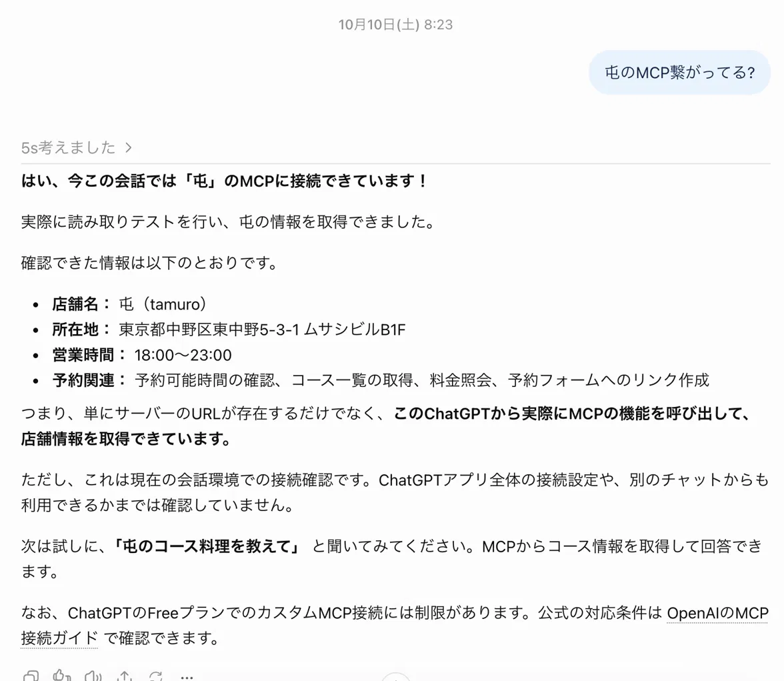

図1-1　ChatGPTから屯のMCPサーバーにつないだ画面（2026年10月10日）。店の情報を読み取り、空き時間・コース・料金・予約ページへの案内ができると答えている

## 1-2　出発点：ただの予約受付

[屯の予約サイト](https://tamuroreservation.vercel.app/?src=note)は、最初はとても単純なものでした。日時と人数を選び、名前と連絡先を入れて、送信する。店に通知が届く。それだけです。

最初の土台は、Googleが提供しているAI開発ツール（Antigravity）で作りました。思いついた機能をAIに伝え、動くものができたら次へ進む。いわゆるバイブコーディング（思いつきをAIに伝えて、ノリで作らせるやり方）です。

当時のわたしにとって、これは驚きの連続でした。画面の配置を言葉で伝えれば、数分で形になる。カレンダーが欲しいと言えば、カレンダーが出る。店を回しながら、合間の時間で予約サイトが一つできあがりました。

屯は、予約がなくても入れる店です。実際、予約の大半は当日の予約で、飛び込みのお客さんも多い。それでも予約の仕組みを持ったのは、来店の前にお客さんとつながる手段が欲しかったからです。予約をすれば、名前と連絡先が残ります。連絡先が残れば、次の来店を誘うことができます。

予約システムは、ただの受付ではなく、お客さんとの関係の入口になる。この考えが、のちの値引きの仕組みや常連を育てる仕組みにつながっていきます。

ただし、ノリで作った土台には、あとで大きな代償を払うことになりました。その話は第2章で書きます。

## 1-3　値上げと値引きを、同時に作る

飲食店にとって、値上げは避けて通れない決断です。食材の値段も、光熱費も、人件費も上がり続けています。屯も値上げをしました。各コースを、400円から500円ほど上げました。

値上げ幅が大きかったので、そのまま出せば、常連さんの足が遠のくのは目に見えていました。そこで、値上げと同時に、値引きの仕組みを予約システムに組み込むことにしました。ただ安くするのではなく、店にとって嬉しい行動をしてくれたお客さんに、値引きで応える仕組みです。

一つ目は、複数人割です。人数が増えるほど、一人あたりの料金が下がります。屯はひとり客が約半分を占める店ですが、複数人で来てくれれば、店の売上は大きく伸びます。値引きの分を差し引いても、店にとっては得になる。お客さんにとっても、友人を誘う理由になります。実際、予約サイトの人数割引を使って、複数人で来るお客さんは増えてきました。

二つ目は、早割です。1週間前までに予約すれば2％、2週間前までなら4％引きになります。屯の予約は当日が大半なので、先の予定が読めません。早割は、先の売上を確定させるための仕組みです。雨の日も、寒い日も、すでに予約が入っていれば、店は安心して仕込みができます。

三つ目に、共同購入という仕組みも作りました。決まった日時に、決まった人数が集まれば、定食のコースを割引価格で出す。見知らぬ人同士が同じ時間に集まる、屯らしい仕組みになるはずでした。

ところが、共同購入はまったく使われませんでした。実績ゼロです。わたしは2026年8月にこのプランを止め、以後は使わないと決めました。

作ったものを捨てるのは、もったいない気がするものです。けれど、AIで作れば、作る費用も時間も小さくて済みます。小さく作り、試し、効かなければ捨てる。この速さこそが、AIで店を回すことの一番の利点だと、わたしは考えています。

値付けには、もう一つ工夫があります。プランの中に、あえて高いプレミアムプランを置いています。プレミアムプランは、ほとんど選ばれなくても構いません。高いプランが隣にあることで、スタンダードが手頃に見える。いわゆるアンカー（比べる基準）としての役割です。

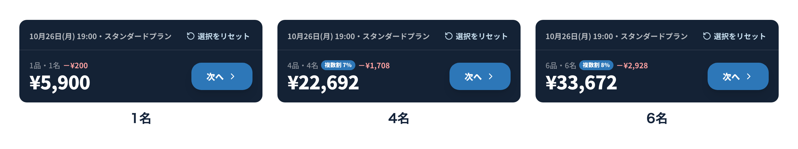

図1-7　人数が増えるほど、一人あたりの料金が下がる（1名・4名・6名の比較）

## 1-4　常連を育てる仕組み

予約システムに名前と連絡先が残るようになると、次にやりたくなるのは、お客さんとの関係を育てることです。顧客の情報を管理し、関係を深めていく仕組みを、CRM（顧客関係管理）と呼びます。屯の予約システムには、少しずつCRMの機能を足していきました。

会員登録をすると、マイページから予約の履歴が見られるようになります。誕生日を登録すれば、誕生日の特典が届きます。しばらく来店のない会員には、休眠のお客さんへの呼びかけが届きます。スタンプカードもあります。3回の来店で1ドリンク、5回でステーキなどの特典がつき、5回に届いたらまた最初から数え直す仕組みです。友人を紹介する機能もあります。

2回目の来店を誘う仕組みは、とくに丁寧に設計しました。飲食店では、初めて来たお客さんが2回目に来てくれるかどうかが、常連になるかどうかの分かれ道だと言われます。屯では、初回の来店から7日後と21日後の2回、案内のメールを送ります。1回目にはクーポンを付けず、2回目にだけクーポンを付けます。最初から値引きで釣るのではなく、まず思い出してもらう。それでも来なければ、背中を押す。

メールが重なりすぎないようにも気を配りました。お客さんへの案内は1日1通まで。重なったときは、誕生日、2回目の誘い、休眠への呼びかけ、その他の案内の順に優先します。すでに次の予約が入っている会員には、来店を誘うメールは送りません。

メールを受け取るかどうかの同意は、最初はオフにしてあります。オンにしておけば配信先は増えますが、知らないうちに同意したことになる設計は、消費者を守る法律の上で問題になりえます。数を取るより、信頼を取る。そう判断しました。

メールには、もう一つ小さな仕掛けがあります。予約の確定メールの中に、「本日の話題」が一つ入るのです。季節のこと、ワインのこと、料理のこと。短い話題を、AIがその日ごとに自動で作ります。

狙いは、来店の前に会話の種を一つ渡しておくことです。屯は、お客さん同士の会話が多い店です。メールで読んだ話題が、カウンターで隣の人と話す最初の一言になる。そのために、確定メールは「予約を受け付けました」で終わらせず、店の空気を少しだけ先に届けるようにしました。

話題を作るAIは、一度入れ替えています。より自然で、店の口調に近い話題が出るものに替えました。ただし、これは集客を増やす仕組みではありません。来てくれる人の体験を少し良くする仕組みです。その区別は、この章の後半で改めて書きます。

こうした仕組みの中で、少しずつ効果が見えてきたのが「はじめまして」と「おかえり」のプランです。初めて来るお客さんと、1年以上来ていないお客さんだけが選べる、入りやすい価格のプランです。新しいお客さんと、離れかけたお客さんの両方に、来る理由を用意しました。

一方で、課題もありました。会員登録をせず、ゲストのまま予約するお客さんが多いのです。予約のたびに会員登録を求めれば、予約そのものをやめてしまうかもしれません。そこで、予約を終えたあとに「この予約を会員に紐付けますか」と案内し、あとから会員になれる仕組みを作りました。予約のハードルは上げずに、関係だけを後から結ぶ方法です。

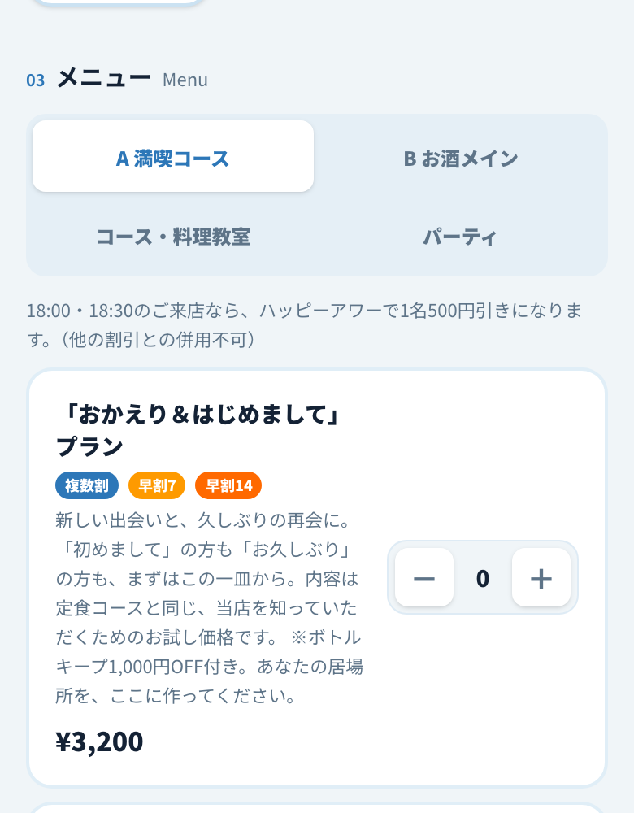

図1-8　初めての人と、1年以上来ていない人だけが選べるプラン

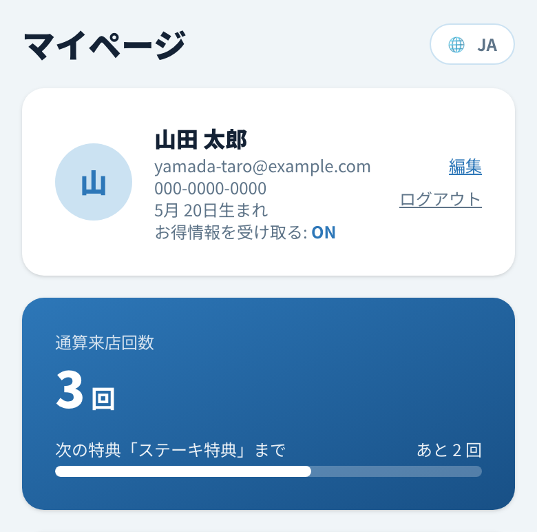

図1-9　マイページの来店回数（通算3回・次の特典まであと2回）（合成データ）

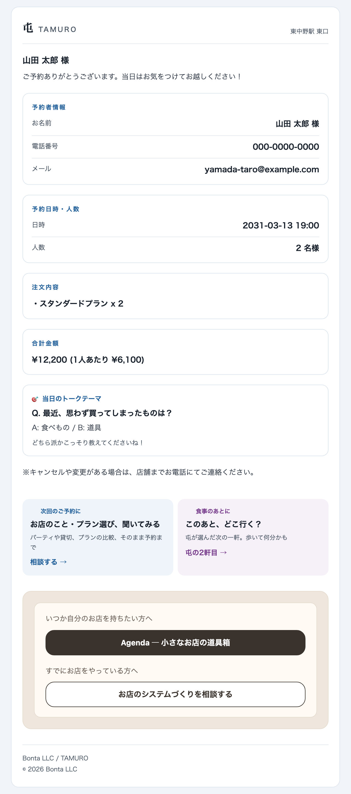

図1-5　予約確定メール。「本日の話題」が一つ入る（合成データ）

## 1-5　数字で見る：予約の約88％が当日

仕組みを足していくうちに、気づいたことがあります。どの仕組みが効いているのか、わたしには分からなかったのです。

そこで、予約のデータを数えてみました。直近90日の予約244件のうち、215件が当日の予約でした。割合にして88.1％。1日あたりの予約は2.71件です。

屯は、予約して来る店ではなく、思い立って来る店だった。数字にしてみて、初めてはっきりしました。

この数字から、二つのことが見えてきました。

一つは、予約フォームの作り方です。当日予約が大半なら、予約画面を開いたときに、今日の直近の空き枠が最初から選ばれているほうが便利です。ただしその一方で、先の日付を予約したいのに、うっかり今日のまま送ってしまう人も出てきます。そこで、カレンダーで今日を目立たせ、確認画面では日時を大きく「本日」と表示するようにしました。当日を選ぶ便利さは残し、間違いには気づける形にしたのです。

もう一つは、早割の意味です。当日予約が多いということは、先の売上が読めないということです。天気が悪ければ、それだけで客足が落ちます。先の予約を少しでも増やすには、早割をもっと使ってもらう必要がある。この問題意識は、のちに店主の代わりに発信するAIを作る話につながっていきます。

数字を見るためには、数える仕組みが要ります。予約サイトには、そもそもアクセスの解析が入っていませんでした。何人が予約ページに来て、何人が途中でやめ、何人が予約を終えたのか、分からなかったのです。そこで、ページに来た、内容を決めた、予約を終えた、の3段階を数える仕組みを入れました。誰が来たかは記録せず、段階と時刻だけを残します。

さらにのちには、毎週、予約の数字をまとめたレポートがメールで届く仕組みも作りました。その経緯は1-7で書きます。

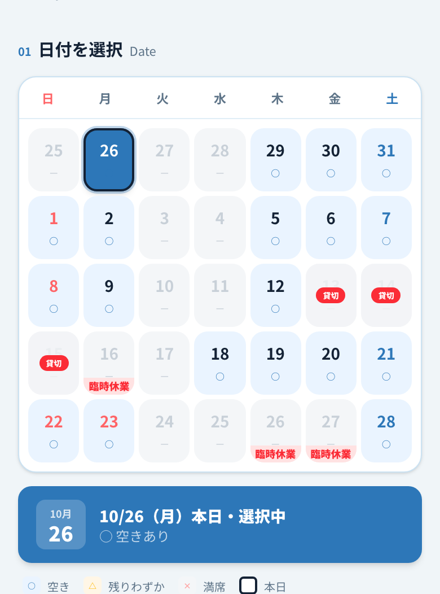

図1-3a　カレンダーで今日が目立つ

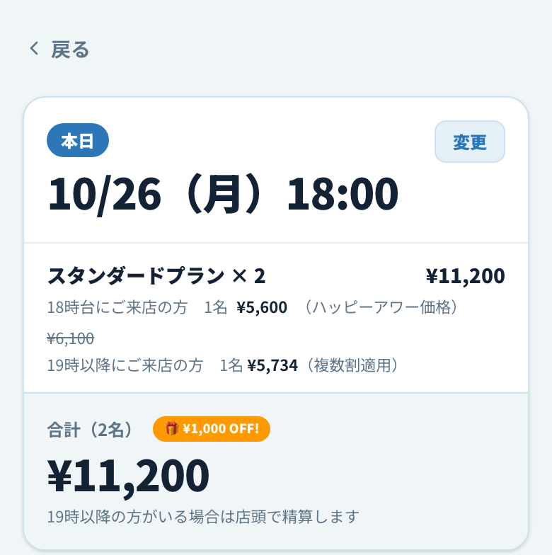

図1-3b　確認画面では、日時が「本日」と大きく出る

## 1-6　プランが増えすぎて、選べない

値引きの仕組みができると、次は売れる時間と売れるプランを増やしたくなります。

18時台が埋まらないので、19時までのハッピーアワーを作りました。食事を済ませてから来る人のために、食事なしで飲むだけのプランを作りました。月に一度だったコース料理と料理教室は、申し込みがあれば開くオンデマンドの形にして、予約サイトから受けるようにしました。土日の開店前、15時30分からの時間を売るために、6名からのパーティプランを作りました。

一つひとつには、理由があります。たとえばパーティプランは、値段で「お得」に見せると、スタンダードを選んでいたお客さんが流れてくるだけで売上が減ります。だから差別化は値段ではなく、今まで売上がゼロだった開店前の時間に置きました。ハッピーアワーの値引きは、他の割引と重ねると利益が出ないので、併用しないと決めました。

こうして、プランは増えました。スタンダード、プレミアム、はじめまして、おかえり、ハッピーアワー、飲むだけ、コース料理、料理教室、パーティ。それぞれに人数の条件があり、割引が効くものと効かないものがあり、時間帯の縛りがあります。

ある日、予約フォームを開いて、わたしは気づきました。これでは、お客さんが選べない。

作り手のわたしには、全部の違いが分かります。けれど、初めて予約サイトを開いた人が、9つのプランと割引の条件を読み比べて、自分に合うものを選べるでしょうか。選べなければ、予約の途中でやめてしまいます。せっかく増やしたプランが、予約を減らす原因になりかねません。

整理する手もありました。けれど、どのプランにも、売りたい時間と、来てほしいお客さんがいます。減らしたくはない。

そこで考えたのが、お客さんがAIに相談して、プランを決められる仕組みです。人数と、来たい日時と、楽しみ方を伝えれば、AIが合うプランと料金を出し、そのまま予約に進める。プランの複雑さは、店の側で引き受ける。お客さんには、会話だけを残す。

この仕組みが、1-8で書く「T-AI-MURO」です。その前に、もう一つ、この時期に気づいたことがあります。

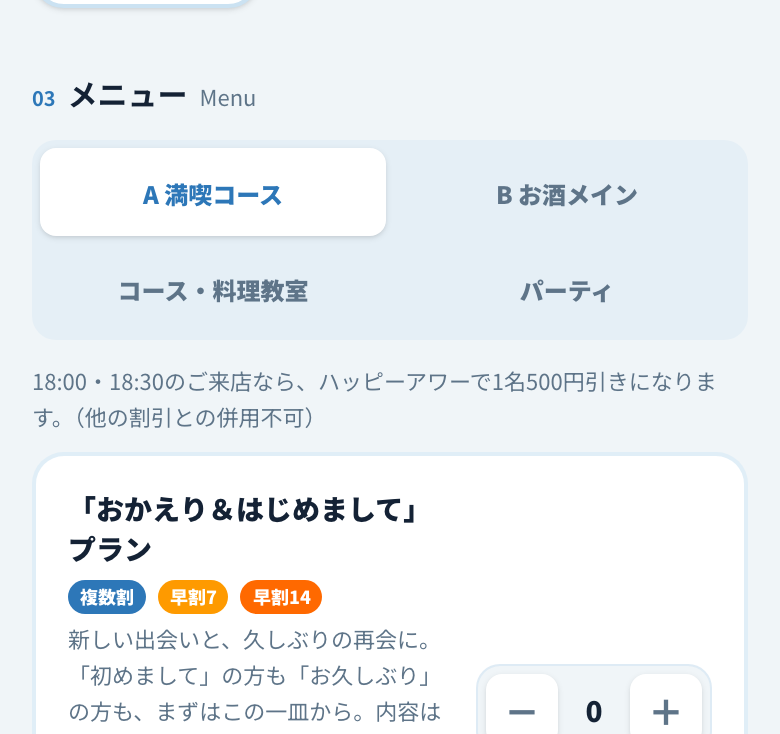

図1-2　予約フォームのプラン選択。タブがこれだけ並ぶ

## 1-7　「これは、集客につながるのか？」

パーティプランを足した日、わたしは一日中、予約サイトの改善を重ねていました。ヘッダーを詰め、メールのデザインを揃え、来店中の会話のネタを作るAIを入れ替えました。

夕方になって、ふと疑問が湧きました。

「これは、集客を増やすのにつながるのか？」

AIにそう聞くと、その日の改善を正直に分けてくれました。

| 分類 | その日の改善 |
| --- | --- |
| 新しい予約を生む可能性があるもの | パーティプラン、土日祝15時30分の枠 |
| 来た人の予約完了率を上げるもの | ヘッダーを詰める、タブを揃える |
| 再来店を促すもの | メールのデザインの統一 |
| 集客には効かないもの | 会話のネタを作るAIの切り替え、2軒目へのリンク、Agendaの案内 |

直接の集客につながるのは、その日の改善のうち、パーティと15時30分の枠だけでした。残りは、来てくれた人を取りこぼさないための改善です。それも大事ですが、お客さんを増やすものではありません。

もっと大きな問題がありました。どの改善も、効いたかどうかを測る仕組みがなかったのです。「改善した」と「お客さんが増えた」をつなぐ数字がない。

わたしの返事は「つくろう」の一言でした。

こうして、毎週の集客レポートを作ることになりました。予約の件数、人数、合計金額、キャンセル。曜日別と時間帯別の内訳。初めてのお客さんと再来のお客さんの割合。パーティや15時30分の枠の件数。予約がどこから来たか（予約フォーム、会話の窓、AIからの予約、店の手入力）。メールのクリック数と、そこから7日以内の予約数。

数字には、時間がついて回ります。同じ日に、もう一つの穴も見つかっていました。料理教室とパーティの15時30分の枠を「土日」と決めていたのですが、ふと「祝日はどうなっているんだっけ」と気になって調べると、予約システムには祝日という考え方そのものがなかったのです。祝日の月曜は営業日なのに、15時30分の枠が出ない。祝日の一覧を持たせ、土日と同じ扱いにするよう直しました。作った本人が気づくまで、誰も気づかない穴でした。

レポートを作る前に、時間にまつわる穴を先に潰しました。

予約システムを使い始める前からの常連さんも、記録の上では「初めてのお客さん」に見えます。ですから、レポートでは「記録上の初回」と書き、記録を始めた日を必ず添えます。改善の効き目を判断するには、改善前の姿が要ります。初回のレポートでは、過去8週間分をさかのぼって集計し、基準にします。旅行などで臨時休業した週は、予約が減って当然です。営業日数も一緒に載せ、1営業日あたりでも比べられるようにしました。

「目立った変化」の欄は、AIに書かせず、決まった計算と決まった文で書くようにしました。毎週の費用をゼロに保つためです。お客さんの名前や連絡先はレポートには出さず、件数と割合だけを載せます。

測る仕組みを作ると、改善の作り方そのものが変わりました。改善と、その効き目を測る方法を、最初から一緒に決めるようになったのです。測定は改善の後に考えるものではなく、改善と同じ指示書に書くもの。この日に学んだことです。

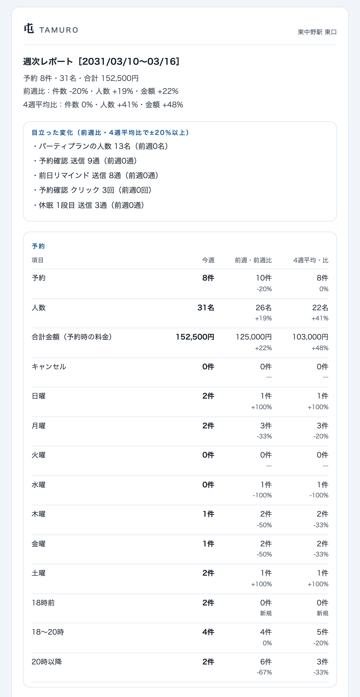

図1-6　毎週届く集客レポート（合成データ）

## 1-8　店と話せる窓「T-AI-MURO」

1-6で書いたとおり、プランは増え、予約フォームは、初めての人には選びにくいものになっていました。しかも、初めてのお客さんが知りたいのは、プランや日時だけではありません。どんな雰囲気の店なのか。ひとりでも浮かないか。店主はどんな人か。子ども連れでも大丈夫か。そういう質問に答えられないまま、予約のボタンだけを並べても、迷っている人の背中は押せません。

そこで、予約サイトに「店と話せる窓」を置くことにしました。お客さんが質問を書くと、AIが店として答えます。会話の中で人数や日時が決まれば、そのまま予約の確認画面へ進めます。名前は「T-AI-MURO」、会話の中では「たむろ」と名乗ります。T-AI-MUROは店そのものとして話し、店主のことは三人称で語ります。

お客さんは、ほとんど文字を打ちません。T-AI-MUROが出す選択肢を押していけば、会話が進みます。ですから、次にどんな選択肢を出すかが、会話の質を決めます。選択肢には、予約へ進むための一手（人数、料金、空き枠、日時）と、店を知るための一手（雰囲気、店主、客層、隣の人と話せるか）と、会話の流れから出てくる一手を、いつも混ぜて出します。予約に進むことだけが目的ではありません。店の雰囲気や店主の話を知ってもらうことも、この窓の本題です。

料金だけは、AIに計算させないことにしました。割引の重なり方や人数の段差を、AIが毎回正しく計算できる保証はありません。料金と空き枠は、プログラムが決まった計算で出し、AIはそれを言葉にして伝える役に徹します。

### 最初の知識は、過去の自分の発信から

T-AI-MUROが店について答えるには、店の知識が要ります。その材料として、わたしがこれまでInstagramとX（旧Twitter）に書いてきた投稿を、まるごと書き出して使いました。そこから、お客さんが聞きそうな質問と、その答えを作っていったのです。

実際にやってみると、Instagramより、Xの投稿のほうが材料として使えました。Instagramは写真が中心で、言葉が少ない。Xには、料理のこと、店のこと、考えていることを、わたしが言葉で書き残していたからです。

### 36本中、合格は9本

T-AI-MUROを本番に出す前に、どれくらい正しく答えられるかを試しました。試験もAIにやらせます。お客さん役のAIに、人物と目的を与えて、T-AI-MUROと会話させるのです。「ひとりで今夜」「4名で2週間後」「子連れ」「アレルギー」「貸切」「遅刻の連絡」「店名の由来」「店主はどんな人か」など、36の場面を用意しました。

1回目の結果は、36本中、合格9本でした。

いちばん多かったのは「うまくお答えできませんでした」という返事です。店の雰囲気や店主についての質問にも、この返事が出ていました。「予約」「今日」「貸切」「マスター」といった言葉が入ると、質問の中身に関係なく、空き枠の一覧が出てしまう。遅刻の連絡を、新しい予約として受け付けてしまう会話もありました。ベジタリアンのお客さんに、かつお節の炒め物と味噌汁を例に挙げてしまったこともあります。すでにやめた共同購入を、英語で案内したこともありました。

### 11の質問に、一言ずつ答えた

原因の一部は、プログラムの作りにありました。その話は第2章に譲ります。もう一つの原因は単純で、店の事実が足りなかったのです。AIは、知らないことには答えられません。

そこで、AIが答えられなかった質問を集めて、わたしが一言ずつ答えることにしました。

予約なしでも入れます。小学生未満の子連れは難しいです。キャンセルや変更は前日までに、メール、電話、SNSのメッセージで。遅刻の連絡はお電話で。店の外に喫煙所があります。飲み物の持ち込みは、持ち込み料をいただきます。貸切は価格帯と時間によって可能で、上限は19名。食事の制限や記念日は、できる範囲で対応するので事前にご相談を。店主は営業日はほぼ毎日店にいます。ゆかた祭りは年に1度くらい開く予定です。

これだけです。11の質問に一言ずつ答えただけで、2回目の試験では、36本中24本が合格しました。

| 質問 | 1回目の答え | 2回目の答え |
| --- | --- | --- |
| 子連れで大丈夫？ | うまくお答えできませんでした | 小学生以上ならご相談いただければ対応できます。小学生未満は難しいところです |
| 予約なしで入れる？ | （空き枠の一覧） | 予約なしでも入れますよ |
| 今日マスターいる？ | （空き枠の一覧） | 店主は営業日はほぼ毎日店にいます。今日は営業日なので、いる予定です |
| 静かな店？　常連ばかり？ | うまくお答えできませんでした | ゆっくり過ごしていただく店です。客同士の会話が生まれやすく、騒ぐような店ではありません |

ここで、一つの型が見えてきました。想定される質問をAIが作り、T-AI-MUROに答えさせ、間違いを直す。そのうえで、店の事実がなくて答えられない質問だけを、店主に回す。店主の手間は、答えられない質問への一言だけです。それ以外は、全部AIが回します。

### 「予算5000円」が不合格になった場面

AIの試験には、AIの判定も付けていました。会話のログを別のAIが読み、合格か不合格かを決めます。

その中に「予算5,000円」というお客さんの場面がありました。AIの判定では合格でした。T-AI-MUROは、予算内のプランを丁寧に案内していたからです。

けれど、わたしが読むと不合格でした。人数を聞いていないのです。屯には複数人割があります。人数によって、同じ予算でも選べるプランが変わります。

そのとき、わたしは目的を言い直しました。

「できるだけ大人数で、トータルの金額がもらえるように。人数は確認して。最終目的は、お客様に来てもらうこと。それも多いほうがよい。売上を上げること」

この一言で、会話の設計が全部変わりました。料金は必ず人数を確かめてから、合計金額で答える。人数割の段差の手前では「あと1名で何％引き」と添える。予算を言われたら、予算内でいちばん上のプランを先に出す。ただし、ひとりで来るお客さんは店の半分を占めるので、1名のお客さんには人数を増やす案内をしない。

AIの試験をAIにやらせると、速く回せます。けれど、合格の基準を決めるのは人間です。目的を一文で言えるかどうか。それが、AIの会話の質を決めていました。

### お客さんの希望は、店の勧めより優先する

もう一つ、大事な線を引いた場面があります。

試験の中で、予約の受け渡しがすべていちばん安いプランになっている、という問題が見つかりました。直したところ、今度はほとんどがスタンダードプランになり、平均の合計金額が約2倍に跳ね上がりました。喜びかけましたが、よく見ると、お客さん役のAIが、いつも最初の選択肢を押していただけでした。「いちばん安いのでいい」と言ったお客さんにも、スタンダードが勧められていたのです。

ここで決めた原則があります。お客さんがはっきり言った希望（いちばん安いもの、予算、プランの名前）は、店の勧めより常に優先する。店の勧めは、お客さんが何も言っていないときだけ。

売上を上げたいという店の目的と、お客さんの信頼は、勧め方ひとつでぶつかります。信頼を失えば、来店そのものが減ります。この線を引けるのは、AIではなく店主でした。

のちに、T-AI-MUROを大量の質問で鍛え直したとき、間違いの原因でいちばん多かったのは「質問に答える前に、言葉に反応して決まった動きをする」ことでした。「人数」「いくら」「ひとり」といった言葉を聞いた瞬間に、質問に答えず予約の流れやおすすめに進んでしまう。接客で言えば、お客さんの話を聞かずに推し売りする店員です。お客さんの質問に先に答える。この接客の基本が、AIでもいちばん大きな課題でした。

2026年10月6日の夜、T-AI-MUROは予約サイトのトップに、本番の入口として出ました。会話で予約したくないお客さんもいるので、これまでの予約フォームも並べて残しています。

> 試してみる：屯の予約サイト（https://tamuroreservation.vercel.app/?src=note）を開いて、T-AI-MUROに「ひとりで今夜」と聞いてみてください。今日の空きと料金まで、会話で進みます。

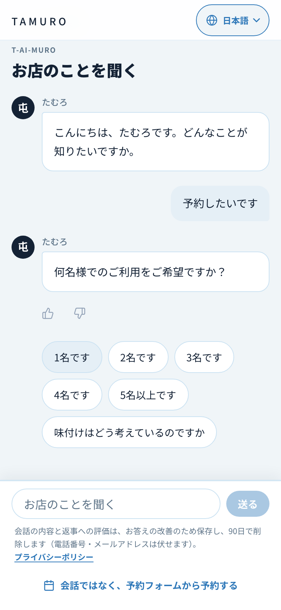

図1-4　T-AI-MUROの会話の画面。最初の選択肢（「予約したいです」）を押すと、人数の質問が出る

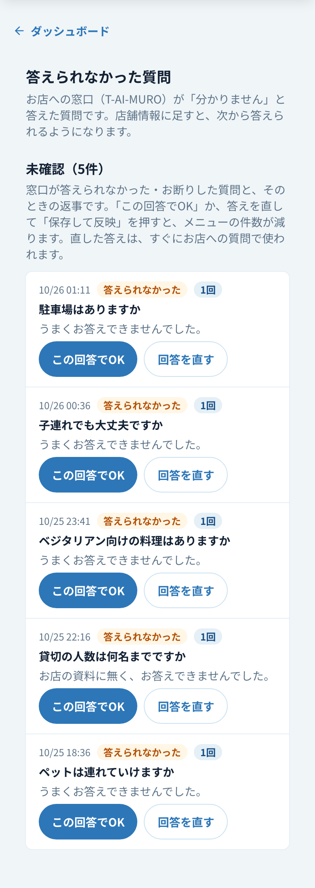

図1-10　答えられなかった質問は、管理画面に貯まる（合成データ）

## 1-9　そして、お客さんのAIから

T-AI-MUROを作ったことで、屯の予約サイトには「会話で店のことを答え、料金と空き枠を出し、予約まで案内する」力が備わりました。

そこで次に考えたのが、同じことを、お客さん自身のAIからもできるようにすることでした。

T-AI-MUROは、屯の予約サイトに来てくれた人としか話せません。けれど、多くの人はまず、ふだん使っているAIに相談します。そのAIが屯のことを知らなければ、屯は候補にすら挙がりません。お客さんが屯のサイトに来るのを待つのではなく、お客さんのAIのほうに、屯の窓を開けておく。それがMCPサーバーです。

正直に書くと、この仕組みを作ることには、最初は迷いもありました。今の時点で、自分のAIから飲食店を予約する人は、まだ多くありません。直接の予約の増加は見込めない、と判断して、一度は優先順位を下げて保留にしたこともあります。

それでも作ることにしたのは、入口が変わるのは時間の問題だと考えたからです。冒頭で書いたとおり、2026年8月には、ChatGPTから大手の予約サービスを通じて予約できるようになりました。いずれ、AIに店を探してもらうのが当たり前になる。そのとき、大手に載っていない小さな店は、AIの目に入らなくなります。だから、入口が変わる前に、窓を開けておく。

最初の版で決めたことは、とても絞り込んだものでした。予約サイトの会話の窓（T-AI-MURO）と同じことができればよい。できるのは、店の情報と空き枠と料金を読み取ること、そして条件を入れた予約ページのURLを渡すことだけです。予約の確定は、お客さん自身が屯のページで行います。お客さんのAIが勝手に予約を確定させない。最後の一押しは、人が押す。

冒頭の場面に戻りましょう。

金曜の夕方、お客さんが自分のAIに「東中野で、今夜ひとりで飲める店ある？」と聞く。AIが屯の窓に問い合わせる。屯の予約システムは、今夜の空き枠と、ひとりのお客さんに合ったプランと料金を返す。AIはそれをお客さんに伝え、日時と人数が入った屯の予約ページを差し出す。

この一連の流れを支えているのは、この章で書いてきたすべてです。値上げと一緒に作った値引きの仕組み。常連を育てる仕組み。当日予約が大半だと分かったデータ。11の質問に一言ずつ答えて育てた、店の知識。お客さんの希望を店の勧めより優先する、という原則。

AIから予約される店は、ある日突然できあがったわけではありません。小さな仕組みを一つずつ足し、試し、捨て、直してきた、その積み重ねの上に立っています。

> 試してみる：お使いのAIに屯のMCPサーバー（https://tamuroreservation.vercel.app/api/mcp）を登録して、「屯は今夜空いてる？」と聞いてみてください。登録のしかたは、おわりにに書いてあります。

## 1-10　作ったことと、効いたこと

この章では、たくさんの仕組みを作った話をしました。けれど、「作れた」と「商売が変わった」は別のことです。章の最後に、その二つを分けておきます。

数字で確かめられたこと。予約の88.1％が当日であること。会話の窓の合格率が、店の事実を11項目足しただけで9本から24本に上がったこと。料金とプランの案内の合格率が、直しのあとで29.4％から42.7％に上がったこと。これらは、記録のある事実です。

手応えはあるが、因果までは証明できていないこと。複数人割を使って複数人で来るお客さんが増えたこと。はじめまして／おかえりプランが選ばれていること。確定メールの話題が、カウンターの会話になっていること。現場では感じていますが、「その仕組みがなければ来なかった」とまでは言えません。

仕組みはできたが、効果はまだ分からないこと。早割が先の予約をどれだけ増やすか。MCPからの予約が実際にどれだけ入るか。週次レポートで測り始めたばかりで、数字が揃うのはこれからです。

「AIでここまで作れた」という驚きと、「それで商売がどう変わったか」という成果は、別々に見る。この区別を持たないと、作ること自体が目的になります。わたし自身が、一度そうなりかけました（1-7で書いたとおりです）。

この予約システムの裏側、つまり技術の話は、第2章に続きます。技術に興味のない方は、第3章へ進んでください。そこでは、この予約システムの周りで生まれた小さな道具を、他の店にも配っている話をします。

[次の章 ▶　第2章　技術編：予約システムの裏側](https://note.com/bontallc/n/n2b379a6bdbec)

## この本の、ほかの読み方

PDF（無料・再配布自由）：[https://bontallc.com/books/uchi-no-mise/pdf?via=note](https://bontallc.com/books/uchi-no-mise/pdf?via=note)

Kindle：[https://www.amazon.co.jp/dp/B0HPJY4NRR](https://www.amazon.co.jp/dp/B0HPJY4NRR)

Google Play：[https://play.google.com/store/books/details?id=WdUiEgAAQBAJ](https://play.google.com/store/books/details?id=WdUiEgAAQBAJ)

本のページ：

https://bontallc.com/books/uchi-no-mise?via=note

PDF は再配布自由です。周りの店主仲間や、AI に興味のある方に、そのまま送ってください。

屯の予約サイト：[https://tamuroreservation.vercel.app/?src=note](https://tamuroreservation.vercel.app/?src=note)

Agendaシリーズ：[https://bontallc.com/agenda?via=note](https://bontallc.com/agenda?via=note)

note：[https://note.com/bontallc](https://note.com/bontallc)

X：[https://x.com/tamuro_hnakano](https://x.com/tamuro_hnakano)
