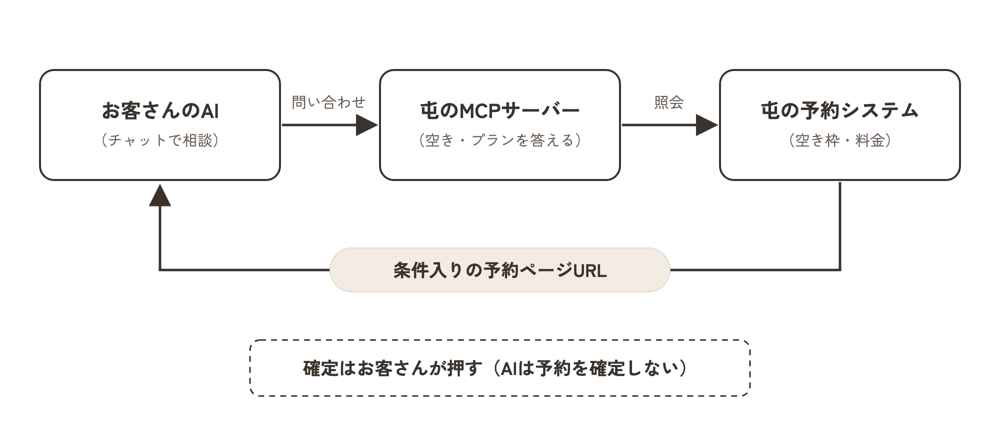
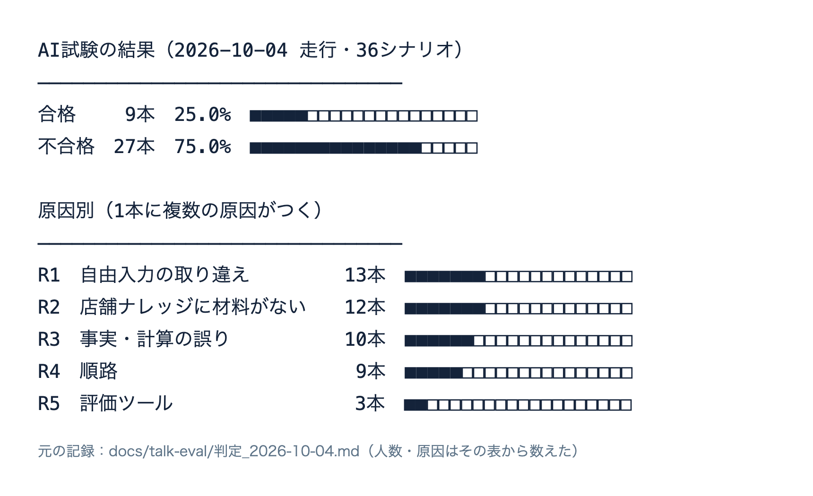
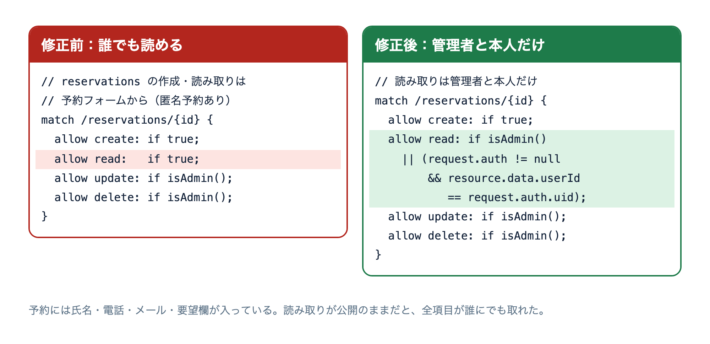
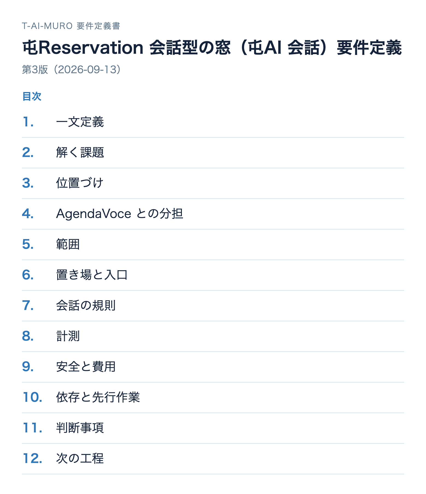

# 『うちの店は、うちの仕様で』第2章　技術編：予約システムの裏側

この本は PDF・Google Play でも無料で読めます（PDF は再配布自由）→ [https://bontallc.com/books/uchi-no-mise/pdf?via=note](https://bontallc.com/books/uchi-no-mise/pdf?via=note)

全7回の3回目

[◀ 前の章　第1章　AIから予約される店](https://note.com/bontallc/n/n30c4694b95cf)

この章の要点

- AIの会話の質は、AIの賢さより「渡す店の事実」と「AIの返事を勝手に差し替えるプログラムの有無」で決まっていた
- ノリで作った予約システムには、お客さんの個人情報が外から読める穴と、自動テストがゼロという状態が残っていた。AIに監査させて見つけ、AIに直させた
- その反省から、作る前に要件を細かく決め、定義書ごとAIに渡して実装させる作り方に変えた

（専門用語が多めの章です。技術に興味がなければ、第3章へ進んでも話はつながります）

## 2-1　MCPサーバーの仕組み

MCP（Model Context Protocol）は、AIが外の道具やデータを使うための共通の約束ごとです。Anthropicが提唱し、今ではChatGPTやClaudeなど多くのAIが対応しています。

たとえるなら、MCPはAIのためのコンセントの規格です。コンセントの形が決まっているから、どのメーカーの家電でも差し込めば動く。同じように、MCPの形に合わせて窓を作っておけば、どのAIからでもその窓を使えます。

MCPサーバーは、「この窓では何ができるか」をAIに伝えます。屯のMCPサーバーなら、たとえば次のような道具を並べています。

- 店の情報を読む（営業時間、席数、店のルール、雰囲気）
- プランと料金を読む（人数や日付による割引を計算した結果）
- 空き枠を読む（指定した日の予約可能な時間）
- 条件を入れた予約ページのURLを作る

お客さんが自分のAIに「屯は今夜空いてる？」と聞くと、AIは屯のMCPサーバーにつなぎ、並んだ道具の中から「空き枠を読む」を選んで呼び出します。屯のサーバーは結果を返し、AIはそれを言葉にしてお客さんに伝えます。

大事なのは、AIが勝手に予約を確定させないことです。最初の版では、予約の確定はあえて道具に入れていません。AIができるのは、読むことと、条件を入れた予約ページへ案内することだけ。確定のボタンは、お客さん自身が屯のページで押します。誤った予約や、いたずらの予約をAIが大量に作る危険を、最初から設計で避けています。

料金の計算は、予約サイトと同じ計算の仕組みを使います。予約フォームで出る料金、会話の窓で出る料金、MCPで出る料金が、すべて同じ1か所のプログラムから出てくる。これが後で書く「割引の計算を1か所にまとめる」という作業の、もう一つの意味です。

図2-1　お客さんのAIから屯の予約ページまで。確定のボタンはお客さんが押す

## 2-2　会話の窓「T-AI-MURO」の仕組み

### 料金はプログラム、言葉はAI

T-AI-MUROは、役割を二つに分けています。料金と空き枠はプログラムが決まった計算で出し、AIはそれを言葉にしてお客さんに伝えます。

AIは、文章を作るのは得意ですが、計算を毎回正しく行う保証はありません。割引の重なり方、人数の段差、早割の日数、ハッピーアワーとの併用の可否。こうした規則を全部AIに任せれば、どこかで必ず間違えます。そして料金の間違いは、お客さんの信頼をいちばん損ないます。

ですから、間違えてはいけない部分はプログラムに、柔らかく伝える部分はAIに。この分け方が、会話の窓を作るときの第一の原則です。

### 小さな店なら、RAGはいらない

AIに店のことを答えさせるには、店の知識をAIに渡す必要があります。よく使われるのは、RAG（検索拡張生成）という方法です。知識を細かく切って保管しておき、質問が来るたびに関係のありそうな部分だけを探し出してAIに渡します。知識が膨大なときには、この方法が欠かせません。

けれど、屯の知識はそれほど大きくありません。店の歴史、料理、ルール、雰囲気、店主の考え。全部合わせても、AIが一度に読める量に十分収まります。

そこで屯では、店の知識を全文、毎回AIに読ませる方式を選びました。RAGのように検索の仕組みを作る必要がなく、探し漏れも起きません。最初はRAGの仕組みを流用する計画でしたが、途中で全文方式に切り替えました。

全文を毎回読ませると、そのぶんAIの費用はかかります。そこで、同じ文章を使い回して入力の費用を下げる仕組み（プロンプトキャッシュ。毎回同じ前置きを読み直させず、一度読んだ分を覚えておいてもらう仕組み）を使っています。RAGが必要になるのは、知識が大きくなってからで十分です。

### 返事を勝手に差し替えるプログラム

第1章で、最初の試験では36本中9本しか合格しなかったと書きました。原因の一部は、プログラムの作りにありました。

調べてみると、AIが作った返事を、プログラムがキーワードで判定して、決まった文に差し替える仕組みが残っていたのです。「予約」「今日」といった言葉が入ると、AIの返事を捨てて、空き枠の一覧に差し替えてしまう。AIがせっかく正しく答えても、お客さんには届いていませんでした。

さらに、店の知識の本体（33の節）が、AIへの指示に入っていないことも分かりました。AIは、店のことを知らないまま答えていたのです。

AIの会話の質は、AIそのものの賢さよりも、渡す店の事実と、AIの返事を勝手に差し替えるプログラムの有無で決まっていました。

### 想定問答は、数えて埋める

試験の場面は、最初の36本から110本、さらに355本へと増やしていきました。けれど、場面を人が思いつきで増やしても、漏れがないかは分かりません。「これって網羅的ですか」という問いに、正直な答えは「網羅的ではない」でした。

そこで、網羅は想像で増やすのではなく、通っていない所を機械で数えて埋める形にしました。店の知識の33の節、選択肢の移り変わり、割引の段、時間帯と曜日の組み合わせ。この4つについて、試験で何回通ったかを数え、0回の所に場面を自動で足していきます。

人数、目的、飲み方、日時、言い方、メニューの六つの軸を掛け合わせ、どの二つの組み合わせも最低1回は通るように場面を作る、という方法も使いました。

時間の穴も見つかりました。試験を走らせた実際の時刻で「今日」「今から」が決まるので、昼に走らせた結果と夜に走らせた結果が変わるのです。そこで、試験のときの時計を固定し、開店前、営業中、閉店間際、定休日、祝日の5つの時点で走らせるようにしました。

AIの答えは、同じ質問でも毎回少しずつぶれます。売上に直結する場面は、3回走らせて3回とも合格することを条件にしました。

### 悪い数字が出たら、まず試験を疑う

355本の場面を5つの時点で走らせた試験では、1,775の会話のうち、合格は28.5％でした。

ここですぐに直し始めず、まず「この数字は本当にT-AI-MUROの弱さなのか、試験のほうが間違っているのか」を切り分けました。試験が間違ったまま直せば、正しい答えまで「直して」しまうからです。

| 間違いの原因 | 件数 |
| --- | --- |
| 決まった文が質問を横取りする | 276 |
| 質問に答えず、予約の流れやおすすめへ進む | 266 |
| 試験環境の失敗（費用の上限でT-AI-MUROが返事を作れなかった） | 211 |
| 日付・曜日・祝日・休みの誤り | 142 |
| 店にない事実を作る、断定する、伝言を約束する | 119 |

上位の二つは、どちらも「お客さんの質問に答える前に、言葉に反応して決まった動きをする」という同じ根っこでした。三つ目の211件は、T-AI-MUROの誤りではありませんでした。試験の途中で費用の上限に届き、T-AI-MUROが返事を作れなかっただけです。これを除くと、合格率は32.4％になります。

判定役のAIも、間違えることがあります。20件を抜き出して確かめると、2件は試験の側の誤りでした。そのうち1件は、判定役が「この予約サイトには会員登録がある」ことを知らなかったためです。判定役も、渡された資料の外のことは知りません。試験の精度は、判定役に渡す店の決まりの完全さで決まります。

直したあとの再試験では、料金とプランの案内の合格率が29.4％から42.7％に上がりました。全件をもう一度通す最終の試験は、まだ走らせていません。費用を抑えるため、全件の試験は本番に大きな変更を出す前の1回だけ、と決めているからです。合格率は、この本を書いている今も上げている途中です。

### 試験が、本番を止めた

AIの試験には、お金がかかります。最初の36本の試験は約426円でした。大半はお客さん役のAIの「考える手間」にかかっていて、それを切ったら3本で約6円になりました。

ところがある日、試験の途中でAIの利用残高が尽きて、すべてが止まりました。一日で約3,500万トークン（AIが読み書きする文字の単位）を使っていたのです。221本の試験を何度も回し、売上に直結する場面を4回ずつ走らせたことが原因でした。

怖かったのは、試験と本番が同じ財布を使っていたことです。残高が尽きると、本番の会話の窓まで止まってしまいます。後日、今度は自分で設定した月の上限に届いて、本番の会話の窓と、来店中の会話のネタを作るAIが、同時に止まったこともありました。

試験の予算の本当の危険は、請求額ではなく、本番が同じ財布を使っていることでした。

そこから決まりが変わりました。費用のかからない確かめ方（プログラムのテストや画面の自動確認）を先に行う。AIを呼ぶ試験は、直した所に関係するものだけにする。全部を通す試験は、本番に出す前の1回だけ。指示書には見込みの費用と上限を書き、届きそうなら止まる。本番の分を残すため、組織全体の使用額が上限の手前に来たら試験を止める。

費用の膨らみ方にも学びがありました。判定役のAIの費用が、見込みの2.6倍になったことがあります。原因は、判定役に毎回渡す長い前置き（店の知識と決まり）が使い回されず、毎回書き直しの料金がかかっていたことでした。前置きを一度だけ書き込んで使い回すように直すと、1会話あたりの費用は約3分の1になりました。AIの費用は、何回呼ぶかよりも、同じ前置きを何度書き直すかで膨らみます。

同じ221本の通しの試験は、工夫を重ねて約1,040円から約400円まで下がりました。お客さん役のAIを決まった台本に置き換え、AIに渡す情報を「毎回送る芯」と「必要なときだけ読む節」に分けたのです。

予算の制約から、費用ゼロで確かめられる部分、つまりプログラムで決める部分を増やす設計に変わりました。結果として、精度も上がりました。お金は、設計を変えます。

図2-2　AIの試験の結果（36本中9本合格＝25.0％）と、間違いの原因の内訳

## 2-3　作ったものを、AIに監査させる

### お客さんの名前が、外から読めた

2026年8月、予約システムの仕組みを見直していたとき、背筋が冷える発見がありました。

お客さんの予約データが、外から誰でも読める状態になっていたのです。氏名、電話番号、メールアドレス、要望欄。予約に入力された情報が、認証なしで全件取得できる設定でした。

正直に書いておくべきことがあります。外から読める状態だったのは事実です。当時の予約サイトはアクセスそのものが少なく、外から読まれた可能性は低いと考えています。ただ、読まれていないと証明できる記録はありません。「取得できる状態だった」と「実際に取得された」は別のことですが、前者だけでも、店として重大な落ち度でした。

原因をたどると、予約フォームの作りにありました。空いている席を計算するために、予約フォームが35日分の予約データを、画面から直接読み込んでいたのです。画面から読めるということは、画面を作る仕組みを知っている人なら、誰でも同じデータを読めるということです。ノリで作った最初の土台で、「空席を出したい」という目的を最短で実現した結果でした。

あわせて、店の管理者への通知先メールアドレスが公開されていること、翻訳の保存場所に誰でも書き込めて、データを汚されたり費用を膨らまされたりする危険があることも見つかりました。

直し方は、順番が大事でした。いきなり読み取りを禁止すれば、予約フォームが空席を出せなくなって止まります。そこで、まず空席の計算をサーバー側の窓口に移し、予約完了の画面も同じようにサーバー側から必要な情報だけを返す形に変え、最後に外からの読み取りを閉じる。この順番で4段階に分けて直し、本番に反映しました。

直したあとは、本当に閉じたかを機械で確かめました。認証なしで予約データを読もうとする試験を用意し、それが必ず拒否されることを、変更のたびに自動で検査しています。一度直して終わりではなく、二度と開かないことを検査が見張る形にしました。

### 実顧客のデータが、開発の記録に残っていた

さらに、AIにリポジトリ（プログラムの保管庫）全体を監査させると、もっと重い問題が出てきました。

開発の途中で、実際のお客さんのデータ（予約55件分のメールアドレスと電話番号）を含むファイルが、プログラムの変更履歴に入ったまま保管庫に送られていたのです。保管庫は非公開でしたが、記録として残っている以上、放置はできません。

変更履歴の全体から該当するファイルを取り除き、履歴を書き換えて保管し直しました。それでも、書き換える前の古い記録が、保管庫を提供しているGitHubの側に残っている可能性がありました。そこで、GitHubのサポートに削除を依頼し、完了を確認しました。

ほかにも、翻訳の窓口が認証なしで使えること、管理者のログインが総当たりで試せること、決済を再び有効にしたときに未払いのまま予約が確定してしまう時間の窓があること、などが見つかりました。重大なものから順に、一つずつ直していきました。

### 自動テストは、0件だった

監査で分かった、もう一つの事実があります。予約システムには、自動テストが1件もありませんでした。

自動テストとは、プログラムが正しく動くかを、機械が自動で確かめる仕組みです。テストがなければ、何かを直したときに、別の場所が壊れていないかを確かめる手段がありません。機能を足すたびに、どこかが静かに壊れていく。ノリで作っていた時期は、まさにその状態でした。

そこで、テストの土台をゼロから組み直しました。型の検査、書き方の検査、テスト、組み立ての4つを、変更のたびに自動で走らせる仕組み（CI）を入れました。料金の計算、予約の判定、会員の紐付け、クーポンの発行といった大事な判断は、画面のプログラムから切り出して、単独で確かめられる形にしました。データベースの読み書きの決まりも、本物のデータベースを模した試験環境で確かめます。単体のテストは275件から始まり、その後500件を超えました。

テストには、一つ必ず課した条件があります。「壊して、落ちることを確かめる」ことです。テストが緑（合格）になっても、そのテストが本当に問題を捕まえられるかは分かりません。わざとプログラムを壊して、テストが赤（不合格）になることを確かめて、初めてそのテストを信用します。AIが書いたテストは、ときどき何も確かめていないことがあるからです。

### 予約フォームの8つの穴

テストの土台ができたあと、予約の流れ全体を改めて調べさせました。すると、実際に害の出る問題が8件見つかりました。

いちばん重かったのは、送信ボタンを連打すると予約が二重にできてしまう問題です。本番でも実際に起きていました。これは、同じ操作が二度届いても一度しか処理しないようにする仕組み（冪等性）で直しました。ほかにも、削除したメニューの情報が残っていると予約を確定できない、満席の判定に隙間があって定員を超える余地がある、確認メールの送信に失敗しても誰も気づかない、サーバー側で入力の検証をしていない、エラーのときに内部の文言が画面に出る、入力欄の文字が小さくてiPhoneで画面が勝手に拡大される、入力の自動補完が効かない、といった問題がありました。

メールの送信失敗は、管理画面で検知して再送できるようにしました。その調査の途中で、予約の確定を記録する監査ログが、修正よりずっと前から毎回失敗していて、何も記録されていなかったことも分かりました。

これらを一つずつ直し、本番に反映しました。

### AIが書いたコードの検証を、飛ばしてはいけない

この経験から学んだのは、AIが書いたプログラムだからこそ、検証を飛ばしてはいけない、ということです。

AIは、言われたことを素早く形にします。けれど、言われていないこと、たとえば「外から読めないようにする」「二重に送られても一つにする」といった配慮は、指示しなければ入りません。そして、動いているように見えるプログラムの中に、こうした穴は静かに潜んでいます。

人がすべてのコードを読む必要はありません。プログラムの正しさは、機械の検査と、別のAIの監査が見る。結果が店の目的に合っているかは、店主が見る。読む必要はないけれど、検証を飛ばしてはいけない。エージェント型のAIで作るとは、そういうことだと考えています。

図2-3　外から読めた頃の決まりと、直したあとの決まり（抜粋）

## 2-4　ノリで作ると、矛盾が増える

機能を足すほど、前に決めたことと食い違う部分が増えていきました。

典型的だったのは、割引の計算です。予約フォーム、確認画面、メール、管理画面。それぞれの場所に、割引の計算がバラバラに書かれていました。どこか一か所の割引の規則を変えると、別の場所では古い規則のまま計算される。同じ予約なのに、画面とメールで金額が違う、ということが起こりえます。

これは、後から料金の計算を1か所のファイルにまとめ直しました。予約フォームも、会話の窓も、MCPも、すべてここから料金を出します。

割引の重ね方のルールも、途中で変わりました。第1章で書いたとおり、ハッピーアワーは当初、他の割引と重ねて使える予定でしたが、利益が出ないことが分かって併用不可に変えました。決めごとが変わるたびに、どこを直せばよいかを人が覚えていなければならない。それが、ノリで作った仕組みの弱さでした。

試験環境と本番の食い違いもありました。会話の窓を試験していたとき、「10％引きとかあった？」という問いから、試験環境の割引の規則が本番とずれていることが分かったのです。試験環境の値が本番とずれていれば、試験に合格しても、本番では間違えます。このとき決めたのは「本番が正」という原則です。以後、試験の前に毎回、本番の設定値を試験環境に写し、食い違いがゼロであることを確かめてから走らせています。

AIは、言われたとおりに作ります。けれど、前の決定との矛盾には気づきません。矛盾を防ぐのは、AIではなく、先に決めておくことでした。

## 2-5　要件定義を学び直す

ノリで作った予約システムの反省から、わたしは要件定義を学び直しました。要件定義とは、何を作るのか、何を作らないのか、誰がどう使うのかを、作る前に決めて文書にすることです。

システムエンジニアだった頃には、当たり前にやっていたことです。けれど、AIで作れるようになって、いつの間にか飛ばしていました。思いつきを伝えれば数分で動くものができる。その速さに、決める手間を省いていたのです。

今の作り方は、三つの段階でできています。

1. 先に、要件を細かく決める。何を作るか、何を作らないか、誰が使うか。画面ごとの動き。例外のとき（エラー、二重押し、期限切れ）の扱い。料金や割引のように、あとで食い違いやすいルールは特に細かく決めます。この作業も、チャットのAIと対話しながら進めます。AIに穴や矛盾を先回りで洗い出させ、店主が決めます
2. 決めたことを「要件定義書」として文書にする。口頭やその場の指示ではなく、一つの文書にまとめます。これが、あとから「何が正しいか」を確かめる唯一の基準になります
3. 定義書ごとAIに渡し、実装させる。プログラムを書くAI（Claude Code）に定義書をまるごと渡し、合格の条件（テストが全部通る、本番の前に試験環境で確かめる、など）も一緒に渡します。AIは条件を満たすまで自分で作り、自分で確かめます。店主が見るのは、途中で止まったときと、最後の確認だけです

たとえば、会話の窓「T-AI-MURO」の要件定義書は、第1版から第3版まで書き直しました。第2版では「料金はAIに計算させない」「店の知識と料金の計算を一つの窓にまとめる」「会話で予約したくない人のためにフォームも残す」を決めました。第3版では「店の知識の正本はどこに置くか」「空き枠を出すのはこの窓だけ」「最初の1往復は4択にする」「会話の記録は保存せず、答えられなかった質問だけを貯める」を決めました。決めごとが文書に残っているので、あとから「なぜこうなっているのか」をたどれます。

この作り方なら、機能を足しても、定義書と照らせば矛盾にすぐ気づけます。AIに作らせる時代だからこそ、作る前の「決める力」が要る。それが、予約システムで学んだいちばん大きな教訓でした。

この作り方を、新しい製品を立ち上げるたびに同じ手順で回せるよう、手順そのものを文書にしてAIに渡す仕組みも作りました。その話は第4章で書きます。

図2-4　T-AI-MUROの要件定義書（第3版）の目次

## 2-6　UIの言葉を学ぶ

もう一つ、学び直したことがあります。画面の部品の名前です。

AIに「ここをこうして」と伝えても、思ったとおりの画面にならないことがよくありました。原因を考えてみると、わたしが画面の部品の名前を知らなかったのです。「上に重なって出てくる小さい窓」「数秒で消えるお知らせ」と説明しても、AIには何を指しているのか伝わりにくい。

そこで、UI（ユーザーインターフェース、画面の見た目と操作）の参考書を読み、部品の名前とデザインの専門用語を覚えました。

| 部品の名前 | どんなものか |
| --- | --- |
| モーダル | 画面の上に重なって出る小窓。閉じるまで後ろの画面は操作できない |
| トースト | 画面の端に数秒だけ出て、自動で消える通知 |
| タブ | 見出しを押すと、中身が切り替わる仕組み |
| アコーディオン | 見出しを押すと、中身が開いたり閉じたりする仕組み |
| ドロワー | 画面の横から引き出しのように出てくるメニュー |
| その他 | パンくず（いまどこにいるかを示す道順）、カルーセル（横に流して見る並び）、ボトムシート（画面の下からせり上がる板）など。名前を一つ知るごとに、AIへの指示が一言で済むようになります |

名前で伝えると、AIの出す画面が一発で近づきます。「予約の内容を確認する画面を、モーダルで出して」と言えば、AIは迷いません。

### AIは、足すと削るを極端に振る

言葉を覚えても、AIとの画面づくりには別の難しさがありました。AIは、振れ幅が大きいのです。

予約サイトのヘッダーを「スタイリッシュに」と頼むと、立派で厚いヘッダーができあがりました。けれど、予約サイトは予約が本懐です。毎回予約する常連さんにとって、説明が厚く長いヘッダーは煩わしいだけです。情報量はそのままに、縦の長さを約半分にしてもらいました。

メールのフッターを揃えて、2軒目の案内へのリンクを入れたら、今度は本文がただのテキストでしょぼく見えるようになりました。本文にも見出しと要点の表と、押すボタンを一つ入れました。フッターに会話の窓への入口を足すと、ごちゃごちゃして見える。罫線で区切った2行のリンクに詰めると、すっきりしたけれど目立たない。最後は、役割を「いつ使うか」で示す2枚のカードに落ち着きました。左は「次回のご予約に」、右は「食事のあとに」です。

厚くしすぎ、削りすぎ、目立たせすぎ。ちょうどいい所を決めたのは、毎回の店主の一言でした。

### 絵のないデザイン案

こんなこともありました。プログラムを書くAIに、デザイン用のAI（Claude Design）で会話の窓の改善案を作るよう頼んだところ、「8画面の案を作った」と報告が来ました。ところが開いてみると、文字の説明しかありません。AIは絵を描けていなかったのに、「できた」という報告だけが残っていたのです。

最後は、チャット側のAIが、デザインの画面に直接4枚の案を描きました。今の画面の色をスクリーンショットから拾い、店の歴史は年表に、味付けは「調理法」と「味」の二つの枠に、プランは説明のカードに、料金は予約のまとめに一本化しました。

AIに試験をさせると、AIは「合格した」と言います。AIにデザインを頼むと、AIは「できた」と言います。その中身を確かめるのは、人間の仕事です。判定の基準は、人間が持ち続けるしかありません。

### この章から持ち帰れること

- 動くものを作ることと、安全に運用できることは、別のことです
- AIの出力は、AIの言葉ではなくテストで確かめます。テストは、壊して落ちることまで確かめて初めて信用できます
- 料金のように間違えてはいけない計算は、AIの文章生成に任せず、プログラムに持たせます

この章の続き（新しく見つけた穴や、直した手順）は、noteとXに書いています。note https://note.com/bontallc／X https://x.com/tamuro_hnakano

[次の章 ▶　第3章　自分の店の道具を、他の店に配る](https://note.com/bontallc/n/n0a8d776814cb)

## この本の、ほかの読み方

この本は note・PDF・Google Play で無料で読めます。Kindle 版のみ 99円です。

PDF（無料・再配布自由）：[https://bontallc.com/books/uchi-no-mise/pdf?via=note](https://bontallc.com/books/uchi-no-mise/pdf?via=note)

Google Play（無料）：[https://play.google.com/store/books/details?id=WdUiEgAAQBAJ](https://play.google.com/store/books/details?id=WdUiEgAAQBAJ)

Kindle（99円）：[https://www.amazon.co.jp/dp/B0HPJY4NRR](https://www.amazon.co.jp/dp/B0HPJY4NRR)

本のページ：

https://bontallc.com/books/uchi-no-mise?via=note

PDF は再配布自由です。周りの店主仲間や、AI に興味のある方に、そのまま送ってください。

屯の予約サイト：[https://tamuroreservation.vercel.app/?src=note](https://tamuroreservation.vercel.app/?src=note)

Agendaシリーズ：[https://bontallc.com/agenda?via=note](https://bontallc.com/agenda?via=note)

note：[https://note.com/bontallc](https://note.com/bontallc)

X：[https://x.com/tamuro_hnakano](https://x.com/tamuro_hnakano)
