# 『うちの店は、うちの仕様で』第3章　自分の店の道具を、他の店に配る

この本は PDF・Google Play でも無料で読めます（PDF は再配布自由）→ [https://bontallc.com/books/uchi-no-mise/pdf?via=note](https://bontallc.com/books/uchi-no-mise/pdf?via=note)

全7回の4回目

[◀ 前の章　第2章　技術編：予約システムの裏側](https://note.com/bontallc/n/n2b379a6bdbec)

## 3-1　予約ページの、小さな緑の看板

屯の予約ページを開くと、上のほうに小さな緑の看板が出ています。営業中は「OPEN」、閉店すると「CLOSED」。店主が延長のボタンを押すと、閉店の時刻が30分延び、看板に朱色が差します。

個人の飲食店には、ある特徴があります。開店はほぼ時刻どおりなのに、閉店はよく延びるのです。お客さんとの話が弾めば、22時30分のラストオーダーを過ぎても、店の灯りはついています。

ところが、お客さんの側からは、それが見えません。Googleマップの「営業中」の表示は、登録した時刻から判断しているだけなので、延長も、早じまいも、臨時休業も反映されません。「まだやってるかな」と思いながら、閉店時刻を過ぎた店に足を運ぶ人はいません。電話して確かめるのも気が引けます。

この看板は、その「まだやってる？」に答える道具です。名前を「AgendaLuce（灯り手帳）」といいます。Luceは、イタリア語で「灯り」という意味です。

灯り手帳は、店主がほとんど触らなくても動くように作りました。曜日ごとの開店と閉店の時刻を一度登録しておけば、看板は自動で点き、自動で消えます。店主が触るのは、延長するとき、早じまいするとき、臨時で休むときだけ。延長は、スマートフォンのボタンを一度押すだけです。スタッフも、ログインなしで使える専用のリンクから操作できます。

お客さんの側は、ログインも登録もいりません。公開ページを開けば、今の灯りの状態が分かります。スマートフォンのホーム画面に追加すれば、アプリのように使えます。小さな看板の部品は、他のホームページにも貼れます。屯の予約ページに出ているのは、その部品です。

灯り手帳は無料です。ホームページに看板の部品を貼るだけなら、設定は10分ほどで済みます。

そして、ここが大事なところです。この灯り手帳は、屯専用ではありません。どの店でも使えます。

看板の絵柄には、あえて店名を入れていません。店名を入れれば、屯のための看板になってしまうからです。表示する言語も選べます。どこの店のホームページにも貼れるよう、部品は小さく作りました。

屯の「閉店が延びる」という困りごとから生まれた道具を、最初から誰でも使える形で作った。それが灯り手帳です。そして、こうした道具を集めたものが「Agendaシリーズ」です。

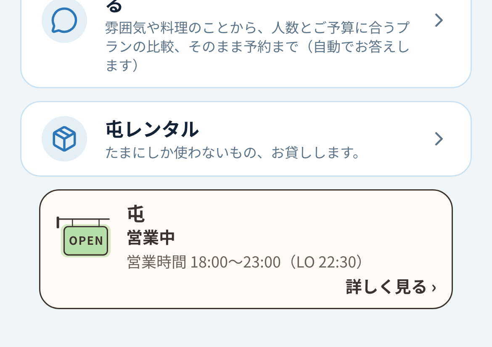

図3-1a　予約ページの上に乗る、灯り手帳の看板（営業中）

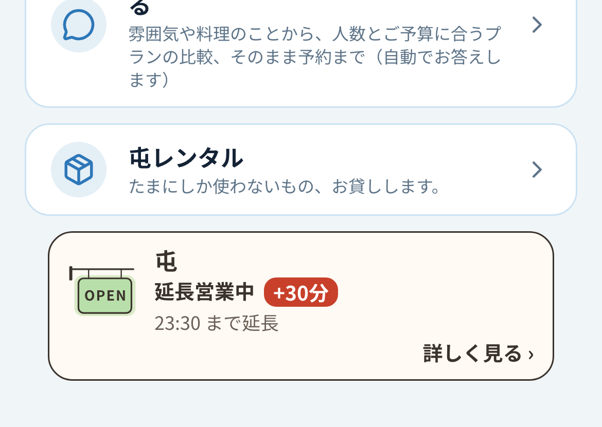

図3-1b　延長中は朱色が差す

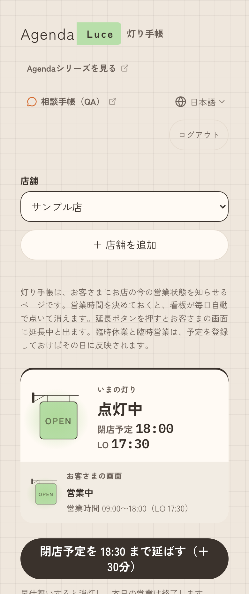

図3-6a　店主の画面。延長は、ボタンを一度押すだけ

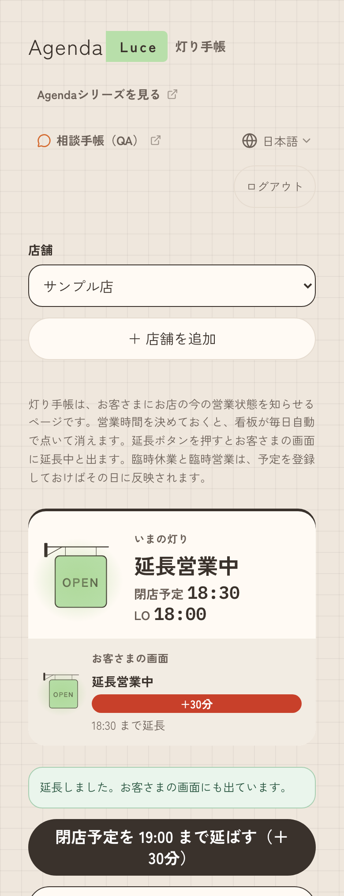

図3-6b　延長を押した直後。閉店時刻が30分延びる

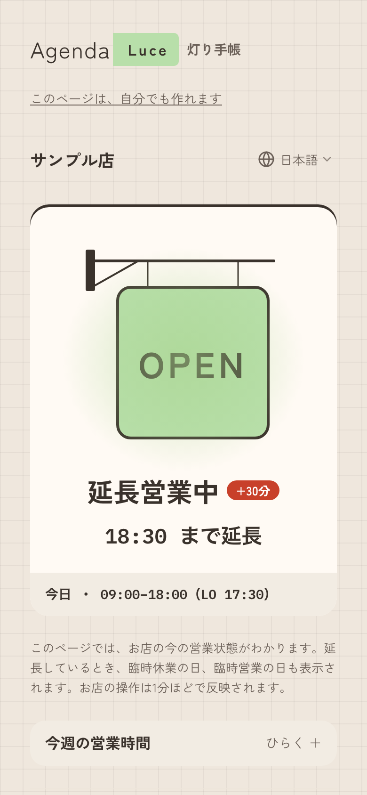

図3-6c　お客さんが見る公開ページ（延長中）

## 3-2　黒革の手帖から始まった

Agendaシリーズは、シリーズとして計画されたものではありません。始まりは、たった一本の、しかもまだ世に出ていないシステムでした。

わたしが最初に作ろうとしたのは、お客様の顔を認識して、常連さんをお迎えする仕組みです。店の入口のカメラが来店したお客様の顔を見分け、「前回はトンテキを召し上がった、3か月ぶりのあの方だ」と店主に知らせる。小さな店の店主が頭の中でやっている「顔と名前と好みを覚える」仕事を、機械に手伝わせるつもりでした。

ところが、作り始めてすぐに、これがとても重いものを預かるシステムだと分かりました。顔。属性。来店の履歴。お客様の人となり。どれも、漏れたら取り返しのつかない情報です。

そのとき頭に浮かんだのが、松本清張の「黒革の手帖」でした。誰にも見せない、しかし確かに存在する記録。開けば人の生き死にが動いてしまう帳面。わたしが作ろうとしているのは、まさにそれではないか。

イタリア語で「手帳」はAgenda（アジェンダ）、「黒」はNera（ネーラ）。合わせて、AgendaNera。黒革の手帳。こうして、名前が先に決まりました。

AgendaNeraは、今も作っている途中です。シリーズの中で、いちばん慎重に作っています。

そして、この名づけがきっかけでした。黒い手帳があるなら、ほかの色の手帳があってもいい。自分の店で日々使っていた仕組みを、どの店でも使える形に作り直して、一冊ずつ手帳として出していく。それが[Agendaシリーズ](https://bontallc.com/agenda?via=note)です。

## 3-3　一冊ずつ、手帳を増やす

Agendaシリーズは、飲食店の困りごと一つに、道具一つで答える、小さなWebアプリの集まりです。それぞれにイタリア語の名前と、「〜手帳」という日本語の呼び名があります。名前には、一つずつ由来があります。

| 名前 | 呼び名 | 名前の由来 | 何をするか |
| --- | --- | --- | --- |
| AgendaTimbro | 打刻手帳 | Timbroは「判子・押印」。打刻そのもの | スタッフの出勤と退勤を記録する |
| AgendaOro | 採算手帳 | Oroは「金（きん）」。お金の手帳 | 開業や新メニューの採算を試算する（無料） |
| AgendaBis | 2軒目手帳 | Bisは「アンコール」。演奏会で客席から飛ぶ「ビス！」 | お客さんに近くの2軒目を案内する（無料） |
| AgendaQA | 相談手帳 | Quaは「ここ」。困ったときは、ここ | シリーズ共通の相談窓口（無料） |
| AgendaLuce | 灯り手帳 | Luceは「灯り」 | 店が営業中かどうかを見せる（無料） |
| AgendaRicetta | 原価手帳 | Ricettaは「レシピ」 | レシピの原価と原価率を出す（無料） |
| AgendaNera | 常連手帳 | Neraは「黒」。黒革の手帖 | 顔認識で常連さんをお迎えする（構築中） |
| AgendaTurno | 当番手帳 | Turnoは「順番・当番」 | スタッフのシフトの希望を集め、店主のAIが組んだシフトを配る（準備中） |

どの手帳が、どんな店に向くか。打刻手帳は、スタッフが2人以上いて、勤怠を紙やLINEで管理している店に。採算手帳は、これから店を開く人と、家賃や原価が変わって今の数字を見直したい人に。2軒目手帳は、食事が中心で、お客さんを早めに次の店へ送り出したい店に。灯り手帳は、閉店が延びたり早まったりする、個人経営の店に。原価手帳は、レシピは頭の中にあるが原価率を出したことがない店に。

### 打刻手帳は、給与計算をしない

打刻手帳は、店のタブレットやスタッフのスマートフォンが、そのまま出退勤の打刻機になる道具です。名前をタップするだけ。勤怠表は自動で集計され、CSV（表計算ソフトで開ける形式）で出力できます。業務日は朝5時始まりなので、深夜営業でも日付をまたぎません。

ところが、この打刻手帳は、あえて給与計算をしません。

時給も、手当も、締め日も、店ごとに事情が違いすぎるのです。深夜は25％増、祝日は別枠、交通費は日額。どう作っても、誰かの店には合わないものになります。

そこで、計算はしない代わりに、「AIに渡すための指示文のひな形」を用意しました。ダウンロードした勤怠表のCSVと、このひな形を、ChatGPTでもClaudeでもGeminiでも、店主がふだん使っているAIにそのまま貼る。すると、深夜割増も祝日手当も交通費も、AIが計算して一覧にしてくれます。「うちは月末締めで、深夜は25％増で、日曜は別枠で」という店ごとのルールは、ひな形に書き足せば、そのまま反映されます。CSVに曜日と祝日名の列を入れてあるのも、AIが正しく計算できるようにするためです。

計算の仕組みをわたしが抱え込まず、店ごとのルールは店の手元に持ってもらう。これがいちばん壊れにくい、とわたしは考えました。

### 2軒目を案内して、自分の店を刻む

2軒目手帳は、お客さんに渡す「2軒目のご案内ページ」を作れる道具です。食事を終えたお客さんに、近くのバーや締めの一軒を、歩いて何分かと一緒に案内します。

送客の道具に見えますが、ここには小さな仕掛けがあります。2軒目の案内ということは、1軒目はうちの店でね、という意図です。送客しているようで、実はお客さんの記憶に「1軒目はこの店」と刻んでいる。そういう設計です。

### 設計の三原則：自動・他力・単機能

Agendaシリーズには、すべての手帳に共通する三つの原則があります。

一つ目は「自動」です。店主が毎日触らなくても動くこと。灯り手帳なら、時刻表を一度登録すれば、あとは自動で点いて消えます。飲食店の店主は、営業中に画面を触っている時間がありません。触らなければ動かない道具は、いずれ使われなくなります。

二つ目は「他力」です。全部を自分で作り込まず、店主がすでに使っている道具やAIに任せること。打刻手帳の給与計算が、その見本です。シフトの手帳も同じで、スタッフの希望を集めるところまでを担当し、シフトを組む作業は店主自身のAIに任せます。自前で複雑な仕組みを持たず、AIの呼び出し費用も持たない。その分、価格を安くできます。

三つ目は「単機能」です。一つの手帳は、一つのことだけを確実にこなす。多機能なシステムは、個人店には重すぎます。機能を足し続ければ使い方は難しくなり、作る側の矛盾も増える。それは、第2章で予約システムを通して身をもって学んだことでした。だから「これ一個だけをちゃんとやる」手帳を、一冊ずつ増やしていきます。

### なぜ、予約システムはシリーズに入れないのか

ここで、当然の疑問が浮かぶと思います。屯でいちばん作り込んだのは予約システムです。なぜ、それをAgendaシリーズに入れないのか。

実は、一度は入れるつもりでした。予約システムを他の飲食店にも使ってもらえる形に整え、シリーズの一冊として出す計画です。けれど、2026年8月に、その計画を取りやめました。

理由は、第1章で書いてきたことそのものです。屯の予約システムには、屯の商売のやり方が詰まっています。ひとり客が半分を占めること。当日予約が9割近いこと。開店前の時間を売りたいこと。複数人で来てほしいこと。常連を育てたいこと。そのすべてに合わせて、値引きの組み合わせも、メールの順番も、会話の勧め方も作り込んできました。

これを誰にでも使える形に薄めれば、どの店にもそこそこ合う、どこにでもある予約システムになります。そうなれば、屯の強みは消えてしまいます。予約システムとCRMは、店の売り方そのものです。汎用の仕組みに店を合わせるのではなく、店の仕組みを店に合わせる。うちの店は、うちの仕様で。だから屯の予約システムは、屯専用として持ち続けることにしました。

では、店の外に配るものは何もないのか。そうではありません。予約システムの周りには、どの店にも共通する小さな困りごとがたくさんあります。店の核は、自分の店の仕様で持つ。その周りの困りごとを解く道具は、最初から皆で使える形にして配る。屯の予約ページは、その両方が一つの画面に並んでいる見本です。屯専用の予約システムの上に、誰でも使える灯り手帳の看板が乗っている。

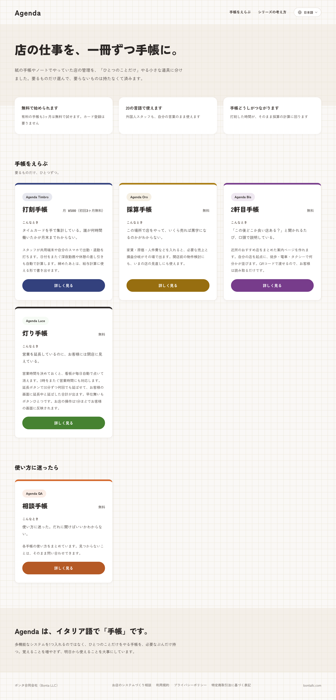

図3-2　Agendaシリーズの紹介ページ（冒頭）。全体は https://bontallc.com/agenda?via=note で

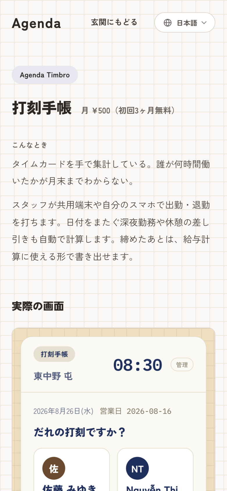

図3-3a　打刻手帳の紹介

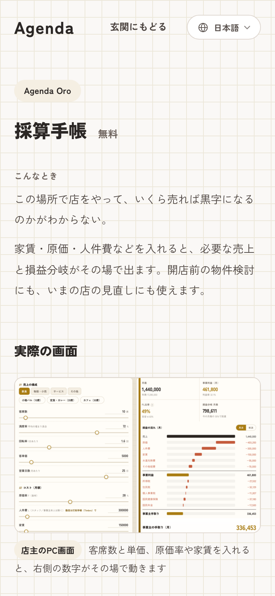

図3-3b　採算手帳の紹介

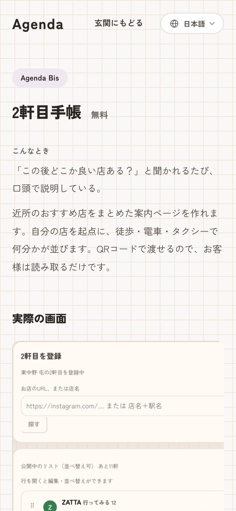

図3-3c　2軒目手帳の紹介

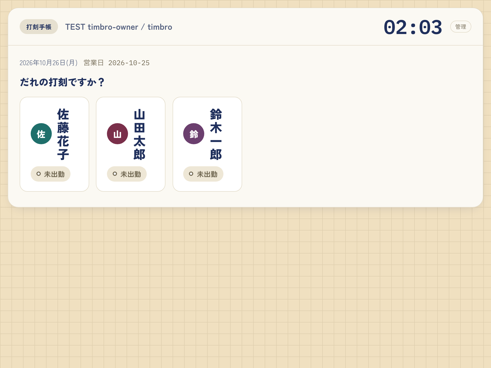

図3-4　打刻手帳の打刻画面。名前をタップするだけ（合成データ）

## 3-4　最初から、汎用的に作る

自分の店のために作った道具を、他の店にも配る。言葉にすると簡単ですが、そのためには、作り始める前の決め方が変わります。

屯のためだけに作るなら、屯の営業時間や屯の店名を、プログラムの中に直接書いてしまえば早く済みます。けれど、それでは他の店では使えません。あとから汎用化しようとすると、直接書き込んだ部分を一つずつ探して直す羽目になります。

ですから、Agendaシリーズの道具は、最初から「皆が使える前提」で要件を決めます。屯の困りごとを出発点にしながらも、要件定義の段階で「これは屯だけの事情か、どの店にもある事情か」を分けて考えます。看板に店名を入れない、言語を選べるようにする、どのホームページにも貼れるようにする。そうした決めごとは、灯り手帳の要件定義書を書く段階で決めました。

これは、第2章で学び直した要件定義の、もう一つの使い道でもあります。先に決めておけば、屯で使いながら、そのまま他の店にも配れる。

自分の店の困りごとは、他の店の困りごとでもあります。「閉店が延びるのを伝えたい」と思っている店主は、屯の店主だけではありません。個人店の店主が、自分の困りごとから道具を作り、それを他の店に配る。それがAgendaシリーズの考え方です。

## 3-5　技術の民主化

Agendaシリーズの製品は、今では10を超えています。それを、わたしは店に立ちながら、一人で作り、一人で運用しています。

数年前なら、これは考えられないことでした。製品を一つ作るには、企画する人、画面を設計する人、プログラムを書く人、試験をする人、運用する人が要りました。チームと資金がなければ、製品を世に出すことはできなかったのです。

今は違います。店主がAIに要件を伝え、AIがプログラムを書き、AIが試験をし、別のAIが監査します。店主が担うのは、何を作るかを決めること、AIの出した結果が店の目的に合っているかを判断すること、そして人間にしかできない操作だけです。

こうした変化は、一般に「技術の民主化」と呼ばれています。作る力が、一部の人や会社だけのものではなくなりつつある。

ただし、ここは正直に書いておきます。「はじめに」でも書いたとおり、わたしはシステム企画と、現場と開発会社の間をつなぐ調整役として、ITの仕事を約16年続けた経験があります。要件定義も、データベースの考え方も、試験の進め方も、経験として知っていました。ですから、プログラムを一度も書いたことがない人が、明日から同じことをできるとは言いません。

それでも、変わったことは大きいのです。かつてはチームでしかできなかった規模のものを、一人で、本業の合間に作れるようになった。そして、経験のない人にとっても、入口は確実に低くなっています。AIは、分からないことを聞けば教えてくれます。言葉で伝えれば、形にしてくれます。足りないのは技術ではなく、何を作るかを決める力と、それをAIに伝える言葉です。それは、店を営む人がふだんから使っている力でもあります。

## 3-6　「SaaSの死」という論争

Agendaシリーズのように、インターネット越しに月額で使ってもらうソフトウェアのことを、SaaS（Software as a Service）と呼びます。会計ソフト、勤怠管理、予約管理。今の飲食店は、多くのSaaSを使って営業しています。

そのSaaSが、AIによって終わるのではないか。そんな議論が、2026年に大きく盛り上がりました。

きっかけの一つは、マイクロソフトのサティア・ナデラCEOの発言です。2024年12月のポッドキャストで、ナデラ氏はAIエージェントの時代にSaaSのアプリケーションは崩れていくだろうと述べました。業務の判断の部分をAIエージェントが担うようになれば、人が画面を操作するためのソフトウェアは要らなくなる、という見立てです。

そして2026年2月、AnthropicがClaude Cowork（業務を自律的にこなすAIの道具）を発表すると、米国のソフトウェア企業の株が大きく売られました。この急落は、ウォール街で「SaaSpocalypse（SaaSの終末）」と呼ばれるようになりました。投資家が恐れたのは、AIエージェントが仕事をこなすようになれば、人数分の利用料（席ごとの課金）で稼ぐSaaSの仕組みが崩れる、ということでした。

一方で、反論もあります。エヌビディアのジェンスン・フアンCEOは、AIエージェントはソフトウェアを置き換えるのではなく、人の代わりにソフトウェアを使うのだと述べ、売りを行き過ぎだとしました。ほかにも、AIを取り込んだSaaSはむしろ強くなる、という見方が少なくありません。

SaaSは本当に死ぬのか。わたしの考えは、こうです。

死ぬのは、人数分の席に高い月額をかけ、人が画面を操作することを前提にした、中間層のSaaSです。AIが人の代わりに仕事をこなすなら、人数分の席は要りません。画面を操作する人がいないなら、凝った画面も要りません。

残るのは、安くて、一つのことを確実にこなす道具です。そして、AIに使われやすい道具です。

これは、Agendaシリーズの三原則そのものです。自動で動き、店主のAIに任せ（他力）、一つのことだけをする（単機能）。AgendaTurnoがシフトを組む作業を店主のAIに任せているのは、まさにフアン氏の言う「AIがソフトウェアを使う」形です。屯の予約システムがMCPでお客さんのAIに窓を開けているのも、同じ発想です。

もちろん、ここには一つの矛盾があるように見えるかもしれません。SaaSの死を語りながら、Agendaシリーズ自体もSaaSだからです。けれど、Agendaシリーズは、店主が自分の店のために作った道具を、安く公開したものです。人数分の席に高い月額をかける仕組みでもなく、人が毎日画面に張り付く前提でもありません。AIに使われる前提で、最初から作っています。

### 飲食店にとっての「SaaSの死」

この論争は、投資家やIT業界の話に聞こえるかもしれません。けれど、飲食店にはもっと身近な形で、同じことが起きようとしています。

多くの個人店は、グルメサイトや予約サイトに月額を払い、さらに予約1件ごとに送客の手数料を払っています。お客さんを連れてきてくれる代わりに、お客さんとの接点はサイトの側にあり、店はお客さんの連絡先すら持てないことが珍しくありません。値上げがあれば従うしかなく、ランキングの仕組みが変われば客足が変わります。

第1章で書いたとおり、2026年には、お客さんが自分のAIに店を探させる時代が始まりました。入口がAIに移れば、サイトに月額と手数料を払って上位に載せてもらう、という構図そのものが揺らぎます。店が自分でAIに窓を開けば、お客さんは大手のサイトを経由せずに店にたどり着く。予約の記録も、お客さんとの関係も、店の手元に残ります。

「SaaSの死」を個人店の言葉に言い換えるなら、「払えば載せてもらえた時代の終わり」です。屯がMCPで窓を開けたのも、予約とCRMを自分の店の仕様で持ち続けているのも、その準備のつもりです。

SaaSが死ぬかどうかは、まだ誰にも分かりません。ただ、AIの時代に残る道具の形は、少しずつ見えてきている。わたしはそう考えています。

## 3-7　マネタイズ：小さく、たくさん、安く

Agendaシリーズは、事業として成り立たせることを考えて作っています。飲食とは別の、もう一本の収入の柱にするためです。

料金は、小さく、安く設定しています。月額は数百円から。たとえば打刻手帳は、月500円です。採算手帳、灯り手帳、原価手帳のように、無料の道具も混ぜています。無料の道具は、Agendaシリーズを知ってもらう入口の役割を果たします。灯り手帳は地図のAPIも生成AIも使わないので、運用の費用はほとんどかかりません。だから無料で配れます。

アカウントは一つです。AgendaIDという共通のアカウントで、シリーズのすべての道具を使えます。道具ごとに登録し直す必要はありません。有料の道具には3か月の無料期間があり、カードの登録なしで始められます。無料期間は、店と製品の組み合わせごとに一度きりです。他の店を紹介すると、特典が付きます。

安くできる理由は、作り方にあります。一人で作り、AIに作らせ、共通の土台を使い回す。データベースの費用は、シリーズ全体で月35ドル程度に抑えています。作る費用と運用の費用が小さければ、小さな売上でも事業は成り立ちます。

正直に書いておきます。この本を書いている時点で、試しに触ってくださる店はあっても、課金の登録はほとんどありません。作る仕組みは整いましたが、知ってもらう仕組みはこれからです。この本は、その「知ってもらう」ための一冊でもあります。

### 作ることと、使い続けてもらうことは違う

もう一つ、正直に書いておきます。道具を作れることと、誰かが使い続けてくれることは、別のことです。

作るのは、AIのおかげで速くなりました。けれど、使い続けてもらうには、別の仕事が要ります。使い方の相談に答えること（相談手帳はそのためにあります）。無料期間が終わる前に案内を届けること。値段を上げるときに、理由を説明すること。退会したいと言われたときに、データをきちんと消すこと。そして、何より、店主が触らなくても動き続けること。

Agendaシリーズの三原則のうち「自動」は、この「使い続けてもらう」ための原則です。店主が毎日触らないと動かない道具は、いずれ解約されます。作って終わりではなく、使われ続けて初めて事業になる。使い続けてくれる店を一つずつ増やしていく。それが、この本を出したあとの、わたしの仕事です。

### あなたの店で始めるなら

この本を読んで、自分の店でも試してみたいと思った方へ。手順は3つです。

1. https://bontallc.com/agenda?via=note を開き、Googleのアカウントでログインする（AgendaIDが作られます。カードの登録は不要です）
2. まず無料の手帳を一冊入れる。おすすめは灯り手帳です。看板の部品をホームページに貼るだけで、10分で動きます。開業前なら採算手帳を
3. 合いそうなら、打刻手帳を3か月無料で試す。期限が近づけば案内が届くので、放っておいても課金されません

分からないことは、相談手帳（AgendaQA）から聞いてください。操作の疑問はAIが即答し、仕様や不具合の相談は、わたしが直接読みます。

飲食店の売上は、天気や季節に左右されます。席数にも、営業時間にも上限があります。一方で、道具の売上には、席数の上限がありません。店を営みながら、自分の店の困りごとから生まれた道具を配り、それが少しずつ収入になる。これが、個人店のもう一つの稼ぎ方になると、わたしは考えています。

### 小さな会社のまま、世界へ

もう一つ、Agendaシリーズには最初から決めていることがあります。日本語だけで作らない、ということです。

打刻手帳も、採算手帳も、相談手帳も、20の言語で使えます。画面の文言も、よくある質問も、すべてです。東京の19席のバーのために作った道具が、英語でも、韓国語でも、ベトナム語でも、同じように動きます。

理由は二つあります。一つは、飲食店の困りごとは、国が変わっても変わらないことです。スタッフの出退勤を記録したい。開業前に採算を知りたい。閉店が延びたことをお客さんに伝えたい。どれも、世界中の個人店が抱えている困りごとです。もう一つは、日本の個人店の数が減り続けていることです。日本語の市場だけを相手にしていては、道具の売上に上限ができます。

かつて、小さな会社が海外に製品を売るには、現地の代理店や翻訳会社や法人が必要でした。今は、翻訳も校閲もAIが手伝います。決済は共通の仕組みが世界中で使えます。配信にはサーバーがあればよく、国ごとの在庫も倉庫も要りません。一人の店主が作った道具が、作った翌日には20の言語で世界に並ぶ。これは、以前なら大企業にしかできなかったことです。

ごく小さな会社が、最初から複数の国を相手に商売をする。そういう会社を、マイクロマルチナショナル（極小の多国籍企業）と呼ぶことがあります。ボンタ合同会社は、東中野の一軒の店と一人の店主で、それを目指しています。

もちろん、20の言語に翻訳したからといって、すぐに海外の店主が使い始めるわけではありません。翻訳の自然さは、まだネイティブの校閲を待っている部分もあります。それでも、言語の壁を最初から取り払っておくことで、道具が届く範囲の上限は、席数の上限と同じく、なくなります。

その土台をどう作っているのか。それが第4章の話です。

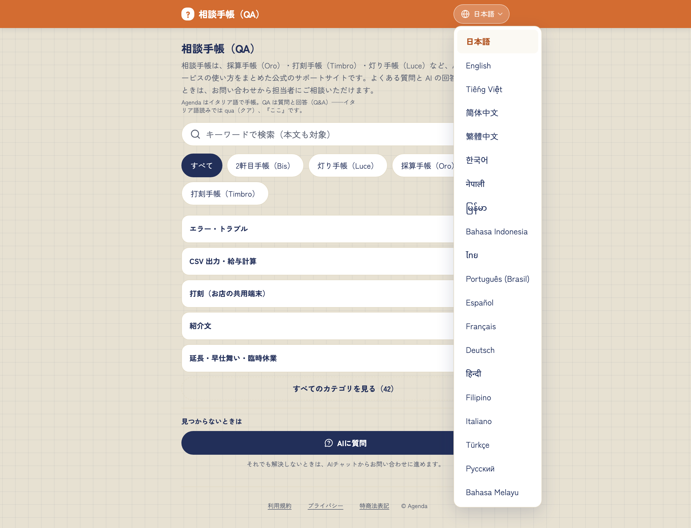

図3-5　相談手帳の言語切替。20の言語が並ぶ

[次の章 ▶　第4章　技術編：一人で製品を作り続ける仕組み](https://note.com/bontallc/n/ne8ef4e1311dd)

## この本の、ほかの読み方

この本は note・PDF・Google Play で無料で読めます。Kindle 版のみ 99円です。

PDF（無料・再配布自由）：[https://bontallc.com/books/uchi-no-mise/pdf?via=note](https://bontallc.com/books/uchi-no-mise/pdf?via=note)

Google Play（無料）：[https://play.google.com/store/books/details?id=WdUiEgAAQBAJ](https://play.google.com/store/books/details?id=WdUiEgAAQBAJ)

Kindle（99円）：[https://www.amazon.co.jp/dp/B0HPJY4NRR](https://www.amazon.co.jp/dp/B0HPJY4NRR)

本のページ：

https://bontallc.com/books/uchi-no-mise?via=note

PDF は再配布自由です。周りの店主仲間や、AI に興味のある方に、そのまま送ってください。

屯の予約サイト：[https://tamuroreservation.vercel.app/?src=note](https://tamuroreservation.vercel.app/?src=note)

Agendaシリーズ：[https://bontallc.com/agenda?via=note](https://bontallc.com/agenda?via=note)

note：[https://note.com/bontallc](https://note.com/bontallc)

X：[https://x.com/tamuro_hnakano](https://x.com/tamuro_hnakano)
