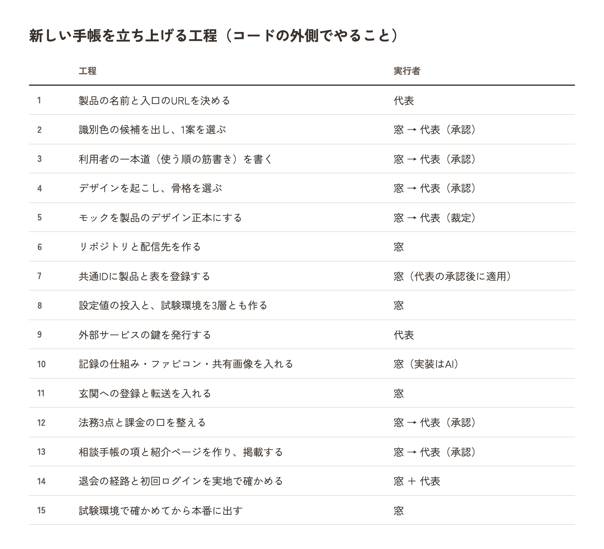
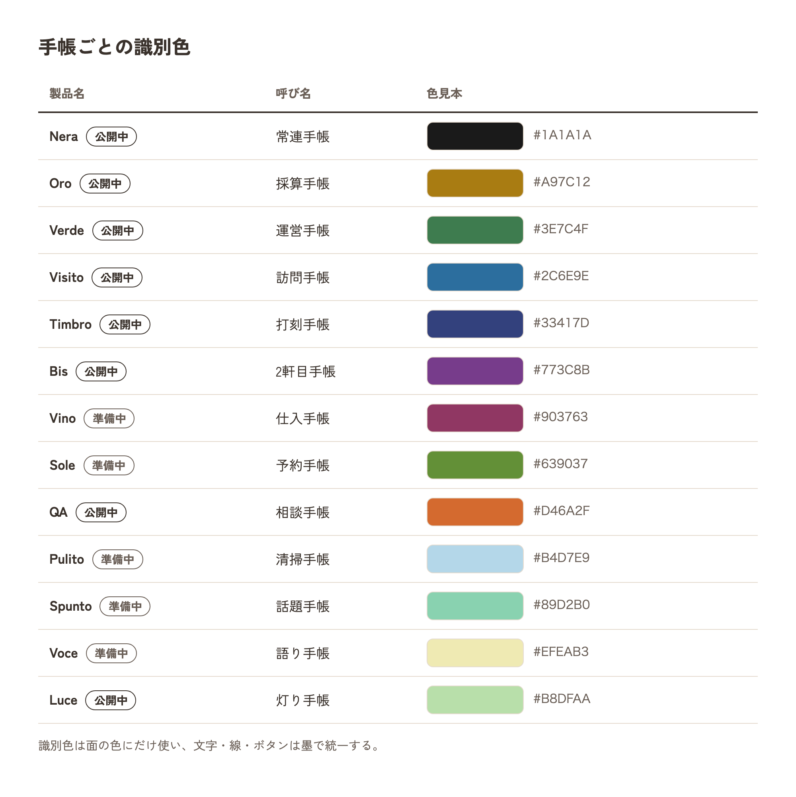
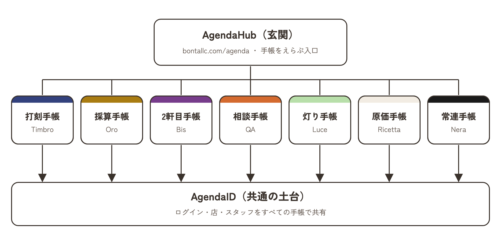
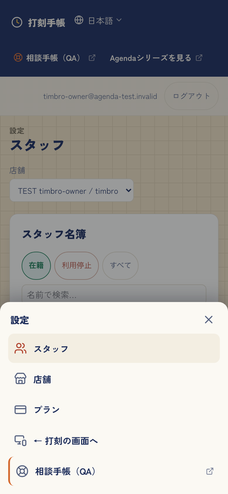

# 『うちの店は、うちの仕様で』第4章　技術編：一人で製品を作り続ける仕組み

この本は PDF でも無料で読めます（再配布自由）→ [https://bontallc.com/books/uchi-no-mise/pdf?via=note](https://bontallc.com/books/uchi-no-mise/pdf?via=note)

全7回の5回目

[◀ 前の章　第3章　自分の店の道具を、他の店に配る](https://note.com/bontallc/n/n0a8d776814cb)

この章の要点

- 新製品を立ち上げる手順そのものを文書にし、AIが読んで実行できる形（スキル）にした。人間がやるのは判断と、人間にしかできない操作だけ
- ログイン、課金、紹介ページ、他の製品への案内といった共通の部分は一度だけ作り、全製品で使い回す。その土台のデータベース費用は月35ドル程度
- 仕組みはまだ育てている途中で、デザインが5回続けて不合格になるような失敗を、手順書に書き足し続けている

（専門用語が多めの章です。技術に興味がなければ、第5章へ進んでも話はつながります）

## 4-1　ProductBootstrap：立ち上げ手順そのものをAIに渡す

製品を一つ作るたびに、同じ準備と、同じ失敗を繰り返していました。リポジトリ（プログラムの保管庫）を作る。ログインをつなぐ。デザインの色を決める。試験の仕組みを入れる。本番の環境を用意する。どれも前の製品でやったはずなのに、細かい手順を忘れていて、同じところでつまずくのです。

そこで、新製品を立ち上げる手順そのものを文書にしました。それを、プログラムを書くAI（Claude Code）が読んで実行できる形にしたものを「スキル」と呼びます。このスキルの名前はProductBootstrapです。ブートストラップは、コンピュータの世界で「最小限の仕組みから自力で立ち上がる」ことを指す一般的な言葉で、それを製品の立ち上げに当てはめました。

雛形のプログラムは持ちません。直近に完成した製品を写して、新しい製品を始めます。こうすると、いちばん新しい教訓が、自動的に次の製品に引き継がれます。古い雛形を保守し続ける必要もありません。

### 手順の流れ

1. 要件定義書を渡す。必須の欄（製品の名前、何をするか、誰が使うか、料金、料金の単位、識別色、デザインの正本の所在など）が空のままなら、AIは着手しません。途中で店主に聞き返すのではなく、最初に揃っていなければ始めない、という決まりです
2. 製品の色を決める。Agendaシリーズの製品には、それぞれ一つの識別色があります。AIが既存の製品の色を実測し、重ならない色の候補を4案ほど出し、店主が選びます
3. デザインを固める。デザイン用のAI（Claude Design）に画面の案を作らせます。AIは自己点検を最大3周まで回し、点検を通った案だけを店主に見せます
4. 実装を最後まで任せる。決められた合格条件（型の検査、書き方の検査、テストがすべて緑、画面の検査に全部通る、データベースの変更が試験環境で問題なく通る）を満たすまで、AIが自分で作り、自分で直します
5. 本番に出すときだけ、店主が承認する。試験環境までは無人で進み、本番の操作だけを店主が判断します

実装の工程は、途中で店主の承認を待って止まらないように作りました。最初の頃は、段階ごとに承認を求める形で進めていたのですが、それでは何も進みませんでした。AIの作業窓が複数あると、それぞれが承認待ちで止まり、店主がすべての窓を回って判断して回ることになります。そこで、事前に承認した範囲と、機械で判定できる合格条件を最初に渡し、失敗したときだけ止まる形に変えました。

止まる条件も決めてあります。手順書と店主の裁定が食い違ったとき。人間にしかできない操作が必要になったとき。同じエラーで3回続けて進まなかったとき。認証が切れたり、権限が足りなかったり、取り返しのつかない操作が必要になったとき。それ以外は、AIが自分で進めます。作業の状態は小さなファイルに記録され、途中で落ちても、そこから再開できます。

### 人間がやるのは、二つだけ

手順書には、こう書きました。工程の実行はすべてAIが行う。店主に頼んでよいのは、次の二つだけである。

- 判断そのもの。承認、裁定、どちらにするかを決めること
- 人間にしかできない操作。外部サービスの管理画面でしか発行できない鍵、本人確認を伴う申請、実機での操作と目視の判定

それ以外をAIが店主に振ったら、手順書の違反です。手順の一覧表には、行ごとに「実行者」の欄を設け、店主の欄に理由が書けない行は、AIの側に倒します。

この決まりを作ったのには、理由があります。ある製品の残作業を整理したとき、AIが「サーバーのプロジェクト作成」「ログイン先の登録」「環境変数の投入」「試験環境の構築」を、すべて店主の作業として並べてきたのです。どれも、AIが自分で実行できる操作でした。「なんで俺がやるの」というのが、そのときのわたしの正直な反応です。AIは、頼めば自分でやります。けれど、頼まなければ人に振る。だから、手順書に書いておく必要がありました。

第2章で書いた予約システムの失敗は、すべてこの手順書のチェックリストに入れました。テストを先に入れる、本番のデータを開発の場所に置かない、試験環境を最初に作る。同じ痛みを、次の製品では最初から避けます。

### まだ、育てている途中

この手順書は、完成品ではありません。失敗するたびに書き足している途中のものです。

たとえば、ある製品の画面を、デザイン用のAIに5回続けて作らせて、5回とも不合格になったことがあります。シリーズ共通のデザインの決まり（DESIGN.md）を渡した回も含めてです。

最初、AIは「配色そのものが原因」と見立てました。わたしはそれを否定しました。実際の原因は二つでした。一つは、決まりに定義のない色が勝手に使われていたこと。もう一つは、役割の違う三つの区画が、同じ地の色、同じ余白で縦に並んでいて、境目がなかったことです。規則には違反していないのに、役割が見た目から消えている。

そこで、デザインの決まりに条文を足しました。役割が違うものを同じ見た目にしない。色だけで分けない。いちばん重要なものが、視線の最初に来る。同じ重さで並べてよいのは、実際に対等なものだけ。縦に積むだけの構成にしない。

もう一つ、失敗から学んだことがあります。「避けたい既定の見た目」を禁止の列挙だけで伝えると、AIは列挙されていない別の既定に丸ごと振れるのです。カードと影と角丸を全部禁止したら、今度は罫線と余白だけの新聞のような画面が出てきました。以来、依頼の資料には「避けたい型」「禁止したかったのは何か」「代わりに何をするか」を3列で書かせています。

識別色の決め方も、途中で変えました。製品が8つを超えたあたりで、濃い色の帯が既存の製品で埋まり、9つ目以降の製品が、線やボタンに使う濃い色を既存と衝突せずに取れなくなったのです。そこで、製品の識別色は薄い面の色だけに使い、線、罫線、アイコン、主要なボタンはシリーズ共通の墨色に揃える、という規則に改めました。製品が増えて初めて分かる制約でした。

失敗するたびに、手順書を直す。次の製品は、その分だけ楽になる。手順書を育てることが、一人で製品を作り続けるための、いちばんの投資だと考えています。

図4-2　立ち上げ手順の工程と、実行する者（AIか、店主か）

図4-3　Agendaシリーズの識別色。製品ごとに一色、面にだけ使う

## 4-2　AgendaHub：玄関

製品が増えると、同じものを何度も作ることになります。ログイン、課金、紹介ページ、他の製品への案内。一人で回すには、共通の部分を一度だけ作り、全製品で使い回す必要があります。

AgendaHubは、その共通の部分を集めた場所です。わたしは「玄関」と呼んでいます。

まず、一つの住所からすべての製品へ振り分ける入口です。bontallc.comという一つのドメインの下に、/agendatimbro、/agendaoro、/agendaluceと、製品ごとの入口が並びます。お客さんから見れば、一つのサイトの中に製品が並んでいるように見えますが、実際にはそれぞれ別のプログラムが動いています。

次に、製品の紹介ページを置く場所です。シリーズの紹介ページが1枚あり、その中に製品ごとの項が並びます。項には、製品名と呼び名、価格、「こんなとき」で始まる店主の言葉での困りごと、何ができるかの説明、詳細ページへのリンクを入れます。新しい製品を出すときは、この項を足すところまでが立ち上げの手順に含まれています。

そして、デザインの決まりと、立ち上げの手順の置き場です。識別色の正本、画面の決まり（DESIGN.md）、第4-1で書いたProductBootstrapのスキル、画面を検査するスキル、データベースの変更を安全に行うスキル。シリーズをまたぐ決まりごとは、すべてここに実体を置き、各製品からは参照の形で読みに行きます。

図4-1　Agendaシリーズの構成。玄関（AgendaHub）から各手帳へ、すべての手帳は一つのアカウント（AgendaID）につながる

## 4-3　AgendaID：共通のアカウントと課金

AgendaIDは、シリーズ共通のアカウントと課金の仕組みです。

店主は、Googleのアカウントで一度ログインすれば、すべての製品を使えます。製品ごとにアカウントを作る必要はありません。言語の設定も、いずれ製品をまたいで引き継ぐ形にする予定です。

課金の仕組みも一本です。決済サービス（Stripe）とのつなぎ込みを、製品ごとに作るのではなく、AgendaIDが一手に引き受けます。料金の区分は4種類。月300円の軽い製品、使った分だけの製品、買い切り600円の製品、そして無料の製品です。有料の製品は、カードの登録なしで3か月の無料期間があり、店と製品の組み合わせごとに一度だけ使えます。紹介した側とされた側に、無料期間を3か月ずつ足す仕組みもあります。

無料期間が終わる前には、7日前と1日前に案内のメールが届きます。このメールも、最初は打刻手帳の中に作っていたのですが、製品が増えるにつれて、各製品に同じ仕組みを持たせるのは無駄だと分かり、AgendaIDの側に一本化しました。

### 退会と削除も、共通の決まりに

地味ですが、大事な部分があります。退会と、データの削除です。

お客さんが退会したとき、どのデータをいつ消すのか。製品ごとに別々に作れば、必ずどこかで抜けが出ます。しかも、Agendaシリーズには、顔認識で常連さんを識別する製品のように、とくに機微なデータを扱うものもあります。

そこで、削除の粒度を4段階に分けて、シリーズ共通の決まりにしました。製品の解約、店舗の削除、アカウントの退会（シリーズ全体から去る）、スタッフ個人からの削除の請求です。上の段階は下の段階に連鎖し、各製品は自分のデータを消す手続きを共通の仕組みに登録します。削除の猶予は30日で、その間は元に戻せます。

ここには、時間の軸がつきまといます。たとえば勤怠の記録は、法律で5年間の保存が求められます。退職したスタッフから削除の請求があっても、保存期間の内は、物理的に消すのではなく、名前などを匿名化して記録だけを残す必要があります。「消す」と「残す」の線を、法律と照らして決めておく必要がありました。

### AIが本番を汚さないための、試験用のログイン口

AgendaIDには、もう一つ、AIのための仕組みを足しました。試験用のログイン口です。

AIに動作確認をさせるには、AIがログインして画面を操作する必要があります。ところが、ログインはGoogleのアカウントで行うので、AIは自分ではログインできません。かといって、店主のアカウントをAIに渡すわけにもいきません。本番のデータを、AIの試験で汚してしまう危険があるからです。

そこで、試験環境でだけ使える、合成のアカウント（ペルソナ）を発行する口を作りました。本番では動きません。試験環境のデータベースは本番とは別のプロジェクトで、合成のデータだけが入っています。AIはこの口からログインし、画面を操作して、動作を確かめます。試験のアカウントは毎日作り直され、古いものは消えます。

これで、AIは本番に触れずに、本番とまったく同じ作りの環境で、最後の確認まで自分で行えるようになりました。

## 4-4　共通ナビと、「玄関」という言葉の失敗

どの製品からも、他の製品へ行けるように、共通の案内（ナビ）を各製品に配りました。打刻手帳を使っている店主が、相談手帳で質問したり、他の手帳を見に行ったりするための導線です。

この共通ナビには、小さな失敗談があります。

最初の版には、「玄関にもどる」というリンクを置いていました。わたしが内部でAgendaHubを「玄関」と呼んでいたからです。ところが、実機で確かめてみると、おかしなことになっていました。「玄関にもどる」と「Agendaシリーズを見る」という二つのリンクが、同じ先に飛ぶ。しかも相談窓口のリンクが、日常の業務メニューより上に置かれていて、主従が逆になっていました。そして何より、「玄関」という言葉は、初めてこの製品を使う店主には通じません。作り手の内部の言葉だったのです。

そこで、原則を決め直しました。並びは、利用者の目的に近い順に決め、日常の業務をいちばん上に、外への導線はいちばん下に置く。たとえ獲得のための導線でも、業務より上には置かない。境界は、1本の線で説明できること。文言は利用者の言葉で書き、内部の言葉を使わない。同じ先に飛ぶリンクを複数置かない。「玄関にもどる」は廃止し、「Agendaの他の手帳を見る」の1本にまとめました。

第2章で、UIの言葉を学んだ話を書きました。あれは、店主がAIに伝えるための言葉でした。こちらは逆で、作り手が利用者に伝える言葉です。どちらも、言葉を相手に合わせることでした。

図4-4　直したあとの共通ナビ。業務が上、外への案内は一番下

## 4-5　土台の費用は、月35ドル

この章で書いた土台全体の、データベースの費用は、月35ドル程度です。本番用のプロジェクトを含む有料の契約が25ドル、試験環境のプロジェクトが10ドル。

これも、最初からこの金額だったわけではありません。ある時点では月45ドルを払っていました。顔認識の製品の開発用データベースが、使っていないのに課金され続けていたのです。それを無料の枠に退避して停止し、使っていない別のプロジェクトを削除して、今の金額になりました。

AIの費用にも、気を配っています。プログラムを書くAIの作業は、トークン（AIが読み書きする文字の単位）の量で費用が決まります。作業窓が進行役に徹し、実装そのものは別の、費用の枠が分かれているAIに任せる形にして、費用の集中を避けています。会話の窓の生成モデルも、価格を見て、必要十分なものを選びます。上位のモデルが月1ドルの差でも、「十分か」で選びます。

小さく作れば、小さな売上でも成り立つ。第3章で書いたマネタイズの話は、この土台の費用の小ささに支えられています。

## 4-6　進行役のAIと、裁定する人

最後に、わたしの一日の作業の形を書いておきます。

わたしは、複数のAIの作業窓を同時に開いています。予約システムの窓、各製品の窓、そして、それらに指示を投げて結果を集める進行役の窓です。進行役の窓にはAgendaRegia（進行手帳）という名前を付けました。

裁定、つまり「どちらにするか」を決めるのは、わたしと、チャット側のAIです。チャット側のAIが、仕様の穴や矛盾を先回りで洗い出し、それぞれに既定の裁定を添えて一括で提案します。わたしは、それを読んで決めます。決まったことは、Goalと呼ぶ指示書にまとめ、作業窓に貼ります。事前の承認と、機械で判定できる合格条件を含み、作業窓はそれを読んで、失敗したときだけ止まる形で、最後まで進めます。

指示書には、いつ終わるかの見積もりの時間も入れてもらいます。店の営業の合間に作業を挟むので、どれくらいで終わるかが分からないと、段取りが組めないからです。

店主の役割は、読むことではなく、決めることです。1,775件の会話のログを全部読む必要はありません。店の事実に関する質問に答えること。店の方針でしか決められないことを裁定すること。本番に出たあとに、自分で5、6回触って違和感を確かめること。それだけです。

この形にたどり着くまでに、何度も手戻りをしました。AIが勝手に機能を足し、画面が安定しなくなったこと。一度の指示から作業が際限なく増えたこと。段階ごとの承認待ちで、何も進まなくなったこと。そのたびに決まりを一つ足し、今の形になりました。これもまた、育てている途中です。

### この章から持ち帰れること

- 繰り返す作業は、手順そのものを文書にしてAIに渡します。失敗するたびに手順書を直せば、次は楽になります
- 共通の部分（ログイン、課金、案内）は一度だけ作り、全製品で使い回します。土台が小さければ、小さな売上でも成り立ちます
- 人間がやるのは、判断と、人間にしかできない操作だけ。それ以外をAIが人に振ってきたら、手順書に書き足します

この章の続き（次に作る手帳や、手順書に足した教訓）は、noteとXに書いています。note https://note.com/bontallc／X https://x.com/tamuro_hnakano

[次の章 ▶　第5章　小さな店の、これから](https://note.com/bontallc/n/na09d1688620b)

## この本の、ほかの読み方

PDF（無料・再配布自由）：[https://bontallc.com/books/uchi-no-mise/pdf?via=note](https://bontallc.com/books/uchi-no-mise/pdf?via=note)

Kindle：[https://www.amazon.co.jp/dp/B0HPJY4NRR](https://www.amazon.co.jp/dp/B0HPJY4NRR)

Google Play：[https://play.google.com/store/books/details?id=WdUiEgAAQBAJ](https://play.google.com/store/books/details?id=WdUiEgAAQBAJ)

本のページ：

https://bontallc.com/books/uchi-no-mise?via=note

PDF は再配布自由です。周りの店主仲間や、AI に興味のある方に、そのまま送ってください。

屯の予約サイト：[https://tamuroreservation.vercel.app/?src=note](https://tamuroreservation.vercel.app/?src=note)

Agendaシリーズ：[https://bontallc.com/agenda?via=note](https://bontallc.com/agenda?via=note)

note：[https://note.com/bontallc](https://note.com/bontallc)

X：[https://x.com/tamuro_hnakano](https://x.com/tamuro_hnakano)
