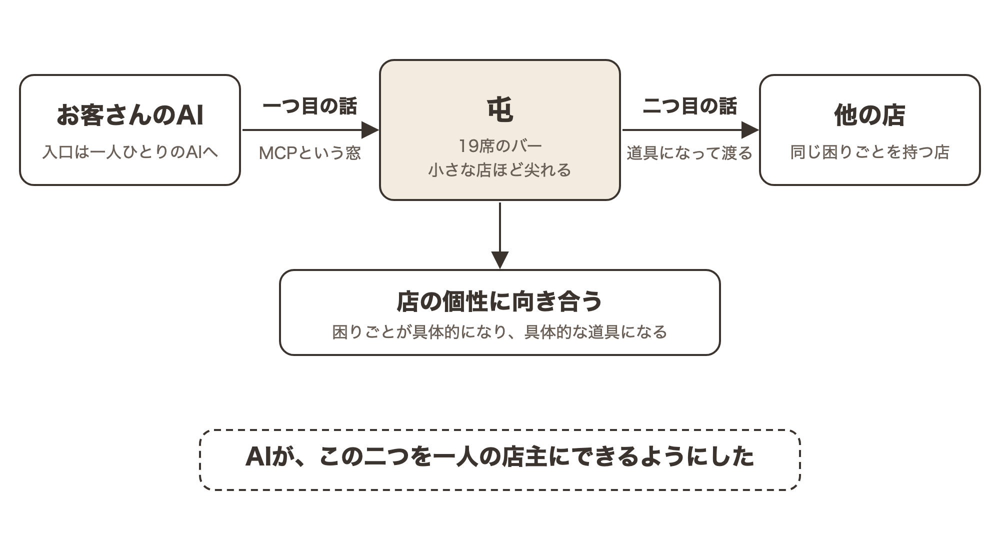

# 『うちの店は、うちの仕様で』第5章　小さな店の、これから

この本は PDF でも無料で読めます（再配布自由）→ [https://bontallc.com/books/uchi-no-mise/pdf?via=note](https://bontallc.com/books/uchi-no-mise/pdf?via=note)

全7回の6回目

[◀ 前の章　第4章　技術編：一人で製品を作り続ける仕組み](https://note.com/bontallc/n/ne8ef4e1311dd)

## 5-1　雑多ごはんから、屯へ

わたしが飲食の道に入ったのは、39歳の頃でした。

きっかけは、近所のバー「雑多」です。月に一度、ときには隔週で、そのバーでごはんを出させてもらっていました。料理は長く独学でしたが、人に食べてもらい、喜んでもらう場があった。それが原体験です。

2014年、新井薬師に「雑多ごはん」という店を開きました。定食を出す、小さな店です。そこで7年、店を営みました。

ただ、新井薬師では、お客さんの数に限界を感じていました。そんなとき、東中野に物件を見つけました。駅の東口から歩いて1分もかかりません。雨の日でも、ほとんど濡れずに来られる場所です。

2018年11月、そこに「屯」を開きました。屯（たむろ）は、人が集まる、という意味です。カウンター11席、座敷8席、合わせて19席。3年間は、新井薬師と東中野の2店を並行して営みました。コロナ禍で両立が難しくなり、新井薬師の店を閉じて、屯一本になりました。

### キュレーションバー

屯は、自分のことを「キュレーションバー」と名乗っています。

キュレーションとは、目利きのことです。わたしは料理人である以前に、キュレーターでありたいと思っています。料理も、酒も、店の雰囲気も、すべてを目利きして作る。それが屯です。

わたしは、海外と国内をよく食べ歩きます。ベトナム、カンボジア、イタリア、上海、北京、メキシコ。食べ歩きは、楽しみであると同時に、屯で出すものを見つける行為でもあります。高級な食材を、手の届く材料で再現する。たとえば、卵黄を乾燥させて削ると、からすみに近い風味が出ます。そうした置き換え（ローカライズ）を、自分の役割だと考えています。

料理は、コロナ禍の時期に学び直しました。フレンチの講座を全8回受け、和食のコースにも通いました。うまみの扱いと、火入れ。そこで学んだことが、今の料理の土台です。

屯の料理は、前菜4品とメイン1品で組みます。ひとり暮らしのお客さんが野菜を多く取れるように、食材の幅を持たせます。調理法（揚げる、酢の物、煮る、焼く）と味（甘い、辛い、酸っぱい）が重ならないように組みます。一番人気はトンテキです。九州の醤油を使った甘めのソースに、にんにくを効かせています。

### 人が集まる店

屯は、ひとりで来るお客さんが約半分を占めます。30代から50代が中心で、近所の東中野の方が多いのですが、赤羽や新宿、西荻窪、荻窪、永福町あたりからも来てくださいます。

この店の特徴は、お客さん同士の会話が多いことです。隣の人と話しやすいカウンターの作りにしていますし、わたしやスタッフが、相性を見て席を決めています。ひとりで来たお客さん同士が、後日いっしょに来てくれることもあります。店の名前のとおり、人が集まる店になってきました。店の日々の様子は、[Instagram](https://www.instagram.com/tamuro.higashinakano/)に載せています。

月に一度ほどのコース料理では、7〜8品を2〜3時間かけて、ワインのペアリングと一緒に出します。月ごとに、イタリアン、フレンチ、和食と、テーマを替えます。料理教室は、3時間のワークショップの形で、作ったあとに全員で乾杯して食べて帰ります。開店前の夕方に、ワインと小皿料理を出すアペリティーボ。年に2回ほどのバーベキュー。年に一度の忘年会。そして、第1章で書いたゆかた祭り。

第1章で書いた予約システムも、会話の窓も、MCPも、すべてはこの店に人が集まるための道具です。AIは、人を集めるための手段であって、目的ではありません。

## 5-2　キャトルエピスのハンバーグカレー

屯は夜の店です。昼間、店は空いています。

その時間を使って、2024年1月に始めたのが「キャトルエピス」です。同じ場所で、昼だけ営業するハンバーグカレーの店で、スタッフが運営しています。

キャトルエピスは、フランス語で「4種のスパイス」という意味です。その名前のとおり、スパイスをたくさん重ねるのではなく、選んで絞ることで、味の輪郭をわかりやすくしています。カレーは小麦粉を使わず、野菜とお肉そのもののとろみで仕上げます。食べ終わったときの満足感と、胸もたれのなさ。そして、ハンバーグとの調和。この三つを前提に設計しました。

ハンバーグは火入れにこだわっています。外はカリッと、中はふわふわに仕上がるよう配合を決め、その配合に合わせて焼いています。夜の屯で学んだ火入れが、昼の一皿にも生きています。

値段や営業日、営業時間は変わることがあるので、最新の情報は屯のInstagram（https://www.instagram.com/tamuro.higashinakano/）でご確認ください。

キャトルエピスは、同じ場所で子ども食堂も運営しています。既存の店の設備と仕入れを使って、地域の子どもたちに食事を出す活動です。そのつながりで、地域のコミュニティセンターとも関係ができました。地域の運動イベントや、コミュニティセンターの催し、盆踊り大会などに、カレーやサンドイッチを出すこともあります。

正直に書くと、昼の時間の活用は、すべてがうまくいったわけではありません。昼飲みの日を作ったり、他の人に店を貸したりもしましたが、思うようにお客さんは来ませんでした。夜の店主がいる時間と、昼のスタッフだけの時間では、店の魅力の出方が違います。昼の店を、夜の店とは別の魅力で育てていくこと。これは、まだ途中の課題です。

## 5-3　ボンタ合同会社：二本の柱

屯とキャトルエピスを営んでいるのは、ボンタ合同会社という小さな会社です。わたしは、その代表社員です。

この会社には、二本の柱があります。一つは飲食。屯とキャトルエピスです。もう一つは、IT。Agendaシリーズの開発と、コンサルティングです。

飲食と道具とでは、稼ぎ方の性質が違います。性質の違う二本の柱で会社を支えるのが、わたしの考える形です。

そして、二本の柱は、互いに材料を供給し合っています。店で困ったことが、道具の種になる。道具を作って分かったことが、店の運営に返ってくる。閉店が延びることから灯り手帳が生まれ、灯り手帳の延長の記録が、採算の試算やシフトの根拠になる。会話の窓で貯まった「答えられなかった質問」が、店の案内を良くする。この循環が、一人で店と開発を両立する理由です。

会社の規模を大きくすることは、考えていません。小さく、たくさん、安く。それが、この会社の形です。

## 5-4　本多楽として、書く

わたしは、執筆と発信のときには「本多楽（ぼんたらく）」というペンネームを使っています。この本も、その名前で書いています。

前作『一人で店を回す、その横にAIが来た。』は、生成AIについての本でした。Amazonのタイムマネジメントの部門で1位になり、多くの方に読んでいただきました。この本は、その続きにあたります。

本のほかに、noteでも文章を書いています。AIを使った店の取り組み、研修旅行で見つけたこと、本の出版の進み具合、そしてAgendaシリーズの話です。この本に書ききれなかった続きは、noteで追っていただけます（https://note.com/bontallc）。

書くことは、わたしにとって、店と開発の両方を言葉にして確かめる作業でもあります。第1章で書いたとおり、会話の窓「T-AI-MURO」の最初の知識は、わたしがXに書き残してきた言葉から作りました。書き残しておいたものが、AIの材料になった。これからも、書いたものは、店とAIの両方に返ってきます。

もう一つ、書くことについて決めていることがあります。未完成のものを「もうすぐできます」と予告する発信は、しないことです。完成させて、紹介ページを作って、それから出す。順番を守ることが、小さな会社の信用になると考えています。

## 5-5　個人店の未来

最後に、この本で書いてきたことを、一つの絵にまとめます。

図5-1　この本で書いてきたことの全体図。小さな店が自分の窓を開け（一つ目の話）、困りごとを道具にして他の店へ渡す（二つ目の話）

お客さんは、自分のAIに店を探させ、予約させるようになります。2026年8月には、ChatGPTから大手の予約サービスを通じて飲食店を予約できるようになりました。入口は、検索やグルメサイトから、一人ひとりのAIへと移っていきます。

そのとき、大手の予約サービスに載っていない店は、AIの目に入りません。けれど、大手に載らなくても、店が直接AIにつながる道があります。屯は、MCPという窓を開けて、その道を選びました。小さな店が、自分の窓を自分で開ける。それが、この本の一つ目の話です。

店主は、自分の困りごとを道具にして、他の店に配れるようになります。閉店が延びることを伝えたい、という屯の困りごとから灯り手帳が生まれ、それはどの店でも使えます。作る力が、一部の人や会社だけのものではなくなりつつある。小さな店の店主が、道具を使う側から、作って配る側に回る。それが、この本の二つ目の話です。

この二つに共通しているのは、小さな店ほど尖れる、ということです。

大きなチェーン店は、どの店でも同じ品質を出すために、仕組みを汎用化します。屯は、その逆です。ひとり客が半分を占め、当日予約が9割近く、お客さん同士が話す。そうした屯の個性に合わせて、予約システムも、値引きも、会話の窓も作り込んできました。汎用化しないからこそ、尖る。尖るからこそ、お客さんが選ぶ理由になる。

そして、尖った店ほど、道具の種が見つかります。店の個性に向き合えば向き合うほど、困りごとは具体的になります。具体的な困りごとは、具体的な道具になります。具体的な道具は、同じ困りごとを持つ、他の店の役に立ちます。

AIは、この二つを、一人の店主にできるようにしました。店を尖らせることと、道具を配ること。かつては、どちらか一つを選ぶしかありませんでした。今は、両方できます。

もちろん、まだ途中です。会話の窓の合格率は、まだ上げている最中です。手順書は、失敗のたびに書き足しています。昼の店の育て方は、課題のままです。AIから予約する人は、まだ多くありません。

それでも、わたしは、小さな店の未来を明るいものだと考えています。小さいことは、弱さではありません。小さいからこそ、速く試せて、速く捨てられて、速く直せる。小さいからこそ、尖れる。そして、尖った店の困りごとは、道具になって、他の小さな店へと渡っていく。

東中野の19席のバーから、この本を書きました。

[次の章 ▶　おわりに](https://note.com/bontallc/n/n3608d237e191)

## この本の、ほかの読み方

PDF（無料・再配布自由）：[https://bontallc.com/books/uchi-no-mise/pdf?via=note](https://bontallc.com/books/uchi-no-mise/pdf?via=note)

Kindle：[https://www.amazon.co.jp/dp/B0HPJY4NRR](https://www.amazon.co.jp/dp/B0HPJY4NRR)

本のページ：

https://bontallc.com/books/uchi-no-mise?via=note

PDF は再配布自由です。周りの店主仲間や、AI に興味のある方に、そのまま送ってください。

屯の予約サイト：[https://tamuroreservation.vercel.app/?src=note](https://tamuroreservation.vercel.app/?src=note)

Agendaシリーズ：[https://bontallc.com/agenda?via=note](https://bontallc.com/agenda?via=note)

note：[https://note.com/bontallc](https://note.com/bontallc)

X：[https://x.com/tamuro_hnakano](https://x.com/tamuro_hnakano)
